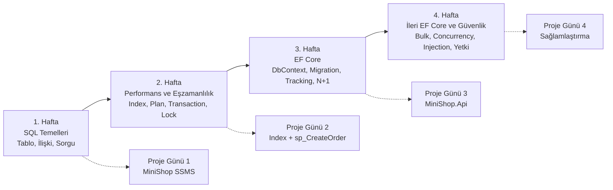
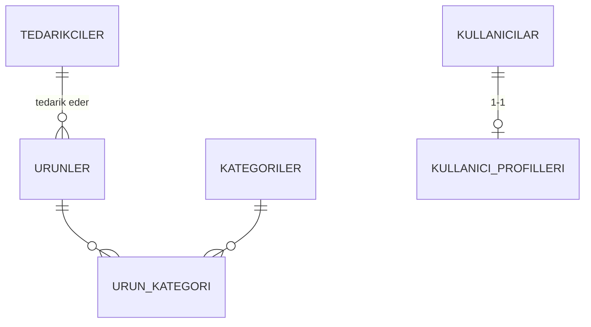
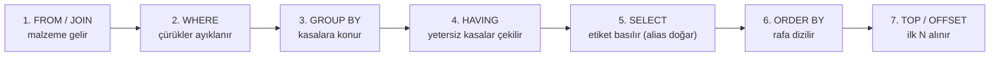
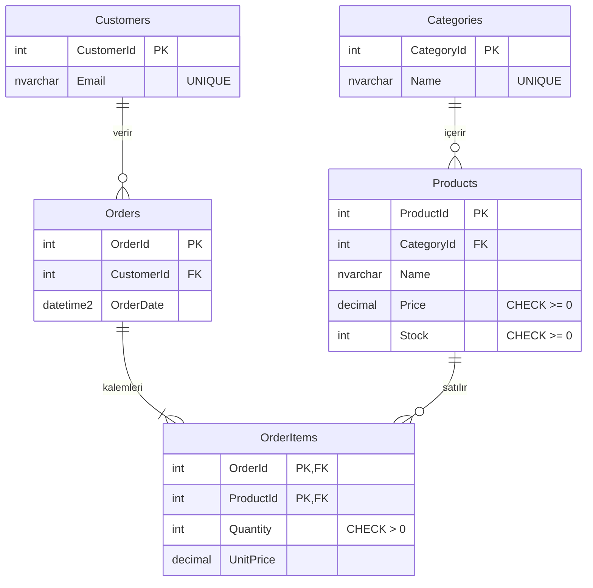
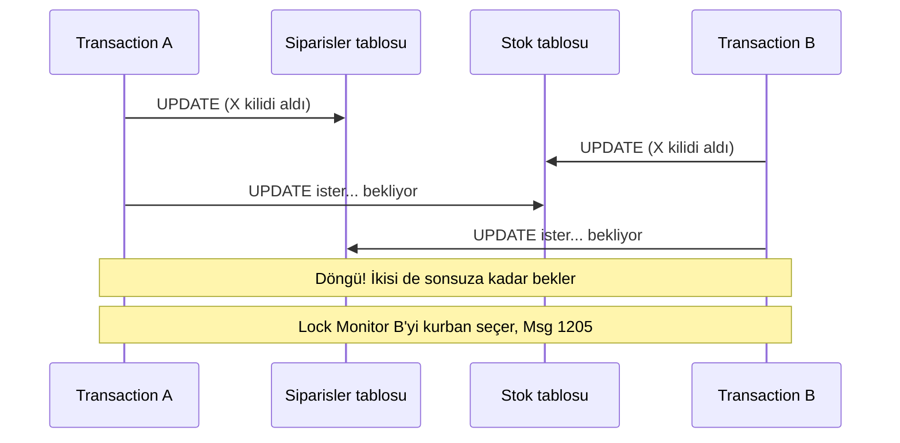
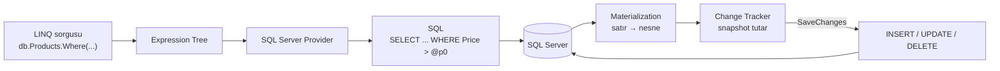
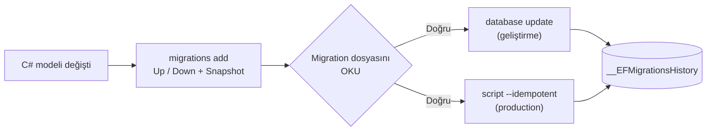
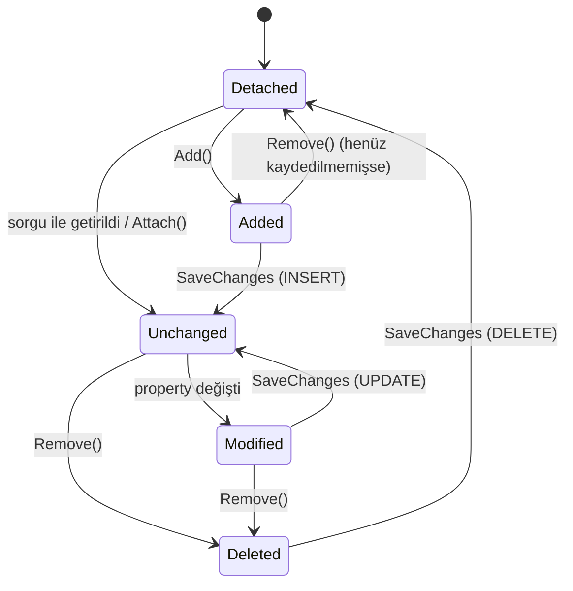
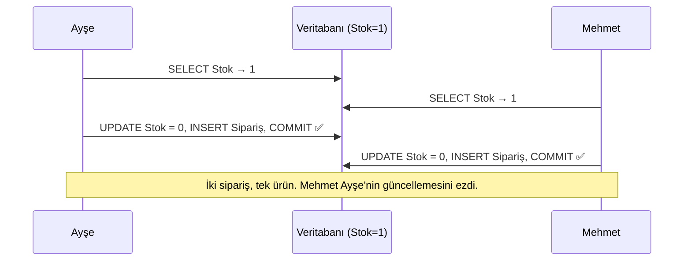
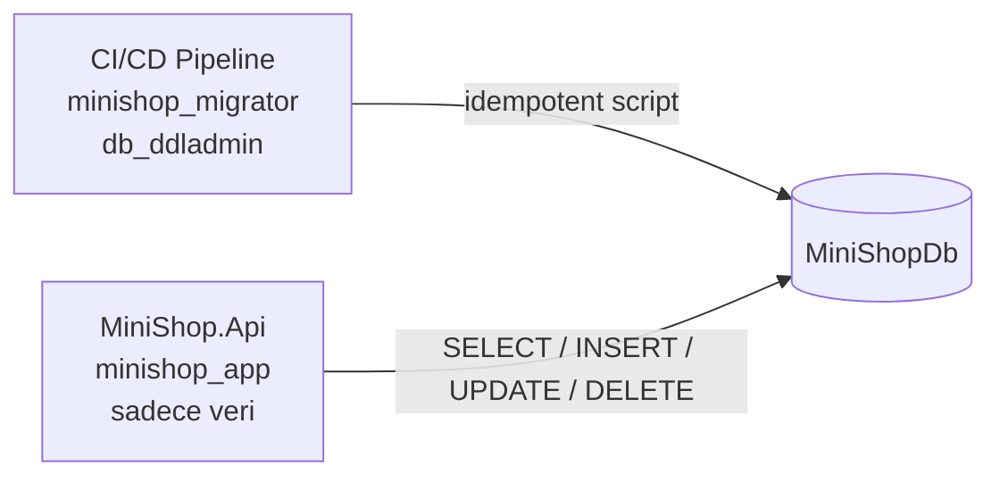

# 04. Ay — SQL, EF Core ve Database Security

> **"Veritabanını anlamayan bir .NET geliştiricisi, ORM'in arkasında ne olduğunu bilmeden araba kullanan bir sürücüye benzer: yol düz olduğu sürece sorun yok, ilk virajda kaza kaçınılmaz."**

Bu rehber; **ilişkisel veritabanı tasarımından** başlayıp **T-SQL sorgulama**, **index ve execution plan** ile performans analizi, **transaction / isolation / locking** ile eşzamanlılık yönetimi, **EF Core** ile modern .NET veri erişimi ve son olarak **SQL Injection, connection string güvenliği ve least privilege** ile veritabanı güvenliğine uzanan 28 günlük bir yolculuğun konu anlatımıdır.

Her konu; **gerçek hayattan bir senaryo**, **çalıştırılabilir SQL / C# örnekleri**, **sık yapılan hatalar** ve **akılda kalacak bir özet** ile anlatılır. Ay boyunca adım adım büyüyen bir proje (**MiniShop**) ile öğrendiklerinin hepsi tek bir gerçekçi uygulamada birleşir.

---

## 🧭 Bu Rehber Kimin İçin?

| Sen... | Bu rehber sana... |
| :--- | :--- |
| C# biliyor ama SQL'e hiç dokunmadıysan | Sıfırdan tablo kurmayı, sorgu yazmayı ve ilişki tasarlamayı öğretir. |
| EF Core kullanıyor ama "arkada ne oluyor?" diye merak ediyorsan | LINQ'in hangi SQL'e dönüştüğünü, N+1'i, Change Tracker'ı ve performans tuzaklarını gösterir. |
| Mülakata hazırlanıyorsan | Her konunun sonundaki özetler ve "Sık Yapılan Hatalar" bölümleri, en çok sorulan soruların cevaplarıdır. |
| Projeni canlıya almak üzereysen | Migration, connection string, yetki ve concurrency gibi production konularını kontrol listesi gibi kullanabilirsin. |

### 📋 Ön Koşullar
- **C# ve OOP:** class, property, interface, kalıtım, generic (`List<T>`).
- **Temel LINQ:** `Where`, `Select`, `OrderBy`, `FirstOrDefault` ve lambda (`x => x.Id`).
- **async/await:** `Task`, `async`, `await` ne işe yarar.
- **ASP.NET Core temeli:** basit bir Controller, GET/POST ve `AddScoped` ile DI (3. hafta için).

### 🛠️ Araçlar
- **SQL Server** (Developer veya Express sürümü — ikisi de ücretsiz) ve **SSMS** (SQL Server Management Studio).
- **.NET 10 SDK**, **Visual Studio 2022+** / **VS Code** / **Rider**.
- Paketler: `Microsoft.EntityFrameworkCore.SqlServer`, `Microsoft.EntityFrameworkCore.Design`, `Microsoft.EntityFrameworkCore.Tools`.

> [!TIP]
> **Mac veya Linux mu kullanıyorsun?** SQL Server'ı Docker ile birkaç saniyede ayağa kaldırabilirsin (Konu 01'de anlatılıyor). SSMS yerine **Azure Data Studio**, **VS Code + MSSQL eklentisi** veya **DBeaver** kullanabilirsin; bu rehberdeki T-SQL'in tamamı aynen çalışır.

---

## 🗺️ Öğrenme Haritası



---

## 📑 İçindekiler

### Bölüm 1: İlişkisel Veritabanı ve T-SQL Temelleri (1. Hafta)
- [01. İlişkisel Veritabanı Temelleri, SQL Server ve SSMS Kurulumu](#t01)
- [02. T-SQL Veri Tipleri, DDL Komutları ve Constraint Yapıları](#t02)
- [03. Veritabanı Tasarımı: İlişkiler (1-1, 1-N, N-N) ve Normalizasyon](#t03)
- [04. Temel DML Komutları, Filtreleme ve Sayfalama](#t04)
- [05. Aggregate Fonksiyonlar, Gruplama ve Sorgu Çalışma Sırası](#t05)
- [06. JOIN Mantığı ve Tabloları Birleştirerek Sorgulama](#t06)
- [07. Subquery, CTE, View, CASE ve Window Fonksiyonları](#t07)
- [08. 🛠 Proje Günü 1: MiniShop Veritabanını SSMS'de Kurmak](#t08)

### Bölüm 2: Performans, Transaction ve Eşzamanlılık (2. Hafta)
- [09. Index Mimarisi: Clustered, Non-Clustered ve Covering Index](#t09)
- [10. Execution Plan Okuma, Seek vs Scan ve SARGable Sorgular](#t10)
- [11. Transaction Yönetimi, ACID Prensipleri ve TRY-CATCH](#t11)
- [12. Eşzamanlılık Sorunları ve Isolation Level Temelleri](#t12)
- [13. Locking Mekanizması: Blocking vs Deadlock](#t13)
- [14. 🛠 Proje Günü 2: SSMS'de Performans ve Transaction](#t14)

### Bölüm 3: Entity Framework Core (3. Hafta)
- [15. ORM Kavramı, EF Core Mimarisi ve DbContext Lifecycle](#t15)
- [16. EF Core Code First: Data Annotations vs Fluent API](#t16)
- [17. EF Core İlişkilerin Kodlanması, Migrations ve Reverse Engineering](#t17)
- [18. Change Tracker Mekanizması, Entity State'leri ve NoTracking](#t18)
- [19. İlişkili Verileri Yükleme (Eager, Explicit, Lazy) ve N+1 Problemi](#t19)
- [20. IQueryable vs IEnumerable, DTO Projection ve SQL Loglama](#t20)
- [21. 🛠 Proje Günü 3: MiniShop Web API + EF Core Entegrasyonu](#t21)

### Bölüm 4: İleri EF Core ve Database Security (4. Hafta)
- [22. EF Core Performansı: Split Query ve Toplu İşlemler (Bulk)](#t22)
- [23. EF Core'da Transaction ve Optimistic Concurrency (RowVersion)](#t23)
- [24. EF Core'da Raw SQL, View ve Stored Procedure Kullanımı](#t24)
- [25. SQL Injection Mekanizması ve Güvenli Sorgu Yazımı](#t25)
- [26. Connection String Güvenliği ve En Az Yetki (Least Privilege)](#t26)
- [27. Audit Kolonları, Soft Delete ve Global Query Filters](#t27)
- [28. 🛠 Proje Günü 4: MiniShop'u Sağlamlaştırma ve Güvenlik](#t28)

### Ekler
- [📎 Ek A: Tek Sayfalık Kopya Kağıdı (Cheat Sheet)](#ek-a)
- [📎 Ek B: Production'a Çıkmadan Önce Kontrol Listesi](#ek-b)
- [📎 Ek C: Kendini Test Et — Mülakat Soruları](#ek-c)

---

# Bölüm 1: İlişkisel Veritabanı ve T-SQL Temelleri

> Bu haftanın hedefi: Hiç C# yazmadan, sadece SSMS ve T-SQL ile bir e-ticaret veritabanını sıfırdan kurmak ve ondan anlamlı raporlar çıkarmak. EF Core'un ileride senin yerine ürettiği her şeyi önce elinle yapacaksın.

---

<a id="t01"></a>
## 01. İlişkisel Veritabanı Temelleri, SQL Server ve SSMS Kurulumu

### 💡 Neden Önemli?
Bir Excel dosyasında müşterileri ve siparişleri aynı sayfada tuttuğunu düşün. Ahmet Bey taşındığında 40 siparişin hepsinde adresini tek tek değiştirmen gerekir ve birini unutursan veri çelişir. İlişkisel veritabanı bu problemi **"her bilgiyi tek bir yerde tut, gerektiğinde bağla"** prensibiyle çözer.

### 📌 Temel Kavramlar
**İlişkisel veritabanı**, veriyi **tablolar** halinde saklayan ve bu tabloları birbirine **anahtarlarla** bağlayan sistemdir. Bu sistemi yöneten yazılıma **RDBMS** (Relational Database Management System) denir. SQL Server, PostgreSQL, MySQL ve Oracle en bilinen örneklerdir.

C# geliştiricisi için en kolay zihinsel model şudur:

| Veritabanı | C# Karşılığı | Örnek |
| :--- | :--- | :--- |
| **Tablo** | `class` | `Musteriler` |
| **Kolon** | property (ve tipi) | `Ad NVARCHAR(50)` ≈ `string Ad` |
| **Satır** | nesne (instance) | `{ Id = 2, Ad = "Ahmet" }` |
| **Primary Key** | nesnenin kimliği | `MusteriId = 2` |
| **Foreign Key** | başka nesneye referans | `Siparis.MusteriId → Musteri` |

Veritabanı tiplere **sıkı sıkıya** bağlıdır. `INT` kolona "abc" yazmaya çalışırsan hata alırsın; hatalı veri daha kapıda reddedilir. Bu, veritabanını uygulamanın son savunma hattı yapar.

### 🔑 Primary Key (PK) — Satırın Kimliği
Primary Key bir satırı **benzersiz** şekilde tanımlar. Üç kuralı vardır:
1. **Tekrar edemez** (iki satır aynı PK'ya sahip olamaz).
2. **Boş (NULL) olamaz.**
3. **Değişmemelidir.**

Sistemde iki tane "Ahmet Yılmaz" varsa onları ayırt eden şey isimleri değil, `MusteriId = 2` ve `MusteriId = 3` değerleridir.

> [!IMPORTANT]
> PK olarak e-posta, TC kimlik no veya telefon gibi **anlamlı (natural key)** veriler değil, `IDENTITY(1,1)` ile sistemin ürettiği **anlamsız (surrogate key)** bir numara kullanılmalıdır. Çünkü insanlar e-postalarını değiştirir, telefon numaraları başkasına geçer, TC kimlik no ise hem kişisel veridir hem de her tabloya kopyalanır.

### 🔗 Foreign Key (FK) — Tablolar Arası Köprü
Foreign Key, bir tablodaki kolonun **başka bir tablonun PK'sına** işaret etmesidir. İki büyük işe yarar:

1. **Tekrarı yok eder:** Müşteri bilgisi tek satırda durur. Müşteri taşındığında tek satır güncellenir, 40 sipariş doğru adresi görür.
2. **Referans bütünlüğünü korur:** Var olmayan müşteriye sipariş eklenemez, siparişi olan müşteri silinemez.

```sql
CREATE TABLE Musteriler
(
    MusteriId INT IDENTITY(1,1) PRIMARY KEY,
    Ad        NVARCHAR(50) NOT NULL
);

CREATE TABLE Siparisler
(
    SiparisId INT IDENTITY(1,1) PRIMARY KEY,
    MusteriId INT NOT NULL,
    Tutar     DECIMAL(10,2) NOT NULL,
    CONSTRAINT FK_Siparisler_Musteriler
        FOREIGN KEY (MusteriId) REFERENCES Musteriler(MusteriId)
);

-- Olmayan bir müşteriye sipariş eklemeyi dene:
INSERT INTO Siparisler (MusteriId, Tutar) VALUES (99, 150.00);
-- Msg 547: The INSERT statement conflicted with the FOREIGN KEY constraint "FK_Siparisler_Musteriler"
```

> [!WARNING]
> Bir kolona sadece `MusteriId` adını vermek onu FK **yapmaz**. Kısıt mutlaka `FOREIGN KEY ... REFERENCES ...` ile açıkça tanımlanmalıdır. Aksi halde veritabanı bu kolonu sıradan bir sayı olarak görür ve `99` gibi yetim değerlere sessizce izin verir.

### ⚖️ SQL Server vs PostgreSQL
İkisi de aynı ilişkisel kavramları paylaşır; farklar **lehçe ve ekosistem** düzeyindedir.

| Özellik | SQL Server | PostgreSQL |
| :--- | :--- | :--- |
| Lisans | Microsoft (ücretsiz Developer/Express sürümleri var) | Açık kaynak |
| SQL lehçesi | T-SQL | PL/pgSQL |
| Otomatik numara | `IDENTITY(1,1)` | `GENERATED ALWAYS AS IDENTITY` |
| İlk N satır | `SELECT TOP 10 ...` | `... LIMIT 10` |
| Yönetim aracı | SSMS, Azure Data Studio | pgAdmin, DBeaver |
| EF Core provider | `UseSqlServer(...)` | `UseNpgsql(...)` |

.NET tarafında EF Core ikisini de destekler; çoğu zaman değişen tek şey **provider** satırıdır.

### 🛠️ Kurulum: Motor + Yönetim Aracı
Kurulum iki ayrı parçadan oluşur:
1. **SQL Server motoru** — verinin yaşadığı servis. Öğrenmek için **Developer** (tam özellikli) veya **Express** (hafif) sürümü yeterli.
2. **SSMS** — motoru yönetmek için kullandığın arayüz.

**Docker alternatifi (Windows / Mac / Linux):**
```bash
docker run -e "ACCEPT_EULA=Y" -e "MSSQL_SA_PASSWORD=Guclu_Bir_Sifre123!" \
  -p 1433:1433 --name sql1 -d mcr.microsoft.com/mssql/server:2022-latest
```
Ardından sunucu adı olarak `localhost,1433` ile bağlanabilirsin.

### 🖥️ SSMS'te İlk Adımlar
| Adım | Ne Yapılır? |
| :--- | :--- |
| **Connect to Server** | Sunucu adı: `localhost`, `.\SQLEXPRESS` veya `(localdb)\MSSQLLocalDB` |
| **Sertifika hatası** | Lokal geliştirmede "Trust server certificate" kutusunu işaretle |
| **Object Explorer** | Sol panel; sunucunun haritasıdır |
| **System Databases** | `master`, `model`, `msdb`, `tempdb` SQL Server'ın kendisine aittir, **dokunma** |
| **New Query** | SQL yazacağın pencere; **F5** ile çalıştırılır |
| **Refresh** | Yeni oluşturduğun tabloları görmek için Object Explorer'da F5 / Refresh |

> [!CAUTION]
> Sorgu çalıştırmadan önce araç çubuğundaki açılır listede **master değil kendi veritabanının** seçili olduğundan emin ol. Yeni başlayanların en sık hatası, tüm tabloları yanlışlıkla `master` içine kurmaktır. Script'lerinin başına her zaman `USE VeritabaniAdi;` yazma alışkanlığı edin.

### 🏗️ İlk Veritabanı
```sql
CREATE DATABASE KitapDukkani;
GO              -- GO bir SQL komutu değil, SSMS'e "bu batch'i şimdi gönder" talimatıdır
USE KitapDukkani;
GO

-- Önce referans verilen tablo, sonra ona bağlanan tablo oluşturulur
CREATE TABLE Musteriler (MusteriId INT IDENTITY(1,1) PRIMARY KEY, Ad NVARCHAR(50) NOT NULL);
CREATE TABLE Siparisler (
    SiparisId INT IDENTITY(1,1) PRIMARY KEY,
    MusteriId INT NOT NULL REFERENCES Musteriler(MusteriId)
);

-- Türkçe karakterler için NVARCHAR kolon + N'...' öneki
INSERT INTO Musteriler (Ad) VALUES (N'Şükrü Öztürk');
```

### 💾 Backup & Restore
**Backup**, veritabanının `.bak` dosyasına alınmış kopyasıdır.

- **SSMS ile:** Veritabanına sağ tık → *Tasks → Back Up* / *Databases → Restore Database → Device*
- **T-SQL ile (otomasyona uygun):**

```sql
BACKUP DATABASE KitapDukkani
TO DISK = 'C:\Backups\KitapDukkani.bak'
WITH FORMAT, INIT, COMPRESSION, STATS = 10;

RESTORE DATABASE KitapDukkani
FROM DISK = 'C:\Backups\KitapDukkani.bak'
WITH REPLACE, STATS = 10;   -- REPLACE: mevcut veritabanının üstüne yazar!
```

### ⚠️ Sık Yapılan Hatalar
- **Klasör izni:** `.bak` dosyasını SSMS değil **SQL Server servisi** yazar. "Access denied" alırsan klasörün servis hesabına yazma izni verip vermediğini kontrol et.
- **Sürüm uyumsuzluğu:** Yeni sürümün (örn. 2022) yedeği eski sürüme (örn. 2019) yüklenemez. Tersi mümkündür.
- **Üstüne restore:** Var olan veritabanının üstüne restore yapmak içindeki **tüm veriyi ezer**. Önce mevcut halin yedeğini al.
- **Yedeği test etmemek:** Hiç geri yüklenmemiş bir yedek, yedek değil umuttur. Ara sıra farklı bir isimle restore edip kontrol et.

> [!TIP]
> **Akılda Kalsın:** Tablo = class, satır = nesne, PK = kimlik, FK = referans. Veritabanı "kim gönderirse göndersin" kuralları uygulayan son kapıdır.

---

<a id="t02"></a>
## 02. T-SQL Veri Tipleri, DDL Komutları ve Constraint Yapıları

### 💡 Neden Önemli?
Fiyat kolonunu `FLOAT` yaptığın bir e-ticaret sitesinde `0.1 + 0.2` toplamı `0.30000000000000004` çıkar. Binlerce siparişte bu küçük hatalar muhasebede açıklanamayan kuruş farklarına dönüşür. Doğru veri tipi ve doğru kısıtlar, hatayı **daha kod yazmadan** önler.

### 📌 DDL vs DML
SQL komutları iki ana gruba ayrılır:

| Grup | Açılım | Görevi | Komutlar | Ev Benzetmesi |
| :--- | :--- | :--- | :--- | :--- |
| **DDL** | Data Definition Language | Yapıyı kurar / değiştirir | `CREATE`, `ALTER`, `DROP`, `TRUNCATE` | Evi inşa etmek |
| **DML** | Data Manipulation Language | İçerikle çalışır | `INSERT`, `UPDATE`, `DELETE`, `SELECT` | Eve eşya taşımak |

> `DELETE FROM Urunler` satırları siler, **tablo yerinde kalır**. `DROP TABLE Urunler` ise tabloyu yapısıyla birlikte **yok eder**. `TRUNCATE TABLE` tüm satırları çok hızlı siler, IDENTITY sayacını sıfırlar ama FK ile referans verilen tablolarda çalışmaz.

### 🧱 Veri Tipleri Rehberi

| İhtiyaç | Doğru Tip | Neden? / Dikkat |
| :--- | :--- | :--- |
| Tam sayı (adet, Id) | `INT` (çok büyükse `BIGINT`) | Telefon, TC kimlik no, posta kodu **sayı değildir** → metin tut (baştaki 0 kaybolur, matematik yapılmaz) |
| Metin (Türkçe) | `NVARCHAR(n)` | `N` = Unicode. "Şükrü", "Çağla" bozulmaz. **Uzunluğu asla atlama.** |
| Sadece ASCII metin (kod, SKU) | `VARCHAR(n)` | Yarı yer kaplar; ama Türkçe karakter gelirse `?` olur |
| Para / fiyat | `DECIMAL(p, s)` → örn. `DECIMAL(18,2)` | `FLOAT` yaklaşık saklar → kuruş hatası. `MONEY` yuvarlama sorunları yüzünden önerilmez |
| Evet / Hayır | `BIT` | 0 / 1 (C# `bool`) |
| Tarih + saat | `DATETIME2` | Eski `DATETIME`'dan daha hassas ve geniş aralıklı. Saat dilimi tutmaz → **UTC** kaydet |
| Saat dilimi önemliyse | `DATETIMEOFFSET` | `2026-11-27 21:00 +03:00` gibi ofsetle saklar |
| Sadece tarih | `DATE` | Doğum günü gibi |
| Global benzersiz Id | `UNIQUEIDENTIFIER` | C# `Guid`. Clustered key olarak dikkat (Konu 09) |

```sql
-- Tuzak 1: Uzunluksuz NVARCHAR tek karakterdir!
DECLARE @ad NVARCHAR = N'Mehmet';
SELECT @ad;            -- Sonuç: 'M'

-- Tuzak 2: Parantezsiz DECIMAL ondalığı siler
DECLARE @fiyat DECIMAL = 19.99;
SELECT @fiyat;         -- Sonuç: 20

-- Tuzak 3: FLOAT yaklaşık saklar
SELECT CAST(0.1 AS FLOAT) + CAST(0.2 AS FLOAT);   -- 0.30000000000000004
SELECT CAST(0.1 AS DECIMAL(10,2)) + 0.2;          -- 0.30
```

### ❓ NULL: "Bilinmiyor"
`NULL` sıfır değildir, boş metin (`''`) değildir; **"değer bilinmiyor"** demektir. Bu yüzden `NULL = NULL` bile **doğru değildir** (sonuç UNKNOWN'dır). NULL kontrolü her zaman `IS NULL` / `IS NOT NULL` ile yapılır.

### 🛡️ Constraint'ler: Veritabanının Kuralları
Constraint'ler, **kim gönderirse göndersin** (API, SSMS'ten elle giren DBA, toplu import script'i) hatalı veriyi tabloya sokmayan kurallardır.

| Constraint | Ne Yapar? | Önemli Ayrıntı |
| :--- | :--- | :--- |
| `PRIMARY KEY` | Benzersiz + NOT NULL kimlik | Varsayılan olarak clustered index oluşturur |
| `FOREIGN KEY` | Başka tablonun PK'sına bağlar | Referans bütünlüğü |
| `NOT NULL` | Alanı zorunlu yapar | |
| `UNIQUE` | Tekrarı engeller | SQL Server'da **tek bir NULL'a** izin verir |
| `CHECK` | Kendi koşulunu tanımlar | NULL değeri **geçirir** → `NOT NULL` ile birlikte kullan |
| `DEFAULT` | Kolon INSERT'te belirtilmezse değer yazar | Açıkça `NULL` gönderilirse DEFAULT devreye **girmez** |
| `IDENTITY(1,1)` | 1'den başlayıp birer artan otomatik numara | Numaralarda **boşluk** olabilir (rollback, silme) |

Kurallara her zaman `PK_`, `FK_`, `UQ_`, `CK_`, `DF_` gibi öneklerle **isim ver**. İsimsiz kısıtlara SQL Server `CK__Urunler__Fiyat__3B75D760` gibi rastgele adlar verir ve ileride silmek/değiştirmek kabusa döner.

```sql
CREATE TABLE Urunler
(
    UrunId    INT IDENTITY(1,1) CONSTRAINT PK_Urunler PRIMARY KEY,
    UrunKodu  VARCHAR(20)    NOT NULL CONSTRAINT UQ_Urunler_UrunKodu UNIQUE,
    Ad        NVARCHAR(150)  NOT NULL,
    Fiyat     DECIMAL(10, 2) NOT NULL CONSTRAINT CK_Urunler_Fiyat CHECK (Fiyat > 0),
    Stok      INT            NOT NULL CONSTRAINT CK_Urunler_Stok  CHECK (Stok >= 0)
                                      CONSTRAINT DF_Urunler_Stok  DEFAULT 0,
    AktifMi   BIT            NOT NULL CONSTRAINT DF_Urunler_AktifMi DEFAULT 1,
    OlusturmaTarihi DATETIME2 NOT NULL CONSTRAINT DF_Urunler_Olusturma DEFAULT SYSUTCDATETIME()
);

-- Kuralları test et:
INSERT INTO Urunler (UrunKodu, Ad, Fiyat) VALUES ('KLM-01', N'Kalem', -5);
-- Msg 547: The INSERT statement conflicted with the CHECK constraint "CK_Urunler_Fiyat"
```

### 🔧 ALTER TABLE ile Yapıyı Değiştirmek
```sql
-- Kolon ekle (dolu tabloya NOT NULL kolon eklerken DEFAULT şart)
ALTER TABLE Urunler
    ADD KdvOrani DECIMAL(4,2) NOT NULL CONSTRAINT DF_Urunler_KdvOrani DEFAULT 20.00;

-- Kolon tipini değiştir (NOT NULL'ı tekrar yazmayı unutma!)
ALTER TABLE Urunler ALTER COLUMN Ad NVARCHAR(200) NOT NULL;

-- Kural ekle / kaldır
ALTER TABLE Urunler ADD CONSTRAINT CK_Urunler_Kdv CHECK (KdvOrani BETWEEN 0 AND 100);
ALTER TABLE Urunler DROP CONSTRAINT CK_Urunler_Kdv;
```

### ⚠️ Sık Yapılan Hatalar
- `ALTER COLUMN` yazarken `NOT NULL` tekrar yazılmazsa kolon **sessizce NULL kabul eder** hale gelir.
- Mevcut veriyle çelişen bir `CHECK` eklenemez (örn. tabloda negatif stok varken `CHECK (Stok >= 0)`). Önce veriyi temizle.
- Türkçe metinleri `N` öneki olmadan yazmak: `'Şükrü'` → `'?ükrü'` olabilir. Her zaman `N'Şükrü'`.

### 🌍 Bonus: Collation ve "Türkçe I" Problemi
**Collation**, metinlerin nasıl sıralanıp karşılaştırılacağını belirler. `Turkish_CI_AS` gibi bir collation'da `CI` = büyük/küçük harf duyarsız, `AS` = aksan duyarlı demektir. Türkçede `i ↔ İ` ve `ı ↔ I` dönüşümü İngilizceden farklıdır; `Latin1_General` collation'ında `UPPER(N'istanbul')` sonucu `ISTANBUL` olur, Türkçe collation'da `İSTANBUL`. Çok dilli sistemlerde hangi collation'ı kullandığını bilinçli seç.

### 🔷 EF Core Köşesi
EF Core migration'ları bu DDL'i senin yerine üretir; ama **tip ve uzunluk kararları hâlâ senin**:

```csharp
public class Urun
{
    public int UrunId { get; set; }

    [MaxLength(150)]                 // → NVARCHAR(150)
    public string Ad { get; set; } = null!;   // NRT açıkken → NOT NULL

    [Precision(10, 2)]               // → DECIMAL(10,2)
    public decimal Fiyat { get; set; }

    public string? Aciklama { get; set; }     // string? → NULL kabul eder
}
```

> [!TIP]
> **Akılda Kalsın:** Para = `DECIMAL`, metin = `NVARCHAR(n)` + `N'...'`, tarih = `DATETIME2` (UTC), kural = isimli constraint. Veritabanı kuralı, uygulama kuralından daha güvenilirdir çünkü atlanamaz.

---

<a id="t03"></a>
## 03. Veritabanı Tasarımı: İlişkiler (1-1, 1-N, N-N) ve Normalizasyon

### 💡 Neden Önemli?
Kötü tasarlanmış bir tablo bugün çalışır, altı ay sonra "bu ürünün tedarikçi telefonu neden üç farklı satırda üç farklı değer?" sorusunu doğurur. Tasarım hataları koddaki hatalardan çok daha pahalıdır, çünkü üzerinde biriken **veriyi** de düzeltmen gerekir.

### 🔍 İlişki Türünü Bulmanın Sihirli Sorusu
İki yönlü sor: **"Bir A'nın kaç B'si olur? Bir B'nin kaç A'sı olur?"**

| Soru | Cevap | İlişki |
| :--- | :--- | :--- |
| Bir müşterinin kaç siparişi olur? / Bir siparişin kaç müşterisi olur? | Çok / Bir | **1-N** |
| Bir kullanıcının kaç profili olur? / Bir profilin kaç kullanıcısı olur? | Bir / Bir | **1-1** |
| Bir öğrencinin kaç dersi olur? / Bir dersin kaç öğrencisi olur? | Çok / Çok | **N-N** |

### 1️⃣➡️🔢 One-to-Many (1-N) — En Yaygın İlişki
**Kural:** FK her zaman **"çok"** tarafına konur. `Siparisler` tablosu `MusteriId` taşır; `Musteriler` tablosunda `SiparisId` kolonu **olmaz** (olsaydı bir müşteri tek sipariş verebilirdi).

### 1️⃣➡️1️⃣ One-to-One (1-1)
Seyrek kullanılan, hassas ya da opsiyonel veriyi ana tablodan ayırmak için kullanılır (örn. `Kullanicilar` ve `KullaniciProfilleri`, ya da `Calisanlar` ve `CalisanMaasBilgileri`).

```sql
CREATE TABLE KullaniciProfilleri
(
    ProfilId     INT IDENTITY(1,1) PRIMARY KEY,
    KullaniciId  INT NOT NULL
        CONSTRAINT FK_Profil_Kullanici REFERENCES Kullanicilar(KullaniciId)
        CONSTRAINT UQ_Profil_KullaniciId UNIQUE,     -- 🔑 İlişkiyi 1-1 yapan satır bu!
    Biyografi    NVARCHAR(500) NULL
);
```

> [!WARNING]
> İlişkiyi gerçekten 1-1 yapan şey FK kolonundaki **UNIQUE** kısıtıdır. O olmadan aynı kullanıcıya ikinci profil eklenebilir ve ilişki **sessizce 1-N** olur.

### 🔢↔️🔢 Many-to-Many (N-N)
İlişkisel veritabanında N-N **doğrudan tutulamaz**. Araya iki FK'den oluşan ve **birleşik (composite) PK**'ye sahip bir **ara tablo (junction table)** girer. Yani N-N aslında iki tane 1-N ilişkinin birleşimidir.

```sql
CREATE TABLE UrunKategori
(
    UrunId     INT NOT NULL REFERENCES Urunler(UrunId),
    KategoriId INT NOT NULL REFERENCES Kategoriler(KategoriId),
    CONSTRAINT PK_UrunKategori PRIMARY KEY (UrunId, KategoriId)  -- aynı eşleşme iki kez eklenemez
);
```



### 🧹 Normalizasyon: "Her Bilgi Tek Bir Yerde"
Normalizasyon üç tür **anomaliyi** önler:
- **Güncelleme anomalisi:** Aynı bilgi 3 yerde → birini güncelle, ikisini unut → veri çelişir.
- **Ekleme anomalisi:** Hiç ürünü olmayan bir tedarikçiyi kaydedemezsin (çünkü tedarikçi bilgisi ürün satırında yaşıyor).
- **Silme anomalisi:** Bir tedarikçinin son ürününü silince tedarikçinin telefonu da yok olur.

| Normal Form | Kural | İhlal Örneği |
| :--- | :--- | :--- |
| **1NF** | Her hücrede **tek değer**, tekrarlayan kolon grubu yok | `Kategoriler = "Elektronik, Oyun"` veya `Kategori1`, `Kategori2`, `Kategori3` kolonları |
| **2NF** | (Birleşik anahtarlı tablolarda) her kolon anahtarın **tamamına** bağlı | `SiparisKalemleri(SiparisId, UrunId, UrunAdi)` → `UrunAdi` sadece `UrunId`'ye bağlı |
| **3NF** | Anahtar olmayan kolon, başka bir anahtar olmayan kolona bağlı **olamaz** | `Urunler(UrunId, TedarikciId, TedarikciTel)` → `TedarikciTel` tedarikçiye ait |

> **Ezber cümlesi:** Her kolon **"anahtara, anahtarın tamamına ve anahtardan başka hiçbir şeye"** bağlı olmalıdır.

**İki önemli istisna:**
- **Hesaplanabilen** bir `Toplam` kolonu saklanmaz (kalemlerden hesaplanır). Raporlama performansı için bilinçli olarak saklanacaksa buna *denormalizasyon* denir ve tutarlılığın sorumluluğu sana geçer.
- Sipariş kalemindeki `BirimFiyat` **tekrar sayılmaz**, çünkü ürünün bugünkü fiyatını değil, **satış anındaki** fiyatı kaydeder. Ürünün fiyatı yarın değişse de geçmiş fatura bozulmamalıdır.

### 🔄 Gerçek Bir Dönüşüm Örneği
Elinde şöyle normalize edilmemiş bir tablo var:

| UrunAdi | Kategoriler | Tedarikci | TedarikciTel |
| :--- | :--- | :--- | :--- |
| PS5 | Elektronik, Oyun | Sony TR | 0212 555 00 00 |
| Xbox | Elektronik, Oyun | Microsoft TR | 0216 444 00 00 |

Dört tabloya ayrılır: `Tedarikciler`, `Urunler (TedarikciId)`, `Kategoriler` ve ara tablo `UrunKategori`. Mevcut veriyi taşırken:

```sql
BEGIN TRAN;

-- 1) Kategorileri virgülden bölüp tekilleştirerek aktar
INSERT INTO Kategoriler (Ad)
SELECT DISTINCT TRIM(s.value)
FROM EskiUrunler e
CROSS APPLY STRING_SPLIT(e.Kategoriler, ',') AS s;

-- 2) Ürün-kategori eşleşmelerini ara tabloya yaz
INSERT INTO UrunKategori (UrunId, KategoriId)
SELECT u.UrunId, k.KategoriId
FROM EskiUrunler e
JOIN Urunler u ON u.Ad = e.UrunAdi
CROSS APPLY STRING_SPLIT(e.Kategoriler, ',') AS s
JOIN Kategoriler k ON k.Ad = TRIM(s.value);

-- Sayıları kontrol et, beklendiği gibiyse:
COMMIT;   -- değilse ROLLBACK;
```

Artık "Oyun" kategorisindeki ürünleri `LIKE '%Oyun%'` ile değil (ki "Oyuncak"ı da getirirdi), kesin eşleşen bir JOIN ile bulursun.

### 🖼️ SSMS Database Diagram
- *Database Diagrams → New Database Diagram* ile tabloları ekle.
- Çizginin **anahtar** simgeli ucu **1**, **sonsuz (∞)** simgeli ucu **N** tarafıdır.
- PK kolonunu sürükleyip FK kolonuna bırakarak ilişki kurabilirsin. **Kaydetmek gerçek tabloları değiştirir!**
- "Database does not have a valid owner" hatası: `ALTER AUTHORIZATION ON DATABASE::KitapDukkani TO sa;`

### 🗑️ Cascade Delete: Kullanışlı ama Tehlikeli
`ON DELETE CASCADE`, ana kayıt silinince bağlı kayıtları da siler. `UrunKategori` gibi ara tablolarda kullanışlıdır; ama **finansal veride** (müşteri silinince faturalarının da silinmesi) felakettir.

### 🔷 EF Core Köşesi (.NET 10)
```csharp
// N-N: İki tarafta koleksiyon varsa EF Core ara tabloyu kendisi oluşturur
public class Ogrenci { public int Id { get; set; } public List<Ders> Dersler { get; set; } = []; }
public class Ders    { public int Id { get; set; } public List<Ogrenci> Ogrenciler { get; set; } = []; }

// 1-1: UNIQUE index'i EF Core otomatik ekler
modelBuilder.Entity<Kullanici>()
    .HasOne(k => k.Profil)
    .WithOne(p => p.Kullanici)
    .HasForeignKey<KullaniciProfili>(p => p.KullaniciId);
```
Ara tabloya ek kolon gerekiyorsa (örn. `KayitTarihi`, `Not`) ara tablo için **ayrı bir entity** yazılır.

> [!TIP]
> **Akılda Kalsın:** FK "çok" tarafa gider. 1-1 = FK + UNIQUE. N-N = ara tablo + birleşik PK. Normalizasyonun amacı disk tasarrufu değil, **verinin kendisiyle çelişmemesidir.**

---

<a id="t04"></a>
## 04. Temel DML Komutları, Filtreleme ve Sayfalama

### 💡 Neden Önemli?
`WHERE` yazmayı unuttuğun tek bir `UPDATE`, bütün ürünlerin fiyatını 0 yapabilir. DML komutları güçlüdür ve **geri al tuşu yoktur**. Bu konuda hem doğru sorgu yazmayı hem de **kendini korumayı** öğreneceksin.

### ➕ INSERT
```sql
-- ✅ Kolon listesini her zaman açıkça yaz (tabloya yeni kolon eklense bile sorgu bozulmaz)
INSERT INTO Kitaplar (Ad, Yazar, Fiyat, Stok)
OUTPUT INSERTED.Id               -- Yeni kaydın Id'sini geri döndürür
VALUES (N'Kürk Mantolu Madonna', N'Sabahattin Ali', 85.50, 20);

-- Tek komutta birden fazla satır
INSERT INTO Kitaplar (Ad, Yazar, Fiyat, Stok) VALUES
    (N'Tutunamayanlar', N'Oğuz Atay', 120.00, 5),
    (N'İnce Memed',     N'Yaşar Kemal', 95.00, 12);

-- ❌ Kolon listesiz INSERT: tablo yapısı değişince kırılır
INSERT INTO Kitaplar VALUES (N'Saatleri Ayarlama Enstitüsü', N'Tanpınar', 90, 3);
```

### 🛡️ Güvenliğin İki Altın Kuralı

**Kural 1 — Asla string birleştirme yapma, parametre kullan:**
```csharp
// ❌ SQL Injection'a açık
var sql = $"SELECT * FROM Kitaplar WHERE Ad = '{kullaniciGirdisi}'";

// ✅ Parametreli
var cmd = new SqlCommand("SELECT * FROM Kitaplar WHERE Ad = @Ad", conn);
cmd.Parameters.Add("@Ad", SqlDbType.NVarChar, 200).Value = kullaniciGirdisi;
```
EF Core LINQ sorgularında bunu kendiliğinden yapar. (Detaylar: [Konu 25](#t25))

**Kural 2 — WHERE'siz UPDATE/DELETE bütün tabloyu etkiler. Kendini koru:**
```sql
-- 1) Önce aynı WHERE ile SELECT çalıştır: kaç satır etkilenecek?
SELECT COUNT(*) FROM Kitaplar WHERE Yazar = N'Oğuz Atay';   -- 1 bekliyorum

-- 2) Transaction içinde çalıştır ve etkilenen satır sayısına bak
BEGIN TRAN;
UPDATE Kitaplar SET Fiyat = Fiyat * 1.10 WHERE Yazar = N'Oğuz Atay';
SELECT @@ROWCOUNT AS Etkilenen;   -- 1 mi?

-- 3) Beklendiği gibiyse COMMIT, değilse ROLLBACK
COMMIT;   -- veya ROLLBACK;
```

### 🎯 WHERE'i Güvenlik Kontrolü Olarak Kullanmak
```sql
UPDATE Kitaplar
SET    Stok = Stok - @Adet
WHERE  Id = @Id AND Stok >= @Adet;    -- stok yetersizse hiçbir satır güncellenmez
```
Bu komut tek başına atomiktir: kontrol ve güncelleme aynı anda yapılır, araya başka bir istek giremez ve stok **asla eksiye düşmez**. C# tarafında `ExecuteNonQueryAsync()` etkilenen satır sayısını döndürür; **0 gelirse** "stok yetersiz" demektir.

### 🗑️ DELETE ve Soft Delete
Silinen veri geri gelmez. Bu yüzden gerçek projelerde çoğu zaman satırı silmek yerine işaretlenir:
```sql
-- Hard delete
DELETE FROM Kitaplar WHERE Id = 7;

-- Soft delete (tercih edilen)
UPDATE Kitaplar SET IsDeleted = 1, DeletedDate = SYSUTCDATETIME() WHERE Id = 7;
```
(EF Core ile otomatik soft delete: [Konu 27](#t27))

### 🔍 SELECT ve Filtreleme Kuralları
```sql
SELECT Id, Ad, Fiyat          -- ✅ * yerine ihtiyacın olan kolonlar
FROM   Kitaplar
WHERE  (Yazar = N'Oğuz Atay' OR Yazar = N'Yaşar Kemal')   -- OR varsa PARANTEZ!
  AND  Fiyat > 50;
```

| Operatör | Kullanım | ⚠️ Tuzak |
| :--- | :--- | :--- |
| `AND` / `OR` | Koşul birleştirme | `AND`, `OR`'dan önce işlenir → OR varsa parantez koy |
| `IS NULL` | NULL kontrolü | `= NULL` hata vermez ama **hiç satır döndürmez** |
| `IN (...)` | Listede var mı | `NOT IN` listesinde tek bir NULL varsa sorgu **hiç sonuç döndürmez** |
| `BETWEEN a AND b` | Aralık | **İki ucu da dahil** eder |
| `LIKE` | Desen arama | `%` = herhangi sayıda karakter, `_` = tek karakter. Başta `%` olan aramalar index kullanamaz |

**Parantez neden şart?**
```sql
-- ❌ Niyet: "Oğuz Atay veya Yaşar Kemal'in 50 TL üstü kitapları"
WHERE Yazar = N'Oğuz Atay' OR Yazar = N'Yaşar Kemal' AND Fiyat > 50
-- Gerçekte çalışan: Oğuz Atay'ın TÜM kitapları + Yaşar Kemal'in 50 TL üstü kitapları
```

**Tarih aralığı tuzağı:**
```sql
-- ❌ 31 Mart 00:00:00'dan sonraki kayıtları kaçırır (31 Mart 14:30 gelmez)
WHERE SiparisTarihi BETWEEN '2026-03-01' AND '2026-03-31'

-- ✅ Yarı açık aralık: başlangıç dahil, bitiş hariç
WHERE SiparisTarihi >= '2026-03-01' AND SiparisTarihi < '2026-04-01'
```

### 📄 Sayfalama (Pagination)
`ORDER BY` olmadan sonuçların sırası **garanti değildir**. Bugün doğru gelen sıra, yarın index değişince bozulabilir.

```sql
DECLARE @Sayfa INT = 3, @Boyut INT = 10;

SELECT Id, Ad, Fiyat
FROM   Kitaplar
ORDER BY Fiyat DESC, Id            -- Id: aynı fiyatlı kayıtların iki sayfada görünmesini engeller
OFFSET (@Sayfa - 1) * @Boyut ROWS  -- 20 satır atla
FETCH NEXT @Boyut ROWS ONLY;       -- sonraki 10 satırı al
```

**Keyset (Seek) Pagination — büyük tablolar için:**
OFFSET, atladığı satırları da okur; 100.000. sayfa yavaşlar. Büyük tablolarda "kaldığın yerden devam et" yaklaşımı kullanılır:
```sql
-- İstemci son gördüğü Id'yi gönderir
SELECT TOP (10) Id, Ad, Fiyat
FROM   Kitaplar
WHERE  Id > @SonGorulenId
ORDER BY Id;
```

| Yöntem | Artı | Eksi |
| :--- | :--- | :--- |
| **OFFSET / FETCH** | "5. sayfaya git" yapılabilir, basit | İleri sayfalarda yavaşlar; araya kayıt eklenirse kayma olur |
| **Keyset** | Her sayfa aynı hızda, kayma yok | Belirli bir sayfaya atlanamaz (sonsuz kaydırma için ideal) |

### 🔷 EF Core Köşesi
```csharp
public async Task<PagedResult<KitapDto>> GetPageAsync(int sayfa, int boyut, CancellationToken ct)
{
    boyut = Math.Clamp(boyut, 1, 100);           // kötü niyetli pageSize=1000000'a karşı üst sınır
    sayfa = Math.Max(sayfa, 1);

    var sorgu = db.Kitaplar.AsNoTracking().Where(k => k.Stok > 0);

    var toplam = await sorgu.CountAsync(ct);     // toplam sayfa sayısı için aynı filtreyle

    var kayitlar = await sorgu
        .OrderByDescending(k => k.Fiyat).ThenBy(k => k.Id)
        .Skip((sayfa - 1) * boyut)
        .Take(boyut)
        .Select(k => new KitapDto(k.Id, k.Ad, k.Fiyat))
        .ToListAsync(ct);

    return new PagedResult<KitapDto>(kayitlar, toplam, sayfa, boyut);
}

// Toplu güncelleme: tek UPDATE cümlesi (Where'i unutursan TÜM tablo!)
await db.Kitaplar
    .Where(k => k.Yazar == "Oğuz Atay")
    .ExecuteUpdateAsync(s => s.SetProperty(k => k.Fiyat, k => k.Fiyat * 1.10m), ct);
```

> [!TIP]
> **Akılda Kalsın:** Kolon listesini yaz, parametre kullan, UPDATE/DELETE'ten önce SELECT ile dene, OR'a parantez koy, tarihte `>= ve <` kullan, sayfalamada `ORDER BY ... , Id` ekle.

---

<a id="t05"></a>
## 05. Aggregate Fonksiyonlar, Gruplama ve Sorgu Çalışma Sırası

### 💡 Neden Önemli?
Yöneticin "Hangi şehir ne kadar ciro yaptı?" diye sorduğunda bütün siparişleri C#'a çekip döngüyle toplamak yerine, bu işi veritabanına **tek bir sorguyla** yaptırabilirsin. Raporlamanın kalbi aggregate fonksiyonlar ve `GROUP BY`'dır.

Örneklerde kullanacağımız tablo:

| Id | Musteri | Sehir | Tutar | IndirimKodu |
| :-: | :--- | :--- | --: | :--- |
| 1 | Ayşe | İzmir | 250 | YAZ10 |
| 2 | Mehmet | Ankara | 80 | NULL |
| 3 | Ayşe | İzmir | 600 | NULL |
| 4 | Zeynep | Ankara | 400 | YAZ10 |
| 5 | Can | İzmir | 120 | KIS20 |

### 🧮 Aggregate Fonksiyonlar
Birçok satırı alıp **tek bir değer** üretirler.

| Fonksiyon | Görev | Örnek Sonuç |
| :--- | :--- | :--- |
| `COUNT(*)` | Satırların hepsini sayar (içeriğe bakmaz) | 5 |
| `COUNT(IndirimKodu)` | Kolonun **dolu** olduğu satırları sayar | 3 |
| `COUNT(DISTINCT IndirimKodu)` | **Farklı** değerleri sayar | 2 (YAZ10, KIS20) |
| `SUM(Tutar)` | Toplar | 1450 |
| `AVG(Tutar)` | Ortalama | 290 |
| `MIN` / `MAX` | En küçük / en büyük (metin ve tarihte de çalışır) | 80 / 600 |

> [!IMPORTANT]
> `COUNT(*)` hariç **tüm aggregate fonksiyonlar NULL değerleri atlar.**

### 🪤 İki Klasik Tuzak
```sql
-- Tuzak 1: INT kolonun AVG'si küsuratı keser
SELECT AVG(Puan) FROM Yorumlar;                          -- 3 (gerçek: 3.67)
SELECT AVG(CAST(Puan AS DECIMAL(5,2))) FROM Yorumlar;    -- 3.666666

-- Tuzak 2: Hiç satır yoksa SUM 0 değil NULL döner
SELECT SUM(Tutar) FROM Siparisler WHERE Sehir = N'Rize';              -- NULL
SELECT ISNULL(SUM(Tutar), 0) FROM Siparisler WHERE Sehir = N'Rize';   -- 0
```

### 📦 GROUP BY: Satırları Kasalara Ayırmak
`GROUP BY` satırları bir kolonun değerine göre **kasalara** ayırır ve aggregate fonksiyonu **her kasa için ayrı** çalıştırır.

```sql
SELECT Sehir, COUNT(*) AS SiparisSayisi, SUM(Tutar) AS Ciro
FROM   Siparisler
GROUP BY Sehir;
```
| Sehir | SiparisSayisi | Ciro |
| :--- | --: | --: |
| Ankara | 2 | 480 |
| İzmir | 3 | 970 |

**Altın kural:** `SELECT`'teki her kolon ya `GROUP BY` içinde ya da bir aggregate fonksiyonun içinde olmalıdır.
```sql
SELECT Sehir, Musteri, SUM(Tutar) FROM Siparisler GROUP BY Sehir;
-- Msg 8120: Column 'Siparisler.Musteri' is invalid in the select list because it is not
-- contained in either an aggregate function or the GROUP BY clause.
```
Mantığı basit: İzmir kasasında Ayşe, Ayşe ve Can var. SQL Server hangisini yazacağına karar veremez.

### 🚦 WHERE vs HAVING
İkisi de filtredir ama **farklı anlarda** çalışır.

| | WHERE | HAVING |
| :--- | :--- | :--- |
| **Ne zaman?** | Gruplamadan **önce** | Gruplamadan **sonra** |
| **Neyi eler?** | Tek tek **satırları** | Bütün **kasaları** |
| **Aggregate kullanılabilir mi?** | ❌ Hayır | ✅ Evet |
| **Örnek** | `WHERE Tutar >= 100` | `HAVING SUM(Tutar) > 700` |

```sql
SELECT Sehir, SUM(Tutar) AS Ciro
FROM   Siparisler
WHERE  Tutar >= 100            -- önce 80 TL'lik sipariş atılır
GROUP BY Sehir
HAVING SUM(Tutar) > 700;       -- sonra cirosu 700'ü geçmeyen şehirler atılır
-- Sonuç: İzmir | 970   (Ankara: 400 → elendi)
```

### 🏭 Sorgunun Gerçek Çalışma Sırası
SQL yazıldığı sırayla **çalışmaz**. Mantıksal sıra şöyledir:



Bu sıra, en sık karşılaşılan hatalardan birini açıklar: **AS ile verilen takma ad (alias) SELECT adımında doğar.**
```sql
SELECT Tutar * 1.20 AS KdvliTutar
FROM   Siparisler
WHERE  KdvliTutar > 300;      -- ❌ Msg 207: Invalid column name 'KdvliTutar'
                              --    (WHERE, SELECT'ten önce çalışır; alias henüz yok)

SELECT Tutar * 1.20 AS KdvliTutar
FROM   Siparisler
ORDER BY KdvliTutar;          -- ✅ ORDER BY sonra çalışır, alias'ı görür
```

**Çözümler:** İfadeyi WHERE içinde tekrar yaz ya da sorguyu bir CTE'ye al:
```sql
WITH T AS (SELECT Musteri, Tutar * 1.20 AS KdvliTutar FROM Siparisler)
SELECT * FROM T WHERE KdvliTutar > 300;
```
> Aynı SELECT içindeki bir ifade de yanındaki alias'ı göremez (`SELECT Tutar*2 AS X, X+1 ...` çalışmaz), çünkü SELECT'teki ifadeler **aynı anda** hesaplanır.

### 🔷 EF Core Köşesi
```csharp
var rapor = await db.Siparisler
    .Where(s => s.Tutar >= 100)                 // → WHERE
    .GroupBy(s => s.Sehir)
    .Where(g => g.Sum(s => s.Tutar) > 700)      // GroupBy'dan SONRAKİ Where → HAVING
    .Select(g => new
    {
        Sehir = g.Key,
        SiparisSayisi = g.Count(),
        Ciro = g.Sum(s => s.Tutar)
    })
    .ToListAsync();                             // ✅ en sonda: işi SQL Server yapar
```
> [!CAUTION]
> `db.Siparisler.ToList().GroupBy(...)` yazarsan **bütün tablo belleğe çekilir** ve gruplama C#'ta yapılır. `ToListAsync()` zincirin **en sonunda** olmalıdır. (Detay: [Konu 20](#t20))

> [!TIP]
> **Akılda Kalsın:** Satır koşulu → `WHERE`, toplam koşulu → `HAVING`. Sıra: **FROM → WHERE → GROUP BY → HAVING → SELECT → ORDER BY**. Alias'ı sadece ORDER BY görür.

---

<a id="t06"></a>
## 06. JOIN Mantığı ve Tabloları Birleştirerek Sorgulama

### 💡 Neden Önemli?
Normalizasyonla veriyi tablolara böldük; şimdi onları raporlarda yeniden birleştirmemiz gerekiyor. JOIN türleri arasındaki tek fark **eşleşmesi olmayan satırlara ne yapıldığıdır** ve yanlış JOIN seçimi, hata vermeden **eksik veya şişirilmiş** rapor üretir.

Örnek veri:

**Kategoriler**
| Id | Ad |
| :-: | :--- |
| 1 | Elektronik |
| 2 | Kitap |
| 3 | Oyuncak |

**Urunler**
| Id | Ad | KategoriId | Fiyat |
| :-: | :--- | :-: | --: |
| 10 | Kulaklık | 1 | 750 |
| 11 | Roman | 2 | 90 |
| 12 | Defter | NULL | 25 |

### 🔗 JOIN Türleri

```text
     Kategoriler          Urunler
    ┌───────────┐      ┌───────────┐
    │  Oyuncak  │      │  Defter   │
    │  (eşi     │ ┌──┐ │  (eşi     │
    │   yok)    │ │✔✔│ │   yok)    │
    │           │ └──┘ │           │
    └───────────┘      └───────────┘
       LEFT tarafı   KESİŞİM   RIGHT tarafı
```

| JOIN | Ne Getirir? | Bizim Örnekte |
| :--- | :--- | :--- |
| **INNER JOIN** | Sadece eşleşenler (kesişim). Eşi olmayanları **uyarmadan atar** | Kulaklık-Elektronik, Roman-Kitap |
| **LEFT JOIN** | Soldaki tablonun **tamamı** + eşleşenler; eşi yoksa sağ kolonlar NULL | + Oyuncak (ürün NULL) |
| **RIGHT JOIN** | LEFT'in aynadaki hali | + Defter (kategori NULL) |
| **FULL JOIN** | İki tarafın da tamamı | + Oyuncak + Defter |
| **CROSS JOIN** | Koşulsuz kartezyen çarpım | 3 × 3 = 9 satır |
| **SELF JOIN** | Tabloyu kendisiyle birleştirme | Çalışan → Yönetici |

```sql
-- INNER JOIN
SELECT u.Ad AS Urun, k.Ad AS Kategori
FROM   Urunler u
INNER JOIN Kategoriler k ON u.KategoriId = k.Id;

-- LEFT JOIN: tüm kategoriler, ürünü olsun olmasın
SELECT k.Ad AS Kategori, u.Ad AS Urun
FROM   Kategoriler k
LEFT JOIN Urunler u ON u.KategoriId = k.Id;

-- FULL JOIN: iki sistem arasındaki tutarsızlıkları bulmak için ideal
SELECT e.StokKodu AS ErpKodu, w.StokKodu AS WebKodu
FROM   ErpStok e
FULL JOIN WebStok w ON w.StokKodu = e.StokKodu
WHERE  e.StokKodu IS NULL OR w.StokKodu IS NULL;

-- CROSS JOIN: beden x renk kombinasyonları
SELECT b.Beden, r.Renk FROM Bedenler b CROSS JOIN Renkler r;

-- SELF JOIN: herkesin yöneticisinin adı
SELECT c.Ad AS Calisan, y.Ad AS Yonetici
FROM   Calisanlar c
LEFT JOIN Calisanlar y ON c.YoneticiId = y.Id;   -- LEFT: yöneticisi olmayan genel müdür de gelsin
```
> RIGHT JOIN pratikte nadiren kullanılır; tablolar yer değiştirilip LEFT JOIN olarak yazılması daha okunaklıdır.

### 🕵️ Anti-Join: "Olmayanı Bul" Kalıbı
JOIN'den gelen NULL bir hata değil, **"burada eşleşme yok"** bilgisidir. Hiç ürünü olmayan kategorileri bulmak için:

```sql
-- ❌ INNER JOIN kullanılamaz: aradığın kayıtları en baştan siler
-- ✅ LEFT JOIN + IS NULL
SELECT k.Ad
FROM   Kategoriler k
LEFT JOIN Urunler u ON u.KategoriId = k.Id
WHERE  u.Id IS NULL;           -- Sonuç: Oyuncak

-- ✅ Alternatif (çoğu zaman daha okunaklı): NOT EXISTS
SELECT k.Ad
FROM   Kategoriler k
WHERE  NOT EXISTS (SELECT 1 FROM Urunler u WHERE u.KategoriId = k.Id);
```
Bu kalıp; hiç sipariş vermemiş müşteri, hiç giriş yapmamış kullanıcı, hiç satılmamış ürün gibi **bütün "olmayanı bul"** sorularının cevabıdır.

### 🪤 En Çok Hata Yapılan 5 Yer

**1. `= NULL` yazmak:** Hata vermez ama hiç satır döndürmez. Her zaman `IS NULL`.

**2. IS NULL kontrolünü yanlış kolonda yapmak:** Kontrol, sağ tablonun **asla NULL olamayacak** bir kolonunda (genellikle PK) yapılmalı. `u.Aciklama IS NULL` yazarsan açıklaması boş olan gerçek ürünler de gelir.

**3. Sağ tablo filtresini WHERE'e yazmak (LEFT JOIN → sessizce INNER JOIN):**
```sql
-- ❌ Fiyatı 100'den büyük ürünü olmayan kategoriler kaybolur
SELECT k.Ad, u.Ad
FROM   Kategoriler k
LEFT JOIN Urunler u ON u.KategoriId = k.Id
WHERE  u.Fiyat > 100;       -- NULL > 100 → UNKNOWN → satır elenir

-- ✅ Filtreyi ON içine taşı
SELECT k.Ad, u.Ad
FROM   Kategoriler k
LEFT JOIN Urunler u ON u.KategoriId = k.Id AND u.Fiyat > 100;
```

**4. LEFT JOIN ile COUNT(*) kullanmak:**
```sql
SELECT k.Ad, COUNT(*)    AS Yanlis,   -- Oyuncak: 1 (NULL satırını saydı)
             COUNT(u.Id) AS Dogru     -- Oyuncak: 0
FROM   Kategoriler k
LEFT JOIN Urunler u ON u.KategoriId = k.Id
GROUP BY k.Ad;
```

**5. Bire-çok JOIN'de toplamın şişmesi:** Bir siparişi 3 kalemiyle JOIN'lersen sipariş satırı 3 kez tekrarlanır. Bu satırda `SUM(s.KargoUcreti)` yaparsan kargo ücretini **3 kat** toplarsın. Önce kalemleri ayrı bir alt sorguda/CTE'de topla, sonra JOIN'le.

### 🔷 EF Core Köşesi (.NET 10)
```csharp
// Navigation property varsa en okunaklı yol:
var bosKategoriler = await db.Kategoriler
    .Where(k => !k.Urunler.Any())          // → NOT EXISTS
    .Select(k => k.Ad)
    .ToListAsync();

// .NET 10 / EF Core 10 ile gelen LeftJoin operatörü:
var liste = await db.Kategoriler
    .LeftJoin(db.Urunler,
              k => k.Id,
              u => u.KategoriId,
              (k, u) => new { Kategori = k.Ad, Urun = u == null ? null : u.Ad })
    .ToListAsync();
```

> [!TIP]
> **Akılda Kalsın:** JOIN türleri sadece "eşi olmayana ne yapılacağı" ile ayrılır. "Olmayanı bul" = `LEFT JOIN ... WHERE sağ.PK IS NULL` veya `NOT EXISTS`. LEFT JOIN'de sağ tablo filtresi **ON**'a, sayım **COUNT(sağ.Id)** ile.

---

<a id="t07"></a>
## 07. Subquery, CTE, View, CASE ve Window Fonksiyonları

### 💡 Neden Önemli?
"Ortalamanın üstünde harcama yapan müşterileri, segmentleriyle birlikte, her şehrin en iyi 3 müşterisi olarak getir." Bu tür sorular tek bir düz SELECT ile çözülemez. Sorguları **katmanlamayı**, **isimlendirmeyi** ve **kaydetmeyi** öğrenme zamanı.

### 🪆 Subquery (Alt Sorgu)
Bir sorgunun içine parantezle yazılan ikinci bir SELECT'tir. Önce içteki çalışır, sonucunu dıştakine verir.

```sql
-- 1) WHERE içinde TEK DEĞER (scalar)
SELECT Id, Tutar FROM Siparisler
WHERE  Tutar > (SELECT AVG(Tutar) FROM Siparisler);

-- 2) WHERE içinde LİSTE
SELECT Ad FROM Musteriler
WHERE  Id IN (SELECT MusteriId FROM Siparisler WHERE Tutar > 500);

-- 3) FROM içinde geçici tablo (derived table) — takma ad ZORUNLU
SELECT t.Sehir, t.Ciro
FROM  (SELECT Sehir, SUM(Tutar) AS Ciro FROM Siparisler GROUP BY Sehir) AS t
WHERE  t.Ciro > 500;

-- 4) Correlated subquery: dıştaki satırın kolonunu kullanır
SELECT m.Ad
FROM   Musteriler m
WHERE  EXISTS (SELECT 1 FROM Siparisler s WHERE s.MusteriId = m.Id AND s.Tutar > 500);
```

> [!WARNING]
> - Tek değer beklenen yerde alt sorgu birden fazla satır döndürürse: *Msg 512: Subquery returned more than 1 value.*
> - `NOT IN (SELECT ...)` listesinde **tek bir NULL** bulunursa sorgu **sessizce boş** sonuç döndürür. Bu yüzden `NOT EXISTS` daha güvenlidir.

### 🔀 CASE: SQL'in if-else'i
Koşullara göre **yeni bir kolon** üretir.

```sql
-- Searched form: her WHEN kendi koşulunu yazar
SELECT Ad, Toplam,
       CASE
           WHEN Toplam >= 50000 THEN N'Altın'     -- en dar koşul en üstte!
           WHEN Toplam >= 10000 THEN N'Gümüş'
           ELSE N'Bronz'                          -- ELSE yoksa → NULL
       END AS Segment
FROM MusteriToplamlari;

-- Simple form: tek kolonu değerlerle karşılaştırır
SELECT Id,
       CASE Durum WHEN 'Iptal' THEN N'İptal Edildi'
                  WHEN 'Kargo' THEN N'Yolda'
                  ELSE N'Hazırlanıyor' END AS DurumMetni
FROM Siparisler;

-- 🔥 Koşullu sayım: tek sorguda birden fazla metrik (pivot benzeri rapor)
SELECT COUNT(*)                                            AS Toplam,
       SUM(CASE WHEN Durum = 'Iptal' THEN 1 ELSE 0 END)    AS IptalSayisi,
       SUM(CASE WHEN Durum = 'Teslim' THEN Tutar ELSE 0 END) AS TeslimCirosu
FROM   Siparisler;
```
> CASE **ilk doğru WHEN'de durur**. `WHEN Toplam >= 10000` en üste yazılırsa 50.000 TL'lik müşteri de "Gümüş" olur.

### 🧾 CTE (Common Table Expression)
`WITH` ile sorgunun başında tanımlanan, **isim verilmiş geçici bir sonuç kümesidir**. İç içe subquery'leri yukarıdan aşağıya okunan adımlara çevirir.

```sql
;WITH MusteriToplam AS (                     -- 1. adım: müşteri cirolarını hesapla
    SELECT MusteriId, SUM(Tutar) AS Toplam
    FROM   Siparisler
    GROUP BY MusteriId
),
Ortalama AS (                                -- 2. adım: önceki CTE'yi kullan
    SELECT AVG(Toplam) AS Ort FROM MusteriToplam
)
SELECT mt.MusteriId, mt.Toplam               -- 3. adım: raporu çıkar
FROM   MusteriToplam mt
WHERE  mt.Toplam > (SELECT Ort FROM Ortalama);
```

| Özellik | Açıklama |
| :--- | :--- |
| Zincirleme | Birden fazla CTE virgülle bağlanır; her biri öncekileri kullanabilir |
| Ömür | Yalnızca **arkasından gelen tek sorgu** boyunca yaşar |
| Noktalı virgül | Önceki ifade `;` ile bitmeli → `;WITH` alışkanlığı bundandır |
| Performans | Sonucu **önbelleğe almaz**; faydası **okunabilirlik** |

**Recursive CTE — hiyerarşik veri (org şeması, kategori ağacı):**
```sql
;WITH Hiyerarsi AS (
    SELECT Id, Ad, YoneticiId, 0 AS Seviye
    FROM   Calisanlar WHERE YoneticiId IS NULL          -- başlangıç: genel müdür
    UNION ALL
    SELECT c.Id, c.Ad, c.YoneticiId, h.Seviye + 1
    FROM   Calisanlar c
    JOIN   Hiyerarsi h ON c.YoneticiId = h.Id            -- kendini çağırır
)
SELECT REPLICATE('   ', Seviye) + Ad AS OrgSemasi FROM Hiyerarsi;
```

### 🪟 Window Fonksiyonları (Eklenen Konu)
`GROUP BY` satırları kasaya koyup **tek satıra indirir**. Window fonksiyonları ise hesabı yapar ama **satırları korur**. "Her şehrin en çok harcayan 3 müşterisi", "bir önceki aya göre değişim", "kümülatif toplam" gibi sorular için vazgeçilmezdir.

```sql
SELECT Sehir, Musteri, Tutar,
       ROW_NUMBER() OVER (PARTITION BY Sehir ORDER BY Tutar DESC) AS SehirSirasi,
       SUM(Tutar)   OVER (PARTITION BY Sehir)                     AS SehirToplami,
       SUM(Tutar)   OVER (ORDER BY Id ROWS UNBOUNDED PRECEDING)   AS KumulatifToplam,
       LAG(Tutar)   OVER (ORDER BY Id)                            AS OncekiSiparis
FROM   Siparisler;

-- Her şehrin en büyük siparişi (Top-N per group)
;WITH Sirali AS (
    SELECT *, ROW_NUMBER() OVER (PARTITION BY Sehir ORDER BY Tutar DESC) AS rn
    FROM Siparisler
)
SELECT Sehir, Musteri, Tutar FROM Sirali WHERE rn = 1;
```

| Fonksiyon | Görev |
| :--- | :--- |
| `ROW_NUMBER()` | 1, 2, 3, 4 (eşitlikte de farklı numara) |
| `RANK()` | 1, 2, 2, 4 (eşitlikte aynı, sonra atlar) |
| `DENSE_RANK()` | 1, 2, 2, 3 (eşitlikte aynı, atlamaz) |
| `LAG()` / `LEAD()` | Önceki / sonraki satırın değeri |
| `SUM() OVER(...)` | Satırı kaybetmeden toplam / kümülatif toplam |

### 👁️ View: Kaydedilmiş SELECT
View, veritabanına **kaydedilmiş ve isim verilmiş bir SELECT**'tir. Tablo gibi sorgulanır ama **veri tutmaz**; her çağrıldığında arkasındaki sorgu yeniden çalışır.

```sql
CREATE OR ALTER VIEW dbo.vw_MusteriSegment
AS
WITH Toplamlar AS (
    SELECT MusteriId, SUM(Tutar) AS Toplam FROM Siparisler GROUP BY MusteriId
)
SELECT m.Id, m.Ad, t.Toplam,
       CASE WHEN t.Toplam >= 50000 THEN N'Altın'
            WHEN t.Toplam >= 10000 THEN N'Gümüş'
            ELSE N'Bronz' END AS Segment
FROM   Musteriler m
JOIN   Toplamlar t ON t.MusteriId = m.Id;
GO

-- Artık bir tablo gibi kullan:
SELECT Ad, Segment FROM dbo.vw_MusteriSegment WHERE Segment = N'Altın' ORDER BY Toplam DESC;
```

**View ne için kullanılır?**
- Sık kullanılan karmaşık sorguyu **tek yerde** toplamak.
- **Güvenlik:** Kullanıcıya tabloyu değil, sadece izin verilen kolonları içeren view'i açmak (örn. maaş kolonu olmayan personel listesi).

**View kuralları:**
- Tanımda `ORDER BY` kullanılamaz (sıralama dışarıda yapılır).
- `SELECT *` yerine kolonlar tek tek yazılmalı (tabloya kolon eklenince view şaşırmasın).
- **Parametre almaz**; filtreleme dışarıdan `WHERE` ile yapılır. (Parametre gerekiyorsa: Stored Procedure veya inline table-valued function.)
- View sorguyu **hızlandırmaz**; sadece saklar. (İstisna: indexed view — ileri konu.)

### 🧭 Hangisini Ne Zaman?
| Araç | Ne Zaman? |
| :--- | :--- |
| **Subquery** | Kısa, tek seferlik "içteki sonucu kullan" ihtiyacı; `EXISTS` kontrolleri |
| **CTE** | Çok adımlı sorgu, okunabilirlik, recursive hiyerarşi |
| **View** | Aynı sorgu birçok yerden kullanılacak; kolon bazlı yetki |
| **Window Function** | Satırı kaybetmeden sıra, toplam, önceki/sonraki karşılaştırması |

### 🔷 EF Core Köşesi
```csharp
// View'i salt okunur (keyless) entity olarak tanıt
modelBuilder.Entity<MusteriSegment>(e =>
{
    e.HasNoKey();
    e.ToView("vw_MusteriSegment");
});

// Normal LINQ ile kullan
var altinlar = await db.MusteriSegmentleri
    .Where(x => x.Segment == "Altın")
    .OrderByDescending(x => x.Toplam)
    .ToListAsync();
```
EF Core View'i migration ile **kendiliğinden oluşturmaz**; `CREATE VIEW` komutunu `migrationBuilder.Sql(...)` ile migration'a sen eklersin ([Konu 24](#t24)). CTE içeren ham SQL'in üzerine LINQ eklemeye çalışırsan hata alırsın; en temiz çözüm sorguyu View'e çevirmektir.

> [!TIP]
> **Akılda Kalsın:** İç içe sorguyu **CTE** ile okunur yap, sık kullanacağını **View** olarak kaydet, satırı kaybetmeden sıralama/toplam için **Window Function** kullan. `NOT IN` yerine `NOT EXISTS`.

---

<a id="t08"></a>
## 08. 🛠 Proje Günü 1: MiniShop Veritabanını SSMS'de Kurmak

> **Senaryo:** Küçük bir butik mağaza (MiniShop) ürün stoklarını takip etmek, müşteri siparişlerini kaydetmek ve ay sonunda satış raporları almak istiyor. İlk haftanın bütün bilgisini bu şemada birleştireceksin.

### 🗂️ Hedef Şema



### 📋 Yapılacak İşler
1. SSMS'te **`MiniShopDb_Sql`** adında bir veritabanı oluştur.
2. `Categories`, `Products`, `Customers`, `Orders` ve sipariş kalemleri için `OrderItems` tablolarını **T-SQL script'i** ile oluştur. (`OrderItems`, Orders ile Products arasındaki N-N ilişkiyi çözen ara tablodur.)
3. Uygun **PK, FK, NOT NULL, UNIQUE** (Customer Email) ve **CHECK** (Fiyat ve Stok >= 0) kısıtlarını ekle.
4. **Database Diagram** oluşturup 5 tablonun ilişki çizgilerini doğrula.
5. `INSERT` ile **3 kategori, 10 ürün, 5 müşteri ve 5 sipariş** (kalemleriyle) ekle.
6. Şu raporları yaz:
   - Kategori adıyla ürünleri fiyata göre azalan listele (**INNER JOIN**).
   - Hiç sipariş vermemiş müşterileri bul (**LEFT JOIN**).
   - Kategori bazında ürün sayısı ve ortalama fiyat (**GROUP BY**).
   - Toplam sipariş tutarı 1000 TL'yi geçen müşteriler (**GROUP BY + HAVING**).
   - Ürünleri stok durumuna göre "Tükendi (0)", "Kritik (1-5)", "Yeterli (>5)" etiketleyen **VIEW** (`vw_StockStatus`).

### 💡 İpuçları
```sql
-- Sipariş tutarı Orders'ta değil, kalemlerden hesaplanır (normalizasyon!)
SELECT o.OrderId, SUM(oi.Quantity * oi.UnitPrice) AS OrderTotal
FROM   Orders o
JOIN   OrderItems oi ON oi.OrderId = o.OrderId
GROUP BY o.OrderId;

-- Ürünü olmayan kategori de "0" ile görünsün → LEFT JOIN + COUNT(p.ProductId)

-- VIEW iskeleti
CREATE OR ALTER VIEW dbo.vw_StockStatus AS
SELECT p.ProductId, p.Name, p.Stock,
       CASE WHEN p.Stock = 0 THEN N'Tükendi'
            WHEN p.Stock <= 5 THEN N'Kritik'
            ELSE N'Yeterli' END AS StockStatus
FROM dbo.Products p;
```

### ✅ Kabul Kriterleri
- [ ] Negatif fiyatlı bir ürün INSERT edilmeye çalışıldığında **CHECK constraint** hatası alınıyor mu?
- [ ] Olmayan bir `CategoryId` ile ürün eklenmeye çalışıldığında **FOREIGN KEY** hatası alınıyor mu?
- [ ] Database Diagram'da **yetim (bağlantısız) tablo** kalmadı mı?

```sql
-- Kabul testleri
INSERT INTO Products (CategoryId, Name, Price, Stock) VALUES (1, N'Test', -10, 5);   -- CHECK hatası beklenir
INSERT INTO Products (CategoryId, Name, Price, Stock) VALUES (999, N'Test', 10, 5);  -- FK hatası beklenir
```

### 🧠 Bağımsız Görev
Tek bir T-SQL sorgusu (Subquery veya CTE ile) yaz: **"Kendi kategorisinin ortalama fiyatından daha pahalı olan ürünleri"** getirsin. Kolonlar: Ürün Adı, Fiyatı, Kategori Adı, Kategori Ortalama Fiyatı.

<details>
<summary>💡 Önce kendin dene! Takılırsan çözümü görmek için tıkla.</summary>

**Yöntem 1 — CTE:**
```sql
;WITH KategoriOrtalama AS (
    SELECT CategoryId, AVG(Price) AS AvgPrice
    FROM   Products
    GROUP BY CategoryId
)
SELECT p.Name AS ProductName, p.Price, c.Name AS CategoryName, ko.AvgPrice AS CategoryAvgPrice
FROM   Products p
JOIN   Categories c       ON c.CategoryId  = p.CategoryId
JOIN   KategoriOrtalama ko ON ko.CategoryId = p.CategoryId
WHERE  p.Price > ko.AvgPrice
ORDER BY c.Name, p.Price DESC;
```

**Yöntem 2 — Window Function (tek geçiş):**
```sql
;WITH T AS (
    SELECT p.Name, p.Price, c.Name AS CategoryName,
           AVG(p.Price) OVER (PARTITION BY p.CategoryId) AS CategoryAvgPrice
    FROM   Products p
    JOIN   Categories c ON c.CategoryId = p.CategoryId
)
SELECT * FROM T WHERE Price > CategoryAvgPrice;
```
**Yöntem 3 — Correlated subquery** de çalışır, ama ortalamayı her satır için yeniden hesaplayabileceği için büyük tablolarda CTE/Window daha iyidir.
</details>

---

# Bölüm 2: Performans, Transaction ve Eşzamanlılık

> Bu haftanın hedefi: "Çalışan" sorgudan "hızlı ve doğru çalışan" sorguya geçmek. Bir sorgunun neden yavaş olduğunu execution plan'dan okuyacak, aynı anda gelen yüzlerce isteğin birbirinin verisini bozmasını engelleyeceksin.

---

<a id="t09"></a>
## 09. Index Mimarisi: Clustered, Non-Clustered ve Covering Index

### 💡 Neden Önemli?
10 satırlık test veritabanında her sorgu hızlıdır. Canlıda 10 milyon satıra ulaştığında, index'i olmayan tek bir arama sorgusu saniyelerce sürer, CPU'yu kilitler ve bütün sistemi yavaşlatır. Index, performans problemlerinin **%80'inin** çözümüdür.

### 📄 Her Şey Sayfayla Başlar
SQL Server veriyi **8 KB'lık sayfalarda (page)** saklar ve okumayı sayfa sayfa yapar. Bu yüzden bir sorgunun maliyeti büyük ölçüde **kaç sayfa okuduğuna** bağlıdır.

- **Index yoksa:** Aranan satırı bulmak için bütün sayfalar taranır → **Table Scan**.
- **Index varsa:** Sıralı bir arama yapısıyla birkaç sayfada hedefe gidilir → **Index Seek**.

> **Benzetme:** Telefon rehberinde "Yılmaz" soyadını aramak. Rehber soyada göre sıralı olduğu için ortadan açıp yön değiştirerek birkaç adımda bulursun (Seek). Sırasız bir not defterinde ise her sayfayı tek tek okursun (Scan).

### 🌳 B-Tree Yapısı
Index'ler **B-Tree** (dengeli ağaç) yapısında tutulur:

```text
                        ┌────────────────────┐
  Kök (Root)            │   1 ... 500 ... 1000│
                        └─────┬─────────┬────┘
                    ┌─────────┘         └─────────┐
  Ara Seviye   ┌────▼─────┐                 ┌─────▼────┐
               │ 1 .. 250 │       ...       │ 750..1000│
               └────┬─────┘                 └────┬─────┘
  Yaprak       ┌────▼─────┐                 ┌────▼─────┐
  (Leaf)       │ asıl veri│  ◄──► ... ◄──►  │ asıl veri│
               └──────────┘                 └──────────┘
```
Ağaç çok geniş dallandığı için **milyonlarca satırda bile derinliği genelde 3-4 seviyedir.** Yani 10 milyon satırlık tabloda bir kaydı bulmak ~4 sayfa okumak demektir.

### 📚 Clustered Index: Tablonun Kendisi
- Clustered index'in **yaprak seviyesinde tablonun satırlarının kendisi** bulunur. Clustered index = tablonun ta kendisi, satırlar bu anahtara göre **fiziksel olarak sıralı** durur.
- Bir veri aynı anda tek bir şekilde sıralanabildiği için **tabloda yalnızca 1 clustered index** olabilir. (Kitapları rafta ya yazara ya yıla göre dizersin; ikisine göre aynı anda dizemezsin.)
- SQL Server'da ve EF Core'da **primary key varsayılan olarak clustered** olur.
- Clustered index'i olmayan sırasız tabloya **heap** denir.

### 📇 Non-Clustered Index: Kitabın Fihristi
- Tablodan **ayrı** duran, başka bir kolona göre sıralanmış **ikinci bir ağaçtır.** Bir tabloda çok sayıda olabilir.
- Yaprağında **index kolonunun değeri** ve satıra giden adres olarak **clustered key** bulunur.
- Index'te olmayan kolonlar için asıl tabloya gidilmesine **Key Lookup** denir.

```sql
CREATE NONCLUSTERED INDEX IX_Musteriler_Email ON Musteriler (Email);

SELECT Id, Email, Ad FROM Musteriler WHERE Email = 'ayse@ornek.com';
-- 1) IX_Musteriler_Email'de Seek → Email ve Id (clustered key) bulunur
-- 2) "Ad" index'te yok → Key Lookup ile clustered index'e gidilir
```

> [!WARNING]
> Key Lookup **az satırda ucuzdur**, ama her eşleşen satır için ayrı bir gidiş demektir. Çok satır eşleştiğinde o kadar pahalı hale gelir ki SQL Server index'i bırakıp tabloyu baştan sona taramayı seçer (**tipping point**).

### 🎯 Covering Index: Lookup'ı Ortadan Kaldırmak
Sorgunun ihtiyaç duyduğu **bütün kolonları içeren** index'e **covering index** denir.

```sql
CREATE NONCLUSTERED INDEX IX_Siparisler_Musteri_Tarih
    ON Siparisler (MusteriId, SiparisTarihi)    -- anahtar kolonlar
    INCLUDE (Tutar);                             -- sadece yaprakta duran ek kolon

SELECT Id, SiparisTarihi, Tutar
FROM   Siparisler
WHERE  MusteriId = 42
ORDER BY SiparisTarihi;
-- ✅ Sadece index okunur: Seek + sıralama yok + lookup yok
-- (Id clustered key olduğu için zaten index'in içinde)
```

| | Anahtar Kolonlar `( ... )` | `INCLUDE ( ... )` Kolonları |
| :--- | :--- | :--- |
| **Nerede durur?** | Ağacın **her seviyesinde** | Sadece **yaprakta** |
| **Ne için?** | Arama, sıralama, JOIN | Sadece **okunmak** için |
| **Sıra önemli mi?** | ✅ Çok önemli | ❌ Önemsiz |

### 🔢 Anahtar Sırası Neden Önemli?
`(MusteriId, SiparisTarihi)` index'i telefon rehberi gibidir: önce soyada, sonra ada göre sıralı.
- ✅ `WHERE MusteriId = 42` → Seek
- ✅ `WHERE MusteriId = 42 AND SiparisTarihi >= '2026-01-01'` → Seek
- ❌ `WHERE SiparisTarihi >= '2026-01-01'` → Bu index yardım edemez (rehberde sadece ada göre arama yapmak gibi)

**Genel kural:** Eşitlik (`=`) koşulu olan kolonlar önce, aralık (`>=`, `<`) ve sıralama kolonları sonra.

### 💸 Index'in Bedeli
Index bedava değildir. Her index verinin **ayrı tutulan bir kopyasıdır** ve her `INSERT`, `UPDATE`, `DELETE`'te ayrıca güncellenir.

- 8 non-clustered index'li bir tabloya 1 satır eklemek **9 ayrı yapıya** yazmak demektir.
- Dolu bir sayfanın ortasına kayıt eklenirse sayfa ikiye bölünür (**page split**) ve index dağınıklaşır (fragmentation).
- Clustered key **her non-clustered index'e kopyalanır**; geniş bir clustered key bütün index'leri şişirir.

**İyi bir clustered key:** **Dar** (INT/BIGINT), **sürekli artan** (IDENTITY), **değişmeyen** ve **benzersiz**.

> [!CAUTION]
> Rastgele üretilen `Guid` (`NEWID()` / `Guid.NewGuid()`) clustered key olarak kullanıldığında her yeni satır tablonun rastgele bir yerine düşer ve sürekli page split yaşanır. Guid gerekiyorsa SQL Server'ın sıralı ürettiği `NEWSEQUENTIALID()`'yi kullan (EF Core da SQL Server'da Guid anahtarları varsayılan olarak sıralı üretir) ya da Guid'i non-clustered tutup clustered key'i INT yap. Dikkat: SQL Server Guid'leri byte sırasını farklı karşılaştırdığı için .NET'teki `Guid.CreateVersion7()` SQL Server'da sıralı davranmaz.

### 🧪 Ekstra Index Türleri
```sql
-- Unique index: tekrar eden değeri engeller (UNIQUE constraint ile aynı yapı)
CREATE UNIQUE INDEX UX_Urunler_Sku ON Urunler (Sku);

-- Filtered index: sadece belirli satırları index'ler (küçük ve hızlı)
CREATE INDEX IX_Siparisler_Bekleyen ON Siparisler (SiparisTarihi)
WHERE Durum = 'Bekliyor';
```

### 📏 Ölç, Tahmin Etme
```sql
SET STATISTICS IO ON;    -- Messages sekmesinde "logical reads" (okunan sayfa sayısı) görünür
SET STATISTICS TIME ON;  -- CPU ve geçen süre

SELECT ... -- sorgun
-- Table 'Siparisler'. Scan count 1, logical reads 12450   ← index'ten önce
-- Table 'Siparisler'. Scan count 1, logical reads 4       ← index'ten sonra
```

| Tablo Profili | Index Stratejisi |
| :--- | :--- |
| **Okuma ağırlıklı** (katalog, rapor) | Index sayısı artırılabilir |
| **Yazma ağırlıklı** (log, sensör verisi) | Index'leri az ve dar tut |

### 🔷 EF Core Köşesi
```csharp
builder.HasIndex(s => new { s.MusteriId, s.SiparisTarihi })
       .IncludeProperties(s => s.Tutar)
       .HasDatabaseName("IX_Siparisler_Musteri_Tarih");

builder.HasIndex(u => u.Sku).IsUnique();

builder.HasIndex(s => s.SiparisTarihi)
       .HasFilter("[Durum] = 'Bekliyor'");
```

> [!TIP]
> **Akılda Kalsın:** Clustered = tablonun kendisi (1 tane). Non-clustered = fihrist (çok sayıda). Covering = sorgunun ihtiyacı index'te, lookup yok. Her index gerçek ve sık çalışan bir sorgu için eklenir ve **logical reads** ile ölçülür. `SELECT *` covering index'in faydasını öldürür.

---

<a id="t10"></a>
## 10. Execution Plan Okuma, Seek vs Scan ve SARGable Sorgular

### 💡 Neden Önemli?
"Sorgum yavaş" demek bir şikayettir; "sorgum `YEAR()` fonksiyonu yüzünden 1 milyon satırı scan ediyor" demek bir **teşhistir**. Execution plan, SQL Server'ın kafasının içini görmeni sağlar.

### 🗺️ Execution Plan Nedir?
SQL Server'ın bir sorguyu **nasıl çalıştırdığını** gösteren yol haritasıdır. Bu haritayı **Query Optimizer** çizer: istatistiklere bakar, olası yolları maliyetlendirir ve en ucuzunu seçer.

| Kısayol | Ne Yapar? |
| :--- | :--- |
| **Ctrl + M** | *Include Actual Execution Plan*: Sorguyu çalıştırınca gerçek planı ayrı sekmede gösterir |
| **Ctrl + L** | *Display Estimated Execution Plan*: Sorguyu **çalıştırmadan** tahmini planı gösterir |
| **F4** | Seçili operatörün **Properties** panelini açar (asıl detaylar burada) |

### 👓 Planı Nasıl Okurum?
1. **Sağdan sola** oku: veri sağdaki operatörlerden başlar, sola doğru akar.
2. **Ok kalınlığı** akan satır sayısını gösterir. Kalın ok = çok satır.
3. Her operatörün **Cost %** değerine bak; en pahalısından başla.
4. Properties'te **"Number of Rows Read"** ile **"Actual Number of Rows"** karşılaştır:
   - Okunan 1.000.000, dönen 50 → **verimsiz** sorgu.
5. Sarı ünlem ⚠️ işaretleri (eksik index önerisi, implicit conversion, spill) birer ipucudur.

### 🔧 Temel Operatörler

| Operatör | Ne Yapar? | İyi mi? |
| :--- | :--- | :--- |
| **Table Scan** | Heap'in tamamını okur | Büyük tabloda genelde ❌ |
| **Clustered Index Scan** | Clustered index'i (yani tabloyu) baştan sona tarar | Az satır istenirken ❌ |
| **Index Scan** | Non-clustered index'i baştan sona tarar | Duruma göre |
| **Index Seek** | Sıralı yapıyı kullanıp doğrudan noktaya / aralığa atlar | ✅ Genelde hedef bu |
| **Key Lookup** | Index'te olmayan kolonlar için her satırda clustered index'e gider | Az satırda ✅, çok satırda ❌ |

> [!NOTE]
> **Scan her zaman kötü değildir.** Tablonun %80'ini istiyorsan scan en doğru yoldur. Asıl sorun, **az satır istenirken bütün tablonun okunmasıdır.**

### 🎯 SARGable Sorgular
**SARGable** (Search ARGument ABLE), SQL Server'ın index'te **Seek** yapabileceği biçimde yazılmış sorgudur.

> **Temel kural:** Index'li kolon karşılaştırmanın bir tarafında **yalnız** durmalı. Fonksiyon, hesaplama veya tip dönüşümü kolona değil, **karşı taraftaki değere** uygulanmalı.

Neden? Index kolonun **ham değerlerine** göre sıralıdır. `YEAR(CreatedDate)` gibi bir ifadenin sonucu ancak her satır okunup hesaplanarak bilinebilir; bu yüzden scan kaçınılmazdır.

| ❌ Non-SARGable (Scan) | ✅ SARGable (Seek) |
| :--- | :--- |
| `WHERE YEAR(CreatedDate) = 2026` | `WHERE CreatedDate >= '2026-01-01' AND CreatedDate < '2027-01-01'` |
| `WHERE Total * 1.20 > 1000` | `WHERE Total > 1000 / 1.20` |
| `WHERE LEFT(Name, 3) = 'Ali'` | `WHERE Name LIKE 'Ali%'` |
| `WHERE Name LIKE '%Ali'` | (Baştaki joker her zaman scan'e zorlar → Full-Text Search düşün) |
| `WHERE ISNULL(Status, 'X') = 'A'` | `WHERE Status = 'A'` |
| `WHERE CAST(OrderDate AS DATE) = '2026-11-27'` | `WHERE OrderDate >= '2026-11-27' AND OrderDate < '2026-11-28'` |

> [!WARNING]
> **Gizli katil: Implicit Conversion.** `VARCHAR` bir kolonu `NVARCHAR` bir parametreyle karşılaştırırsan SQL Server kolon tarafına `CONVERT_IMPLICIT` ekleyebilir ve Seek bozulur. Planda sarı ünlem olarak görünür. Parametre tipi kolon tipiyle **aynı** olmalıdır.

### 🔬 Dersin Ana Örneği: Predicate vs Seek Predicates
```sql
CREATE INDEX IX_Orders_CreatedDate ON Orders (CreatedDate);

-- Sorgu A
SELECT Id FROM Orders WHERE YEAR(CreatedDate) = 2026;
-- Plan: Index Scan | Rows Read: 1.000.000 | Predicate: datepart(year, [CreatedDate]) = 2026

-- Sorgu B
SELECT Id FROM Orders WHERE CreatedDate >= '2026-01-01' AND CreatedDate < '2027-01-01';
-- Plan: Index Seek | Rows Read: 48.210
-- Seek Predicates: Start: CreatedDate >= '2026-01-01', End: CreatedDate < '2027-01-01'
```

| Properties'te Koşul Nerede? | Anlamı |
| :--- | :--- |
| **Predicate** satırında | Önce **okuyor**, sonra filtreliyor |
| **Seek Predicates** satırında | Doğrudan **hedefe gidiyor** ✅ |

### 🔷 EF Core Köşesi (.NET 10)
Aynı kurallar EF Core'un ürettiği SQL için de geçerlidir.

```csharp
// ❌ DATEPART(year, ...) üretir → Scan
var a = db.Orders.Where(o => o.CreatedDate.Year == 2026);

// ✅ Aralığı C#'ta hesapla → Seek
var start = new DateTime(2026, 1, 1);
var end   = start.AddYears(1);
var b = db.Orders.Where(o => o.CreatedDate >= start && o.CreatedDate < end);

// ⚠️ ToLower() → LOWER(), Contains() → LIKE '%...%'  (ikisi de Seek'i bozar)
var c = db.Users.Where(u => u.Name.ToLower().Contains("ali"));
// Çoğu SQL Server collation'ı zaten case-insensitive'dir; ToLower'a gerek yok.
// Baştan eşleşme yeterliyse: u.Name.StartsWith("Ali") → LIKE 'Ali%'

// Üretilen SQL'i gör → SSMS'e yapıştır → Ctrl+M ile planı incele
Console.WriteLine(b.ToQueryString());
```

```csharp
// VARCHAR kolonları modelde işaretle; yoksa EF parametreyi NVARCHAR gönderir (implicit conversion)
builder.Property(p => p.Sku).HasMaxLength(20).IsUnicode(false);
```

> [!TIP]
> **Akılda Kalsın:** Plan sağdan sola okunur. "Rows Read" ≫ "Actual Rows" ise sorun var. Kolona fonksiyon uygulama, değere uygula. Koşul **Seek Predicates**'teyse doğru yoldasın.

---

<a id="t11"></a>
## 11. Transaction Yönetimi, ACID Prensipleri ve TRY-CATCH

### 💡 Neden Önemli?
Bankada Ayşe'den Mehmet'e 1.000 TL transfer ediliyor. Ayşe'nin hesabından para düşüldü, tam Mehmet'in hesabına eklenecekken sunucu çöktü. Para nereye gitti? Transaction'lar tam olarak bu senaryonun **hiç yaşanmamasını** garanti eder.

### 📌 Transaction Nedir?
Birden fazla veritabanı komutunu **"ya hepsi olur ya hiçbiri"** kuralıyla tek bir bütün olarak çalıştıran yapıdır.

### 🧪 ACID Prensipleri

| Harf | Prensip | Anlamı | Banka Örneği |
| :-: | :--- | :--- | :--- |
| **A** | Atomicity (Bölünmezlik) | İşlem yarım kalamaz | Para ya iki hesapta da hareket eder ya hiçbirinde |
| **C** | Consistency (Tutarlılık) | İşlem tablo kurallarını (constraint) bozamaz | Bakiye `CHECK (Bakiye >= 0)` kuralını ihlal edemez |
| **I** | Isolation (Yalıtım) | Eşzamanlı işlemler birbirinin onaylanmamış verisini göremez | Transfer bitmeden rapor yarım veriyi görmez |
| **D** | Durability (Kalıcılık) | Onaylanmış veri sunucu çökse bile kaybolmaz | COMMIT sonrası elektrik kesilse bile para kayıtta (transaction log sayesinde) |

### ⚙️ Autocommit, BEGIN TRAN, COMMIT, ROLLBACK
SQL Server varsayılan olarak **autocommit** modunda çalışır: her komut kendi başına ayrı bir transaction'dır.

```sql
BEGIN TRAN;                                   -- paketi aç
UPDATE Hesaplar SET Bakiye = Bakiye - 1000 WHERE Id = 1;
UPDATE Hesaplar SET Bakiye = Bakiye + 1000 WHERE Id = 2;
COMMIT TRAN;                                  -- her şey yolundaysa kalıcı yap
-- ROLLBACK TRAN;                             -- sorun varsa BEGIN TRAN'dan beri her şeyi geri al
```

### 💀 En Kritik Tuzak: Hata, Transaction'ı Kendiliğinden Geri Almaz!
Constraint ihlali gibi birçok hatada SQL Server **sadece hatalı komutu iptal eder** ve **sonraki satırdan devam eder.**

```sql
-- ❌ TEHLİKELİ: TRY-CATCH yok
BEGIN TRAN;
INSERT INTO Siparisler (UrunId, Adet) VALUES (1, 5);            -- ✅ başarılı
UPDATE Urunler SET Stok = Stok - 5 WHERE UrunId = 1;            -- ❌ CHECK (Stok >= 0) patladı
COMMIT TRAN;                                                    -- 😱 çalışır!
-- Sonuç: Stoğu düşülmemiş bir "hayalet sipariş" kalıcı hale geldi.
```

### 🛡️ Standart Güvenli Kalıp: TRY-CATCH + XACT_ABORT
```sql
CREATE OR ALTER PROCEDURE dbo.sp_SiparisOlustur
    @UrunId INT,
    @Adet   INT
AS
BEGIN
    SET NOCOUNT ON;
    SET XACT_ABORT ON;    -- 🔑 hatada transaction'ı otomatik commit edilemez hale getirir

    BEGIN TRY
        BEGIN TRAN;

        INSERT INTO Siparisler (UrunId, Adet) VALUES (@UrunId, @Adet);

        UPDATE Urunler
        SET    Stok = Stok - @Adet
        WHERE  UrunId = @UrunId AND Stok >= @Adet;

        IF @@ROWCOUNT = 0                              -- 0 satır = hata DEĞİL, iş kuralını kendin kontrol et
            THROW 50001, N'Stok yetersiz.', 1;

        COMMIT TRAN;
    END TRY
    BEGIN CATCH
        IF @@TRANCOUNT > 0 ROLLBACK TRAN;              -- açık transaction varsa geri al

        -- İstersen logla:
        -- INSERT INTO HataLog (No, Mesaj) VALUES (ERROR_NUMBER(), ERROR_MESSAGE());

        THROW;                                         -- hatayı çağırana ilet (yutma!)
    END CATCH;
END;
```

| Araç | Görevi |
| :--- | :--- |
| `SET XACT_ABORT ON` | Hata olunca transaction'ı geri alınmaya zorlar; istemci bağlantısı koptuğunda/timeout'ta yarım transaction'ın açık kalmasını önler |
| `BEGIN TRY / CATCH` | Ciddi bir hata olduğu anda kalan satırları atlayıp CATCH'e geçer |
| `ERROR_NUMBER()`, `ERROR_MESSAGE()`, `ERROR_LINE()` | Hatanın detaylarını okur |
| `@@TRANCOUNT` | Açık transaction sayısı |
| `@@ROWCOUNT` | Son komutun etkilediği satır sayısı |
| `THROW` | Hatayı yeniden fırlatır veya özel hata üretir (50000+ numaralar kullanıcıya aittir) |

### ⚠️ Unutulmaması Gereken Ayrıntılar
- **0 satır etkileyen UPDATE hata değildir.** İş kuralı ise `@@ROWCOUNT` ile kendin kontrol et.
- `THROW`'dan önceki satır **noktalı virgülle** bitmelidir.
- TRY-CATCH **syntax (derleme) hatalarını** yakalayamaz.
- `ROLLBACK`, **IDENTITY sayacını geri almaz** → Id'lerde boşluk normaldir.
- **Kısa tut:** Transaction satırları kilitler. İçinde kullanıcı onayı beklemek, HTTP isteği atmak, mail göndermek gibi yavaş işler yapma.

### 🔷 .NET Köşesi (ADO.NET — Microsoft.Data.SqlClient)
```csharp
await using var conn = new SqlConnection(connectionString);
await conn.OpenAsync(ct);

await using var tx = (SqlTransaction)await conn.BeginTransactionAsync(ct);
try
{
    // 🔑 Transaction'ı 3. parametre olarak ver; vermezsen InvalidOperationException alırsın
    await using (var cmd1 = new SqlCommand(
        "INSERT INTO Siparisler (UrunId, Adet) VALUES (@u, @a)", conn, tx))
    {
        cmd1.Parameters.AddWithValue("@u", urunId);
        cmd1.Parameters.AddWithValue("@a", adet);
        await cmd1.ExecuteNonQueryAsync(ct);
    }

    await using (var cmd2 = new SqlCommand(
        "UPDATE Urunler SET Stok = Stok - @a WHERE UrunId = @u AND Stok >= @a", conn, tx))
    {
        cmd2.Parameters.AddWithValue("@u", urunId);
        cmd2.Parameters.AddWithValue("@a", adet);
        if (await cmd2.ExecuteNonQueryAsync(ct) == 0)
            throw new InvalidOperationException("Stok yetersiz.");
    }

    await tx.CommitAsync(ct);
}
catch
{
    await tx.RollbackAsync(ct);
    throw;
}
// Not: await using sayesinde commit edilmemiş transaction dispose anında otomatik geri alınır.
```

**EF Core'da** tek bir `SaveChangesAsync()` çağrısı **zaten bir transaction'dır.** Birden fazla çağrıyı tek pakete almak için: [Konu 23](#t23).

> [!TIP]
> **Akılda Kalsın:** Hata ≠ otomatik rollback. Kalıp: `XACT_ABORT ON` + `TRY` + `BEGIN TRAN` + `COMMIT` / `CATCH` + `IF @@TRANCOUNT > 0 ROLLBACK` + `THROW`. Transaction kısa olur, içinde dış dünyayla konuşulmaz.

---

<a id="t12"></a>
## 12. Eşzamanlılık Sorunları ve Isolation Level Temelleri

### 💡 Neden Önemli?
Gün sonu ciro raporun 1 milyon TL fazla gösterdi. Sebep: rapor çalışırken bir müşterinin ödemesi reddedilip geri alındı, ama rapor o yarım veriyi çoktan okumuştu. Isolation level, bir transaction'ın diğerlerinin **yarım kalmış işlerinden** ne kadar korunacağını belirler.

> **Temel denge:** Koruma arttıkça tutarlılık artar; ama bekleme (blocking) ve kaynak maliyeti de büyür.

### 👻 Üç Eşzamanlılık Sorunu

**1. Dirty Read (Kirli Okuma)** — Başkasının henüz **commit etmediği** ve geri alınabilecek veriyi okumak.
```text
T1 (Ödeme)                         T2 (Ciro Raporu)
──────────────────────────────     ──────────────────────────────
BEGIN TRAN
INSERT Sipariş 1.000.000 TL
                                   SELECT SUM(Tutar) → +1.000.000 😱
ROLLBACK (ödeme reddedildi)
                                   Rapor yanlış ama kimse bilmiyor
```

**2. Non-Repeatable Read** — Aynı transaction içinde **aynı satırı** iki kez okuyup farklı değer görmek.
```text
T1: SELECT Fiyat → 100 TL
T2:                    UPDATE Fiyat = 120; COMMIT
T1: SELECT Fiyat → 120 TL   (aynı transaction, farklı sonuç)
```

**3. Phantom Read (Hayalet Satır)** — Aynı koşulla yapılan sorguda arada **eklenen/silinen** satırlar yüzünden kümenin değişmesi.
```text
T1: SELECT COUNT(*) WHERE Tarih = Bugün → 50
T2:                    INSERT yeni sipariş; COMMIT
T1: SELECT SUM(Tutar) WHERE Tarih = Bugün → 51 siparişin toplamı (rapor kendi içinde tutarsız)
```

### 📊 Isolation Level Karşılaştırması (Tamamlanmış Tablo)

| Seviye | Dirty Read | Non-Repeatable | Phantom | Okuyan yazanı bekler mi? | Not |
| :--- | :-: | :-: | :-: | :-: | :--- |
| **READ UNCOMMITTED** (`NOLOCK`) | ❌ Olur | ❌ Olur | ❌ Olur | Hayır | Kirli veri |
| **READ COMMITTED** (varsayılan) | ✅ Engeller | ❌ Olur | ❌ Olur | Evet | |
| **READ COMMITTED SNAPSHOT (RCSI)** | ✅ | ❌ Olur | ❌ Olur | **Hayır** | Son commit edilmiş versiyonu okur |
| **REPEATABLE READ** | ✅ | ✅ | ❌ Olur | Evet | Okunan satırlar transaction sonuna kadar kilitli |
| **SERIALIZABLE** | ✅ | ✅ | ✅ | Evet | Aralık kilitleri; en çok blocking |
| **SNAPSHOT** | ✅ | ✅ | ✅ | **Hayır** | Satır versiyonları tempdb'de |

### 🚫 READ UNCOMMITTED / NOLOCK: Hızlı Ama Yalancı
```sql
SELECT SUM(Tutar) FROM Siparisler WITH (NOLOCK);
```
SQL Server bir değişikliği önce veri sayfasına yazar; kalıcı olup olmayacağına transaction bitince karar verilir. NOLOCK bu kararı **beklemeden** o an sayfada ne varsa okur. Raporun hızlanmasının sebebi de, birkaç milisaniye sonra silinebilecek kirli veriyi okumasının sebebi de budur.

**Daha da kötüsü:** Page split'ler nedeniyle NOLOCK, rollback olmasa bile **aynı satırı iki kez sayabilir** veya **bazı satırları atlayabilir.** Rollback'ten sonra geride iz kalmaz; yanlış rapor genelde çok sonra fark edilir.

> [!CAUTION]
> NOLOCK **para, stok ve yönetim raporlarında kullanılmaz.** Sadece "yaklaşık değer yeter" dediğin yerlerde (örn. admin panelinde "~1,2M kayıt") kabul edilebilir.

### ✅ READ COMMITTED ve RCSI
**READ COMMITTED**, SQL Server'ın varsayılanıdır. Yalnızca commit edilmiş veriyi okur; yazan transaction'ın kilidi varsa okuyan **bekler**. Dirty read engellenir ama okuma kilidi hemen bırakıldığı için non-repeatable ve phantom read hâlâ yaşanabilir.

**RCSI (Read Committed Snapshot Isolation)** açıksa okuyan beklemek yerine **son commit edilmiş versiyonu** okur. NOLOCK'ın hız avantajını kirli veri riski olmadan sağlar.
```sql
ALTER DATABASE MiniShopDb SET READ_COMMITTED_SNAPSHOT ON WITH ROLLBACK IMMEDIATE;
```
> Azure SQL Database'de RCSI varsayılan olarak açıktır.

### 📸 SNAPSHOT: Veritabanının Fotoğrafı
Transaction başladığında veritabanının bir **fotoğrafını** çeker ve sonuna kadar ona bakar. Satırların eski versiyonlarını **tempdb**'de saklar. Üç sorunun üçünü de engeller ve okuyanla yazan birbirini beklemez.

```sql
ALTER DATABASE MiniShopDb SET ALLOW_SNAPSHOT_ISOLATION ON;   -- önce izin ver

SET TRANSACTION ISOLATION LEVEL SNAPSHOT;
BEGIN TRAN;
    SELECT COUNT(*)   FROM Siparisler WHERE Tarih >= @Bugun;   -- 50
    -- (bu arada başkası sipariş eklese bile)
    SELECT SUM(Tutar) FROM Siparisler WHERE Tarih >= @Bugun;   -- yine aynı 50 siparişin toplamı ✅
COMMIT;
```

> [!WARNING]
> - `ALLOW_SNAPSHOT_ISOLATION` açılmadan kullanılırsa transaction hata verir.
> - Fotoğraftan sonra başkasının değiştirdiği bir satırı **güncellemeye** çalışırsan **update conflict (Msg 3960)** alırsın → yazma yapan kodda **retry** gerekir.
> - Uzun transaction'lar tempdb'yi şişirir.

### 🔷 .NET Köşesi
```csharp
// ADO.NET
await using var tx = await conn.BeginTransactionAsync(IsolationLevel.Snapshot, ct);

// EF Core
await using var tx = await db.Database.BeginTransactionAsync(IsolationLevel.Snapshot, ct);
var adet   = await db.Siparisler.CountAsync(s => s.Tarih >= bugun, ct);
var toplam = await db.Siparisler.Where(s => s.Tarih >= bugun).SumAsync(s => s.Tutar, ct);
await tx.CommitAsync(ct);   // ikisi de aynı ana ait, tutarlı veriyi gördü

// ⚠️ TransactionScope parametresiz oluşturulursa varsayılan seviye SERIALIZABLE'dır!
using var scope = new TransactionScope(
    TransactionScopeOption.Required,
    new TransactionOptions { IsolationLevel = IsolationLevel.ReadCommitted },
    TransactionScopeAsyncFlowOption.Enabled);
```

> [!TIP]
> **Akılda Kalsın:** Günlük işler → **READ COMMITTED**. Tutarlı raporlar → **SNAPSHOT** veya **RCSI**. NOLOCK → sadece yaklaşık değer yettiğinde. Seviyeyi her zaman **açıkça** belirt.

---

<a id="t13"></a>
## 13. Locking Mekanizması: Blocking vs Deadlock

### 💡 Neden Önemli?
Sistem her gün saat 10:00'da 30 saniye donuyor ve loglar "Execution Timeout Expired" ile doluyor. Ya da arada bir, rastgele kullanıcılar "Transaction was deadlocked" hatası alıyor. İkisi de kilitlerle ilgili, ama **çözümleri tamamen farklı**.

### 🔒 Kilit Türleri
**Kilit (lock)**, aynı veriye aynı anda erişen işlemlerin birbirinin işini bozmasını önleyen mekanizmadır.

| Kilit | Ne Zaman? | Kimi Engeller? |
| :--- | :--- | :--- |
| **S** (Shared / Paylaşımlı) | Okurken | Yazanları. Okuyanlar birbirini engellemez |
| **X** (Exclusive / Özel) | Yazarken | Herkesi (READ COMMITTED'da okuyanları da) |
| **U** (Update) | "Okuyup sonra güncelleyeceğim" niyeti | Başka U ve X'leri; deadlock'ı önler |
| **IS / IX** (Intent) | Üst seviyelere "altta kilit var" işareti | Tablo kilidi almak isteyenleri |

- **Kilit seviyeleri:** Satır (row/key) → Sayfa (page) → Tablo (object).
- **Lock escalation:** Çok sayıda satır kilitlendiğinde (~5.000), SQL Server bunları tek bir **tablo kilidine** çevirebilir.
- Kilitler genelde **transaction bitene kadar** tutulur → **transaction'ın süresi her şeyi belirler.**

### ⏳ Blocking: Sırada Beklemek
Bir işlemin başkasının kilidini **sırayla beklemesidir**. Kilit bırakıldığında **kendiliğinden çözülür.**

```sql
-- Session 1
BEGIN TRAN;
UPDATE Hesaplar SET Bakiye = Bakiye - 100 WHERE Id = 1;
-- ... commit etmeden bekliyor (belki kod bir HTTP çağrısı yapıyor)

-- Session 2
SELECT Bakiye FROM Hesaplar WHERE Id = 1;   -- ⏳ donar, Session 1 commit edince devam eder
```

**Kim kimi bekletiyor?**
```sql
SELECT r.session_id, r.blocking_session_id, r.wait_type, r.wait_time, t.text AS sorgu
FROM   sys.dm_exec_requests r
CROSS APPLY sys.dm_exec_sql_text(r.sql_handle) t
WHERE  r.blocking_session_id <> 0;
```
.NET tarafında blocking genellikle **30 saniyelik varsayılan `CommandTimeout`** aşıldığında *"Execution Timeout Expired"* hatası olarak görülür.

### 💀 Deadlock: Kısır Döngü
İki işlemin **birbirinin tuttuğu kilidi beklediği** ve bu yüzden **kendiliğinden hiç çözülemeyen** döngüdür.


Her deadlock bir blocking olarak başlar; zincir kendi üstüne kapandığında deadlock'a dönüşür.

### 🎯 SQL Server Deadlock'ı Nasıl Çözer?
- **Lock Monitor** varsayılan olarak **5 saniyede bir** döngü arar.
- Bulduğunda bir işlemi **kurban (victim)** seçer, onun **tüm transaction'ını geri alır** ve ona **Msg 1205** hatasını döndürür.
- Kurban seçimi: Önce `SET DEADLOCK_PRIORITY` (LOW / NORMAL / HIGH) değerine bakılır; düşük olan feda edilir. Eşitse **geri alması en ucuz** (en az log yazmış) işlem seçilir.
- Olan deadlock'lar **system_health** Extended Events oturumundaki **deadlock graph** ile incelenir.
- SQL Server işlemi **senin yerine tekrar çalıştırmaz**; yeniden denemek uygulamanın görevidir.

### ⚖️ Blocking vs Deadlock

| | Blocking | Deadlock |
| :--- | :--- | :--- |
| **Ne?** | Sırada bekleme | Döngüsel bekleme |
| **Kendiliğinden çözülür mü?** | ✅ Evet, kilit bırakılınca | ❌ Hayır, SQL Server birini öldürür |
| **Belirti** | Yavaşlık, timeout | Msg 1205 |
| **Türü** | Performans sorunu | Tasarım (erişim sırası) sorunu |

### 🛡️ Önleme Stratejileri

**1. Altın kural: Kaynaklara her zaman AYNI SIRAYLA eriş.**
```sql
-- Para transferi: her zaman küçük Id'li hesap önce güncellenir
DECLARE @Ilk INT = IIF(@Gonderen < @Alici, @Gonderen, @Alici);
DECLARE @Son INT = IIF(@Gonderen < @Alici, @Alici, @Gonderen);
UPDATE Hesaplar SET ... WHERE Id = @Ilk;
UPDATE Hesaplar SET ... WHERE Id = @Son;
-- Döngü kurulamaz; en fazla kısa bir blocking olur.
```

**2. "Oku, sonra güncelle" kalıbında baştan U kilidi al:**
```sql
BEGIN TRAN;
SELECT @Stok = Stok FROM Urunler WITH (UPDLOCK, ROWLOCK) WHERE Id = @Id;
-- (iki session aynı satırı S kilidiyle okuyup sonra X'e yükseltmeye çalışırsa deadlock olur)
IF @Stok >= @Adet UPDATE Urunler SET Stok = Stok - @Adet WHERE Id = @Id;
COMMIT;
```

**3. Diğer önlemler:**
- Transaction'ları **kısa** tut; içine API çağrısı gibi yavaş işler koyma.
- Doğru **index'lerle** sadece gereken satırları kilitle (index yoksa scan = çok daha fazla kilit).
- Okuma-yazma çakışmaları için **RCSI**'yi değerlendir.
- `TransactionScope`'un varsayılan olarak **Serializable** çalıştığını unutma.
- NOLOCK **çözüm değil**, yanlış veri okuma riskidir.

### 🔷 .NET Köşesi: Deadlock Retry
```csharp
public static async Task<T> WithDeadlockRetryAsync<T>(Func<Task<T>> action, int maxRetry = 3)
{
    for (var attempt = 1; ; attempt++)
    {
        try
        {
            return await action();
        }
        catch (SqlException ex) when (ex.Number == 1205 && attempt < maxRetry)
        {
            // Kısa ve rastgele bekleme: iki kurbanın aynı anda tekrar çarpışmasını önler
            await Task.Delay(Random.Shared.Next(50, 250) * attempt);
        }
    }
}
```
> EF Core'da `EnableRetryOnFailure()` geçici (transient) hataları, deadlock dahil, otomatik yeniden dener. (Bkz. [Konu 23](#t23))

> [!TIP]
> **Akılda Kalsın:** Blocking = sıra, kendiliğinden geçer. Deadlock = döngü, SQL Server birini öldürür (1205). Çare: **aynı sıra**, **kısa transaction**, **doğru index**, **UPDLOCK**, **retry**.

---

<a id="t14"></a>
## 14. 🛠 Proje Günü 2: SSMS'de Performans ve Transaction

> **Senaryo:** MiniShop büyüdü. Ürün araması yavaşladı ve aynı ürüne aynı anda gelen siparişlerde stok tutarsızlıkları görülmeye başlandı. Bu hafta öğrendiklerinle ikisini de çözeceksin.

### 📋 Yapılacak İşler

**Bölüm A — Index ve Execution Plan**
1. SSMS'te **Include Actual Execution Plan (Ctrl+M)**'i aç.
2. `Products` tablosunda `Name` kolonuna göre arama yapan bir sorgu çalıştır; planda **Clustered Index Scan** olduğunu gör.
3. `Name` kolonuna **`IX_Products_Name`** adında non-clustered index ekle, `Price` ve `Stock` kolonlarını **INCLUDE** et.
4. Aynı sorguyu tekrar çalıştırıp **Index Seek** olduğunu doğrula.

> 💡 10 ürünlük tabloda optimizer scan'i de seçebilir (tablo zaten tek sayfa). Farkı net görmek için tabloya test verisi bas:
```sql
-- 100.000 sahte ürün üret
INSERT INTO Products (CategoryId, Name, Price, Stock)
SELECT TOP (100000)
       1,
       CONCAT(N'Ürün ', ROW_NUMBER() OVER (ORDER BY (SELECT NULL))),
       ABS(CHECKSUM(NEWID())) % 1000 + 1,
       ABS(CHECKSUM(NEWID())) % 50
FROM sys.all_objects a CROSS JOIN sys.all_objects b;

SET STATISTICS IO ON;
SELECT Name, Price, Stock FROM Products WHERE Name = N'Ürün 4242';
-- Index öncesi ve sonrası logical reads değerlerini karşılaştır

CREATE NONCLUSTERED INDEX IX_Products_Name ON Products (Name) INCLUDE (Price, Stock);
```

**Bölüm B — Güvenli Sipariş Procedure'ü (`sp_CreateOrder`)**
1. İşlemi `BEGIN TRY` ve `BEGIN TRAN` içine al.
2. Önce `Orders` ve `OrderItems` tablolarına kayıt at.
3. Ardından `Products` tablosunda ilgili ürünün stoğunu sipariş adedi kadar düş.
4. Stok yetersizse (`Stock < Quantity` veya CHECK patlarsa) `CATCH`'e düş, `ROLLBACK TRAN` yap ve hata mesajı ver. Her şey yolundaysa `COMMIT TRAN`.

<details>
<summary>🧩 Örnek iskelet (önce kendin yaz, sonra karşılaştır)</summary>

```sql
CREATE OR ALTER PROCEDURE dbo.sp_CreateOrder
    @CustomerId INT,
    @ProductId  INT,
    @Quantity   INT,
    @NewOrderId INT OUTPUT
AS
BEGIN
    SET NOCOUNT ON;
    SET XACT_ABORT ON;

    BEGIN TRY
        BEGIN TRAN;

        DECLARE @UnitPrice DECIMAL(18,2);

        -- UPDLOCK: aynı ürüne eşzamanlı gelen siparişler sırayla işlensin
        SELECT @UnitPrice = Price
        FROM   dbo.Products WITH (UPDLOCK, ROWLOCK)
        WHERE  ProductId = @ProductId;

        IF @UnitPrice IS NULL
            THROW 50002, N'Ürün bulunamadı.', 1;

        INSERT INTO dbo.Orders (CustomerId) VALUES (@CustomerId);
        SET @NewOrderId = SCOPE_IDENTITY();

        INSERT INTO dbo.OrderItems (OrderId, ProductId, Quantity, UnitPrice)
        VALUES (@NewOrderId, @ProductId, @Quantity, @UnitPrice);

        UPDATE dbo.Products
        SET    Stock = Stock - @Quantity
        WHERE  ProductId = @ProductId AND Stock >= @Quantity;

        IF @@ROWCOUNT = 0
            THROW 50001, N'Stok yetersiz, sipariş oluşturulamadı.', 1;

        COMMIT TRAN;
    END TRY
    BEGIN CATCH
        IF @@TRANCOUNT > 0 ROLLBACK TRAN;
        THROW;
    END CATCH;
END;
GO

-- Test
DECLARE @Id INT;
EXEC dbo.sp_CreateOrder @CustomerId = 1, @ProductId = 3, @Quantity = 5, @NewOrderId = @Id OUTPUT;
SELECT @Id AS OlusanSiparis;
```
</details>

### ✅ Kabul Kriterleri
- [ ] Execution Plan'da `IX_Products_Name` üzerinde **Index Seek** görüldü mü ve **Key Lookup** maliyeti INCLUDE sayesinde ortadan kalktı mı?
- [ ] Stokta 2 adet olan bir üründen 5 adet sipariş verilmeye çalışıldığında **`Orders` tablosuna hiçbir kayıt eklenmediği** (rollback çalıştığı) doğrulandı mı?

```sql
-- Rollback testi
SELECT COUNT(*) AS Once FROM Orders;
UPDATE Products SET Stock = 2 WHERE ProductId = 3;
DECLARE @Id INT;
EXEC dbo.sp_CreateOrder 1, 3, 5, @Id OUTPUT;   -- Msg 50001 beklenir
SELECT COUNT(*) AS Sonra FROM Orders;          -- "Once" ile aynı olmalı
```

### 🧠 Bağımsız Görev
`Orders` tablosunda **belirli bir tarih aralığındaki** (`OrderDate`) siparişleri **müşteri Id'sine** göre filtreleyen bir sorgu yaz. Sorgunun **SARGable** olmasını sağla ve onu maksimum hıza çıkaracak **Composite (Birleşik) Index**'i oluşturup Execution Plan'da kanıtla.

<details>
<summary>💡 İpucu ve çözüm</summary>

- Eşitlik koşulu (`CustomerId =`) index'te **önce**, aralık koşulu (`OrderDate >=`, `<`) **sonra** gelmeli.
- `SELECT`'te istediğin diğer kolonları `INCLUDE` ile ekleyerek covering index yap.
- Tarih kolonuna fonksiyon (`YEAR`, `CAST`, `CONVERT`) uygulama.

```sql
CREATE NONCLUSTERED INDEX IX_Orders_CustomerId_OrderDate
    ON dbo.Orders (CustomerId, OrderDate);
    -- Orders'ta başka okunan kolon varsa: INCLUDE (Status, ...)

DECLARE @CustomerId INT = 1,
        @Start DATETIME2 = '2026-11-01',
        @End   DATETIME2 = '2026-12-01';

SELECT OrderId, CustomerId, OrderDate
FROM   dbo.Orders
WHERE  CustomerId = @CustomerId
  AND  OrderDate >= @Start
  AND  OrderDate <  @End
ORDER BY OrderDate;
```
**Kanıt:** Planda `IX_Orders_CustomerId_OrderDate` üzerinde **Index Seek**, Properties'te **Seek Predicates** içinde hem `CustomerId` hem `OrderDate` aralığı, **Sort operatörü yok** (index zaten OrderDate'e göre sıralı), **Key Lookup yok**.
</details>

---

# Bölüm 3: Entity Framework Core

> Bu haftanın hedefi: İlk iki haftada SSMS'te elle kurduğun her şeyi EF Core ile C# tarafından yönetmek. Artık LINQ yazarken **arkada hangi SQL'in üretildiğini** bilen bir geliştiricisin; EF Core senin için sihir değil, bir **çevirmen** olacak.

---

<a id="t15"></a>
## 15. ORM Kavramı, EF Core Mimarisi ve DbContext Lifecycle

### 💡 Neden Önemli?
ORM'siz bir dünyada her sorgu için bağlantı açar, SQL'i string olarak yazar, `SqlDataReader` ile her satırı okuyup elle nesneye dönüştürürsün. 50 tablolu bir projede bu, binlerce satır tekrar eden ve hataya açık kod demektir.

### 📌 ORM Nedir?
**ORM (Object-Relational Mapper)**, C# nesneleriyle veritabanı tabloları arasındaki çeviriyi otomatik yapan katmandır.

```csharp
// ❌ ORM'siz (ADO.NET)
var list = new List<Product>();
await using var conn = new SqlConnection(cs);
await conn.OpenAsync();
await using var cmd = new SqlCommand("SELECT Id, Name, Price FROM Products WHERE Price > @p", conn);
cmd.Parameters.AddWithValue("@p", 100m);
await using var reader = await cmd.ExecuteReaderAsync();
while (await reader.ReadAsync())
    list.Add(new Product { Id = reader.GetInt32(0), Name = reader.GetString(1), Price = reader.GetDecimal(2) });

// ✅ EF Core ile
var list = await db.Products.Where(p => p.Price > 100).ToListAsync();
```

**EF Core'un üstlendikleri:** Nesne ↔ tablo eşlemesi, değişiklik takibi, parametreli sorgular (SQL Injection koruması), migration ile şema yönetimi, ilişkilerin yüklenmesi.

> [!IMPORTANT]
> ORM SQL bilgisini **gereksiz kılmaz.** EF Core'un ürettiği SQL'i okuyup anlayabilmek geliştiricinin sorumluluğudur. Bu rehberin ilk iki haftası tam da bu yüzden vardı.

### 🏛️ EF Core Mimarisi



| Parça | Görevi |
| :--- | :--- |
| **DbContext** | Veritabanıyla yapılan **tek bir iş oturumu** (unit of work) |
| **DbSet\<T\>** | Bir tabloya açılan kapı (`db.Products`) |
| **Provider** | LINQ'i hedef veritabanının SQL lehçesine çevirir (SqlServer, Npgsql, Sqlite...) |
| **Change Tracker** | Getirilen nesneleri takip eder; `SaveChanges`'te yalnızca **değişen alanlar** için SQL üretir |

> **Garson Benzetmesi:** DbContext bir garsonun **adisyon defteri** gibidir. Siparişler (Add, Update, Remove) deftere yazılır; `SaveChanges` çağrıldığında hepsi **tek seferde** mutfağa (veritabanına) iletilir. Buna **Unit of Work** deseni denir.

### 🔌 DI'ya Kayıt ve Yaşam Süresi
```csharp
// Program.cs
builder.Services.AddDbContext<AppDbContext>(options =>
    options.UseSqlServer(builder.Configuration.GetConnectionString("DefaultConnection")));
```

| Lifetime | Davranış | DbContext İçin |
| :--- | :--- | :--- |
| **Scoped** (varsayılan) | Her HTTP isteğinde yeni örnek, istek bitince dispose | ✅ Doğru seçim |
| **Transient** | Her istendiğinde yeni örnek | Nadiren; aynı istekte iki servis farklı context görür |
| **Singleton** | Uygulama ömrü boyunca tek örnek | ❌ **Felaket** (bütün restorana tek adisyon) |

### ⚠️ DbContext Thread-Safe DEĞİLDİR
İçinde kilitsiz change tracker yapıları ve tek bir veritabanı bağlantısı vardır. Aynı örneği iki thread aynı anda kullanırsa veri bozulur.

EF Core bunu çoğu zaman şu hatayla yakalar (ama her durumu yakalayamaz):
> *"A second operation was started on this context instance before a previous operation completed."*

**Singleton bir context ayrıca:**
- Change tracker'ın sürekli şişmesine (memory leak),
- Bayat (stale) veri görülmesine,
- Farklı kullanıcıların yarım değişikliklerinin birbirine karışmasına yol açar.

**Context üretmek ucuzdur:** Model önbelleğe alınır, bağlantılar connection pool'dan gelir. Her istek için yeni context oluşturmaktan çekinme.

### 🪤 Captive Dependency ve Arka Plan Servisleri
Scoped bir context'i **Singleton** bir servise inject etmek onu gizlice Singleton'a çevirir. `BackgroundService` gibi singleton servislerde şu yollardan biri kullanılır:

```csharp
// Yol 1: IServiceScopeFactory
public class RaporWorker(IServiceScopeFactory scopeFactory) : BackgroundService
{
    protected override async Task ExecuteAsync(CancellationToken ct)
    {
        while (!ct.IsCancellationRequested)
        {
            using var scope = scopeFactory.CreateScope();
            var db = scope.ServiceProvider.GetRequiredService<AppDbContext>();
            // ... iş
            await Task.Delay(TimeSpan.FromMinutes(5), ct);
        }
    }
}

// Yol 2: IDbContextFactory
builder.Services.AddDbContextFactory<AppDbContext>(o => o.UseSqlServer(cs));

public class Ihracat(IDbContextFactory<AppDbContext> factory)
{
    public async Task CalistirAsync()
    {
        await using var db = await factory.CreateDbContextAsync();
        // ... iş
    }
}
```

> **Bonus — DbContext Pooling:** Çok yüksek trafikte `AddDbContextPool<AppDbContext>(...)` context örneklerini yeniden kullanarak küçük bir performans kazancı sağlar. Context'inde istek başına state tutmuyorsan değerlendirebilirsin.

### ⚡ Async: Paralel Değil, Ölçeklenebilir
`ToListAsync`, `SaveChangesAsync` gibi metotlar veritabanı cevabı beklenirken **thread'in serbest kalmasını** sağlar. Tek bir sorguyu hızlandırmaz; ama sunucunun aynı anda **çok daha fazla isteği** karşılamasını sağlar.

```csharp
// ❌ Aynı context'te paralel sorgu → thread-safety hatası
var t1 = db.Products.ToListAsync();
var t2 = db.Categories.ToListAsync();
await Task.WhenAll(t1, t2);

// ✅ Her çağrı bir sonrakinden önce await edilir
var products   = await db.Products.ToListAsync();
var categories = await db.Categories.ToListAsync();
```

### 🛑 CancellationToken: Gereksiz İşi Durdur
```csharp
[HttpGet]
public async Task<IActionResult> GetAll(CancellationToken ct)   // ASP.NET Core isteğin iptaline bağlar
{
    var list = await db.Products.AsNoTracking().ToListAsync(ct); // kullanıcı sekmeyi kapatırsa SQL'deki sorgu da iptal edilir
    return Ok(list);
}
```
Token **zincirin her halkasına** (controller → service → repository → EF) geçirilmelidir; aksi halde iptal sinyali yolda kaybolur.

> [!TIP]
> **Dersin özeti tek cümle:** Bir DbContext aynı anda **yalnızca bir iş** tarafından kullanılır ve web uygulamasında o işin sınırı **bir HTTP isteğidir.**

---

<a id="t16"></a>
## 16. EF Core Code First: Data Annotations vs Fluent API

### 💡 Neden Önemli?
Code First'te veritabanı şeması C# kodundan üretilir. `Name` kolonunun `nvarchar(max)` mı yoksa `nvarchar(100)` mü olacağına, index'in nereye konacağına sen karar vermezsen **EF Core karar verir** ve verdiği kararlar canlıda performans sorunu çıkarabilir.

### 🎚️ Üç Konfigürasyon Kaynağı ve Öncelik Sırası

```text
  🥇 Fluent API         (en yüksek öncelik — her şeyi yapabilir)
  🥈 Data Annotations   ([Required], [MaxLength] ...)
  🥉 Convention         (hiçbir şey söylemezsen EF Core'un varsayımları)
```
Aynı property için iki kaynak çelişirse **Fluent API kazanır ve bu sessizce olur.** Bu yüzden entity'lerde **tek bir yöntem** seçmek gerekir.

### 🤖 Convention: EF Core'un Varsayımları

| Sen yazarsan | EF Core yapar |
| :--- | :--- |
| `public int Id` veya `public int ProductId` | Otomatik artan (IDENTITY) primary key |
| `DbSet<Product> Products` | Tablo adı: `Products` |
| `public string Name` | `nvarchar(max)` |
| `public decimal Price` | `decimal(18,2)` + **uyarı** loglar |
| `public int CategoryId` + `public Category Category` | Foreign key ve ilişki |
| NRT açıkken `string` | `NOT NULL` |
| NRT açıkken `string?` | `NULL` |

> [!CAUTION]
> **En büyük tuzak:** SQL Server `nvarchar(max)` kolona **index koymaya izin vermez.** Index koyacağın (veya arayacağın) her string kolona **mutlaka uzunluk ver.**

### 🏷️ Data Annotations
Etiketleri doğrudan entity'nin üstüne yazmaktır.

```csharp
[Index(nameof(Sku), IsUnique = true)]
public class Product
{
    public int Id { get; set; }

    [Required, MaxLength(100)]
    public string Name { get; set; } = null!;

    [MaxLength(20), Unicode(false)]
    public string Sku { get; set; } = null!;

    [Precision(18, 2)]
    public decimal Price { get; set; }
}
```
**Artısı:** Hızlı, okunaklı, her şey tek yerde.
**Eksisi:** Domain sınıfını EF Core'a bağımlı hale getirir (sınıfı "kirletir"); varsayılan değer (`HasDefaultValueSql`), filtreli index, karmaşık ilişki ayarları gibi bazı kuralları **karşılayamaz.**

> [!NOTE]
> **DTO'daki `[Required]` ≠ Entity'deki `[Required]`.** DTO üzerindeki API isteğini **doğrular** (400 Bad Request döner); entity üzerindeki ise kolonu **şekillendirir** (NOT NULL). İkisi farklı işlerdir.

### 🔧 Fluent API (Profesyonel Yol)
Kuralları sınıfın **dışında**, metot zinciriyle yazmaktır. `OnModelCreating` içine yazılabilir ama büyük projelerde bu metot şişer. Profesyonel yol, her entity için **`IEntityTypeConfiguration<T>`** uygulayan ayrı bir sınıftır.

```csharp
// Domain/Product.cs — tertemiz POCO, EF Core'dan haberi yok
public class Product
{
    public int Id { get; set; }
    public string Name { get; set; } = null!;
    public string Sku { get; set; } = null!;
    public decimal Price { get; set; }
    public int Stock { get; set; }
    public DateTime CreatedAt { get; set; }
}

// Data/Configurations/ProductConfiguration.cs
public class ProductConfiguration : IEntityTypeConfiguration<Product>
{
    public void Configure(EntityTypeBuilder<Product> builder)
    {
        builder.ToTable("Products", t =>
        {
            t.HasCheckConstraint("CK_Products_Price", "[Price] >= 0");
            t.HasCheckConstraint("CK_Products_Stock", "[Stock] >= 0");
        });

        builder.HasKey(p => p.Id);

        builder.Property(p => p.Name).IsRequired().HasMaxLength(100);

        builder.Property(p => p.Sku).IsRequired().HasMaxLength(20).IsUnicode(false); // varchar(20)
        builder.HasIndex(p => p.Sku).IsUnique();

        builder.Property(p => p.Price).HasPrecision(18, 2);

        builder.Property(p => p.CreatedAt)
               .HasDefaultValueSql("SYSUTCDATETIME()");   // sadece Fluent API yapabilir
    }
}

// Data/AppDbContext.cs
public class AppDbContext(DbContextOptions<AppDbContext> options) : DbContext(options)
{
    public DbSet<Product> Products => Set<Product>();

    protected override void OnModelCreating(ModelBuilder modelBuilder)
    {
        // 🔑 Bu satır unutulursa bütün configuration'lar HATA VERMEDEN yok sayılır!
        modelBuilder.ApplyConfigurationsFromAssembly(typeof(AppDbContext).Assembly);
    }
}
```

### ⚖️ Karşılaştırma

| Kriter | Data Annotations | Fluent API |
| :--- | :-: | :-: |
| Öğrenme kolaylığı | ✅ | 🟡 |
| Domain sınıfı temiz kalır | ❌ | ✅ |
| Tüm özelliklere erişim | ❌ | ✅ |
| Varsayılan değer, filtreli index, check constraint | ❌ | ✅ |
| Kuralların tek dosyada toplanması | ❌ (sınıfa dağılır) | ✅ (entity başına bir dosya) |
| Doğrulama ile şema ayrımı | ❌ | ✅ |

### 🔄 Konfigürasyon Bir Plandır
Bir kuralı değiştirdin diye veritabanı değişmez. Değişikliği uygulamak için:
```bash
dotnet ef migrations add ProductSkuEklendi
dotnet ef database update
```

> [!TIP]
> **Akılda Kalsın:** Öncelik: **Fluent API > Annotations > Convention**. String'e uzunluk, decimal'e precision ver. Profesyonel projelerde `IEntityTypeConfiguration<T>` + `ApplyConfigurationsFromAssembly`.

---

<a id="t17"></a>
## 17. EF Core İlişkilerin Kodlanması, Migrations ve Reverse Engineering

### 💡 Neden Önemli?
SSMS'te çizdiğin ilişki diyagramını şimdi C# sınıflarıyla ifade edeceksin. Yanlış kurulan bir ilişki, bir kategori silindiğinde **bütün ürünlerin sessizce silinmesine** yol açabilir. Migration'ları okumadan uygulamak ise bir kolon adı değişikliğinde **canlı veriyi kaybettirebilir.**

### 🔗 1-N İlişki: Navigation Property'ler

```csharp
// Principal ("bir" taraf)
public class Category
{
    public int Id { get; set; }
    public string Name { get; set; } = null!;
    public ICollection<Product> Products { get; set; } = new List<Product>();  // collection navigation
}

// Dependent ("çok" taraf)
public class Product
{
    public int Id { get; set; }
    public string Name { get; set; } = null!;

    public int CategoryId { get; set; }              // foreign key
    public Category Category { get; set; } = null!;  // reference navigation
}
```
İsimler kurala uyuyorsa EF Core ilişkiyi **hiçbir ayar yapmadan** convention ile anlar.

> [!WARNING]
> Navigation property'ler **kendiliğinden dolmaz.** `product.Category` kullanmak için sorguya `Include(p => p.Category)` yazmalısın; aksi halde alan `null` gelir ve `NullReferenceException` alırsın. (Detay: [Konu 19](#t19))

### 🔧 İlişkiyi Fluent API ile Açıkça Tanımlamak
Kalıp, **"ürünün bir kategorisi var, kategorinin çok ürünü var"** cümlesinin birebir karşılığıdır:

```csharp
builder.HasOne(p => p.Category)              // ürünün BİR kategorisi var
       .WithMany(c => c.Products)            // kategorinin ÇOK ürünü var
       .HasForeignKey(p => p.CategoryId)
       .OnDelete(DeleteBehavior.Restrict);   // 🔑 bilinçli seç!
```

| DeleteBehavior | Kategori silinince ürünler... | Ne Zaman? |
| :--- | :--- | :--- |
| `Cascade` (zorunlu ilişkide **varsayılan**) | Silinir | Sipariş → Sipariş kalemleri |
| `Restrict` / `NoAction` | Silme engellenir (hata) | Kategori → Ürün, Müşteri → Fatura |
| `SetNull` | FK `NULL` yapılır (FK nullable olmalı) | Opsiyonel ilişkiler |

### 🔢↔️🔢 N-N ve Ek Kolonlu Ara Tablo
```csharp
// MiniShop'ta OrderItem ara tablosunun ek kolonları (Quantity, UnitPrice) var → ayrı entity
public class OrderItem
{
    public int OrderId { get; set; }
    public Order Order { get; set; } = null!;
    public int ProductId { get; set; }
    public Product Product { get; set; } = null!;
    public int Quantity { get; set; }
    public decimal UnitPrice { get; set; }
}

public class OrderItemConfiguration : IEntityTypeConfiguration<OrderItem>
{
    public void Configure(EntityTypeBuilder<OrderItem> b)
    {
        b.HasKey(x => new { x.OrderId, x.ProductId });   // composite PK
        b.Property(x => x.UnitPrice).HasPrecision(18, 2);
        b.HasOne(x => x.Order).WithMany(o => o.Items).HasForeignKey(x => x.OrderId)
         .OnDelete(DeleteBehavior.Cascade);              // sipariş silinirse kalemleri de gitsin
        b.HasOne(x => x.Product).WithMany().HasForeignKey(x => x.ProductId)
         .OnDelete(DeleteBehavior.Restrict);             // satılmış ürün silinemesin
    }
}
```

### 🚚 Migrations: Şemanın Versiyon Kontrolü



| İşlem | Package Manager Console | .NET CLI |
| :--- | :--- | :--- |
| Migration oluştur | `Add-Migration InitialCreate` | `dotnet ef migrations add InitialCreate` |
| Veritabanına uygula | `Update-Database` | `dotnet ef database update` |
| Son migration'ı geri al (uygulanmadıysa) | `Remove-Migration` | `dotnet ef migrations remove` |
| Belirli migration'a dön | `Update-Database Onceki` | `dotnet ef database update Onceki` |
| SQL script üret | `Script-Migration -Idempotent` | `dotnet ef migrations script --idempotent -o deploy.sql` |
| Çalıştırılabilir paket | — | `dotnet ef migrations bundle` |

**Ne üretilir?**
- **Migration dosyası:** `Up()` (uygula) ve `Down()` (geri al) metotları olan C# sınıfı.
- **ModelSnapshot:** Modelin o anki fotoğrafı; bir sonraki migration bu fotoğrafla karşılaştırılarak üretilir.
- **`__EFMigrationsHistory`:** Veritabanında hangi migration'ların uygulandığını tutan tablo.

> [!CAUTION]
> **Rename tuzağı:** Bir property'nin adını değiştirdiğinde EF Core bunu bazen "eski kolonu sil, yeni kolon ekle" olarak yorumlar → **veri kaybı.** Üretilen migration dosyasını **her zaman oku.** Gerekirse `DropColumn` + `AddColumn` yerine elle `migrationBuilder.RenameColumn(...)` yaz.

> [!WARNING]
> Uygulanmamış bir migration'ı geri almak için dosyayı elle **silme**; `Remove-Migration` kullan (snapshot'ı da düzeltir).

### 🏭 Production'da Migration
Canlı ortamda `Update-Database` (veya uygulama açılışında `db.Database.Migrate()`) çalıştırılmaz. Onun yerine:

```bash
dotnet ef migrations script --idempotent --output deploy.sql
```
Bu SQL dosyası **gözden geçirilir** (DBA review) ve kontrollü olarak uygulanır. **Idempotent** script her migration'ı `IF NOT EXISTS (SELECT * FROM __EFMigrationsHistory WHERE MigrationId = ...)` kontrolüyle sarar; veritabanı hangi aşamada olursa olsun güvenle tekrar çalıştırılabilir.

> CI/CD pipeline'ları için `dotnet ef migrations bundle` tek başına çalışan bir `efbundle.exe` üretir; hedef sunucuda .NET SDK gerektirmez.

### 🔙 Reverse Engineering (Database First / Scaffold)
Var olan bir veritabanıyla çalışırken ters yönde gidilir:

```bash
# Package Manager Console
Scaffold-DbContext "Name=ConnectionStrings:DefaultConnection" Microsoft.EntityFrameworkCore.SqlServer -OutputDir Models -ContextDir Data

# .NET CLI
dotnet ef dbcontext scaffold "Name=ConnectionStrings:DefaultConnection" Microsoft.EntityFrameworkCore.SqlServer -o Models --context-dir Data
```
- Tablolardan **entity sınıfları**, FK'lerden **navigation property'ler** ve `HasOne/WithMany` içeren bir **DbContext** üretilir.
- `Name=ConnectionStrings:...` sözdizimi connection string'i **koda gömmez**, konfigürasyondan okur.
- Yeniden scaffold edildiğinde dosyaların **üzerine yazılır** → kendi eklemelerini ayrı **`partial` sınıflarda** tut.

```csharp
// Models/Product.cs  → scaffold üretir, dokunma
public partial class Product { /* ... */ }

// Models/Partials/Product.cs → senin eklemelerin, scaffold'dan etkilenmez
public partial class Product
{
    public bool StoktaVarMi => Stock > 0;
}
```

> [!TIP]
> **Akılda Kalsın:** `HasOne().WithMany().HasForeignKey().OnDelete()` = ilişkinin cümlesi. Zorunlu ilişki varsayılanı **Cascade**; bilinçli seç. Migration'ı **oku**, canlıya **idempotent script** ile çık.

---

<a id="t18"></a>
## 18. Change Tracker Mekanizması, Entity State'leri ve NoTracking

### 💡 Neden Önemli?
`product.Price = 150; await db.SaveChangesAsync();` yazdığında EF Core neyin değiştiğini nereden biliyor? Bu sihrin bir bedeli var: 10.000 ürünlük bir listeyi sadece ekranda göstermek için takip etmek, gereksiz yere megabaytlarca bellek ve CPU harcar.

### 🔍 Change Tracker Nasıl Çalışır?
1. Sorguyla getirilen her nesnenin o anki değerlerinin bir kopyası (**snapshot**) saklanır.
2. `SaveChangesAsync()` çağrıldığında **`DetectChanges`** çalışır; her nesnenin güncel değerleri snapshot ile karşılaştırılır.
3. Sadece **değişen kolonlar** için SQL üretilir.

```csharp
var product = await db.Products.FirstAsync(p => p.Id == 5);  // snapshot: { Price = 100, Name = "Kalem" }
product.Price = 150;
await db.SaveChangesAsync();
// Üretilen SQL: UPDATE [Products] SET [Price] = @p0 WHERE [Id] = @p1;
// (Name değişmediği için SQL'de yok)
```

**Identity Resolution:** Aynı context içinde aynı anahtara sahip satır için EF Core **hep aynı nesneyi** verir.
```csharp
var a = await db.Products.FirstAsync(p => p.Id == 5);
var b = await db.Products.FirstAsync(p => p.Id == 5);
Console.WriteLine(ReferenceEquals(a, b));   // True
```

### 🚦 Beş Entity State



| State | Anlamı | SaveChanges'te |
| :--- | :--- | :--- |
| **Detached** | Hiç takip edilmiyor | Hiçbir şey |
| **Added** | Yeni eklenecek | `INSERT` |
| **Unchanged** | Veritabanından geldi, değişmedi | Hiçbir şey |
| **Modified** | Değişti | `UPDATE` (sadece değişen kolonlar) |
| **Deleted** | Silinmek üzere işaretli | `DELETE` |

```csharp
var p = new Product { Name = "Silgi", Price = 10 };
Console.WriteLine(db.Entry(p).State);   // Detached
db.Products.Add(p);
Console.WriteLine(db.Entry(p).State);   // Added   (veritabanına HENÜZ hiçbir şey gitmedi)
await db.SaveChangesAsync();
Console.WriteLine(db.Entry(p).State);   // Unchanged, ve p.Id artık dolu!

// Debug için: tracker'da ne var?
Console.WriteLine(db.ChangeTracker.DebugView.LongView);
```

> [!NOTE]
> `Add()` ve `Remove()` veritabanına **hiçbir şey göndermez**, sadece etiketi değiştirir. Asıl iş `SaveChangesAsync()` ile yapılır.

> [!WARNING]
> Takip edilmeyen (detached) bir nesneye `db.Update(entity)` uygulanırsa EF Core'un elinde snapshot olmadığı için **bütün kolonları** günceller. İstemciden gelen eksik bir DTO'yu doğrudan entity'ye map'leyip `Update` edersen, gönderilmeyen alanları **NULL/0 ile ezersin.**

### ⚙️ SaveChangesAsync Arka Planda Ne Yapar?
1. `DetectChanges` → değişiklikleri tespit eder.
2. Komutları **bağımlılık sırasına** koyar (önce kategori, sonra ona bağlı ürün).
3. Gerekiyorsa bir **transaction** açar.
4. Komutları **paketler (batch)** halinde SQL Server'a gönderir.
5. Veritabanının ürettiği değerleri (Id, RowVersion, default değerler) nesnelere **geri yazar**.
6. Transaction'ı **commit** eder.
7. Added/Modified → **Unchanged**, Deleted → **Detached** olur; etkilenen satır sayısı döner.

> `DetectChanges` takip edilen **bütün** nesneleri taradığı için context ne kadar çok nesne tutarsa kayıt o kadar yavaşlar. **Context kısa ömürlü olmalıdır.**

### 🏎️ AsNoTracking: Sadece Okuyorsan Takip Etme
```csharp
// Ürün listeleme ekranı: kayıt yapılmayacak
var list = await db.Products
    .AsNoTracking()
    .Where(p => p.Stock > 0)
    .ToListAsync();
```

| | Tracking | NoTracking |
| :--- | :--- | :--- |
| **Bellek (satır başına)** | Nesne + snapshot + takip kaydı + identity map girdisi | Sadece nesne |
| **Hız** | Identity map kontrolü + snapshot kopyalama | Atlanır |
| **2.000 satırda** | 2.000 gereksiz snapshot | 0 snapshot |
| **SaveChanges ile kaydedilir mi?** | ✅ | ❌ |
| **Kullanım** | Güncelleme yapılacak sorgular | Listeleme, rapor, API GET uçları |

### 🪤 NoTracking'in İki Tuzağı
**1. Sessizce kaydedilmeyen değişiklik:**
```csharp
var p = await db.Products.AsNoTracking().FirstAsync(x => x.Id == 5);
p.Price = 999;
await db.SaveChangesAsync();   // 😶 Hiçbir şey olmaz, hata da vermez!
```
Güncelleme yapılacaksa nesne **tracking ile** çekilmelidir.

**2. Identity resolution yok:**
Aynı kategoriye bağlı 500 ürünü `Include(p => p.Category)` ile NoTracking çekersen bellekte **500 ayrı** kategori nesnesi oluşur.
```csharp
var list = await db.Products
    .AsNoTrackingWithIdentityResolution()   // takip yok, ama aynı kategori tek nesne
    .Include(p => p.Category)
    .ToListAsync();
```

### 🌐 Varsayılanı Değiştirmek
Okumanın ağırlıkta olduğu projelerde:
```csharp
builder.Services.AddDbContext<AppDbContext>(o => o
    .UseSqlServer(cs)
    .UseQueryTrackingBehavior(QueryTrackingBehavior.NoTracking));

// Güncelleme gereken sorgularda açıkça iste:
var p = await db.Products.AsTracking().FirstAsync(x => x.Id == id);
```

> [!TIP]
> **Akılda Kalsın:** Change Tracker = snapshot + karşılaştırma. Beş state: Detached, Added, Unchanged, Modified, Deleted. **Okuyorsan `AsNoTracking()`, güncelliyorsan tracking.** Context kısa ömürlü olsun.

---

<a id="t19"></a>
## 19. İlişkili Verileri Yükleme (Eager, Explicit, Lazy) ve N+1 Problemi

### 💡 Neden Önemli?
Geliştirme ortamında 5 yazarla test ettiğin sayfa milisaniyede açılıyor. Canlıda 2.000 yazar var ve aynı sayfa **2.001 sorgu** atıyor; sayfa 40 saniyede açılıyor ve veritabanı CPU'su %100. Bu, ORM dünyasının en ünlü performans katili: **N+1 problemi.**

### 🧩 EF Core İlişkileri Kendiliğinden Getirmez
```csharp
var yazarlar = await db.Yazarlar.ToListAsync();   // SADECE yazarlar gelir
foreach (var y in yazarlar)
    Console.WriteLine(y.Kitaplar.Count);          // Lazy loading kapalıysa → 0 (hata yok, YANLIŞ veri!)
```
Bu, fark edilmesi zor bir **yanlış veri** hatasıdır. İlişkili veriyi yüklemenin üç yolu vardır.

### 💣 N+1 Problemi
Ana listeyi getiren **1** sorgunun ardından döngüde her kayıt için veritabanına **ayrı bir sorgu** atılmasıdır.

```csharp
// ❌ 100 yazar → 1 + 100 = 101 sorgu
var yazarlar = await db.Yazarlar.ToListAsync();
foreach (var y in yazarlar)
{
    var kitaplar = await db.Kitaplar.Where(k => k.YazarId == y.Id).ToListAsync();
    // ...
}
```
**Log'da gördüğün:**
```text
SELECT [y].[Id], [y].[Ad] FROM [Yazarlar] AS [y]
SELECT ... FROM [Kitaplar] WHERE [k].[YazarId] = @__y_Id_0   -- @__y_Id_0 = 1
SELECT ... FROM [Kitaplar] WHERE [k].[YazarId] = @__y_Id_0   -- @__y_Id_0 = 2
SELECT ... FROM [Kitaplar] WHERE [k].[YazarId] = @__y_Id_0   -- @__y_Id_0 = 3
... (97 tane daha)
```
Sorgular tek tek hızlı olsa bile her biri bir **round-trip** (veritabanına gidiş-dönüş) maliyeti taşır. 1 ms × 2.000 = 2 saniye, sadece ağ beklemesi.

### 1️⃣ Eager Loading (Include) — Temel Çözüm
```csharp
// ✅ Tek sorgu (LEFT JOIN)
var yazarlar = await db.Yazarlar
    .Include(y => y.Kitaplar)
        .ThenInclude(k => k.Yorumlar)                     // bir seviye daha derin
    .ToListAsync();

// Filtreli Include
var yazarlar2 = await db.Yazarlar
    .Include(y => y.Kitaplar.Where(k => k.YayinYili >= 2000).OrderBy(k => k.Ad))
    .ToListAsync();
```
> Aynı seviyede birden fazla koleksiyon JOIN edildiğinde satırlar çarpılarak büyür (**kartezyen patlama**). Bu durumda `AsSplitQuery()` kullan. (Detay: [Konu 22](#t22))

### 2️⃣ Explicit Loading — İhtiyaç Anında, Bilerek
```csharp
var yazar = await db.Yazarlar.FirstAsync(y => y.Id == 1);

// Koleksiyon
await db.Entry(yazar).Collection(y => y.Kitaplar).LoadAsync();

// Tekil ilişki
await db.Entry(kitap).Reference(k => k.Yazar).LoadAsync();

// Veriyi çekmeden sadece say
var adet = await db.Entry(yazar).Collection(y => y.Kitaplar).Query().CountAsync();
```
> [!WARNING]
> Explicit loading'i **döngü içinde** kullanırsan N+1 yeniden ortaya çıkar.

### 3️⃣ Lazy Loading — Görünmez Tehlike
```csharp
// Microsoft.EntityFrameworkCore.Proxies paketi
options.UseSqlServer(cs).UseLazyLoadingProxies();

public class Yazar
{
    public int Id { get; set; }
    public virtual ICollection<Kitap> Kitaplar { get; set; } = [];   // virtual şart
}
```
Property'ye ilk erişildiği anda arka planda sorgu atar. **Neden tehlikeli?**
1. **N+1'i görünmez yapar:** `foreach (var y in yazarlar) y.Kitaplar.Count` masum görünür ama 101 sorgu atar.
2. **JSON serileştirme felaketi:** API'den entity dönersen serializer her navigation'a dokunur ve **bütün ilişki zincirini** sorgulayabilir.
3. **Context kapandıktan sonra** erişildiğinde hata fırlatır.

### 🏆 Çoğu Zaman En İyisi: Projection
Sadece bazı alanları göstereceksen:
```csharp
var liste = await db.Yazarlar
    .Select(y => new { y.Ad, KitapSayisi = y.Kitaplar.Count })
    .ToListAsync();
// Tek SQL: SELECT [y].[Ad], (SELECT COUNT(*) FROM [Kitaplar] WHERE ...) FROM [Yazarlar]
// Include gerekmez, gereksiz kolon taşınmaz, tracking yok.
```

### ⚖️ Karşılaştırma

| Yöntem | Sorgu Sayısı | Ne Zaman? | Risk |
| :--- | :--- | :--- | :--- |
| **Eager** (`Include`) | 1 (veya split ile sabit sayıda) | İlişkili veri kesin lazımsa | Kartezyen patlama |
| **Explicit** (`Load`) | İhtiyaç anında 1 | Koşullu yükleme (tek kayıt için) | Döngüde N+1 |
| **Lazy** (proxy) | Erişim başına 1 | Masaüstü/küçük uygulamalar (dikkatle) | Gizli N+1, serileştirme |
| **Projection** (`Select`) | 1 | Listeleme, API, rapor | Neredeyse yok ✅ |

### 🔎 N+1'i Yakala
```csharp
options.UseSqlServer(cs)
       .LogTo(Console.WriteLine, LogLevel.Information);
```
**Aynı SELECT'in sadece parametresi değişerek** tekrar tekrar aktığını görürsen, N+1 yapıyorsun demektir.

> [!TIP]
> **Akılda Kalsın:** EF Core ilişkiyi kendiliğinden getirmez. Döngü içinde sorgu = N+1. Çözüm: **Include** veya daha iyisi **Select projection**. Lazy loading'den uzak dur, log'u izle.

---

<a id="t20"></a>
## 20. IQueryable vs IEnumerable, DTO Projection ve SQL Loglama

### 💡 Neden Önemli?
`ToList()`'i bir satır erken yazmak, veritabanından 50 satır yerine **5 milyon satır** çekmek demektir. Test verisinde fark edilmez; gerçek veride sunucuyu çökertir. Bu konu, EF Core kullanan her geliştiricinin bilmesi gereken **en kritik ayrımdır.**

### 🧭 Temel Fark: Filtre Nerede Çalışıyor?

| | `IQueryable<T>` | `IEnumerable<T>` |
| :--- | :--- | :--- |
| **Nedir?** | Henüz çalıştırılmamış bir **sorgu tarifi** | **Bellekteki** bir koleksiyon |
| **Where nerede çalışır?** | **SQL Server'da** (SQL'e çevrilir) | **Uygulamanın RAM'inde** (C# kodu olarak) |
| **Altyapı** | Expression tree | Delegate (`Func<T, bool>`) |
| **Index kullanılır mı?** | ✅ | ❌ (veri zaten gelmiş) |

> [!WARNING]
> `IQueryable<T>` aynı zamanda bir `IEnumerable<T>`'dir. Bu yüzden ikisi çok kolay karıştırılır ve **derleyici seni uyarmaz.**

### ⏳ Deferred Execution (Ertelenmiş Çalışma)
Sorgu tarifi, şu metotlardan birini görene kadar veritabanına **gitmez:**

```text
ToList / ToListAsync · ToArray · First / FirstOrDefault · Single · Count · Any · Sum · Max · foreach
```
Bu metotlardan biri çağrıldığı anda sorgu çalışır ve **sonraki her işlem artık RAM'de** yapılır.

```csharp
// ❌ Bütün Users tablosu belleğe gelir, filtre C#'ta yapılır
var a = context.Users.ToList().Where(u => u.City == "İzmir");
// SQL: SELECT * FROM Users   (WHERE yok!)

// ✅ Sadece eşleşen satırlar gelir, SQL Server index kullanır
var b = context.Users.Where(u => u.City == "İzmir").ToList();
// SQL: SELECT ... FROM Users WHERE City = N'İzmir'
```

| ❌ Yanlış | ✅ Doğru | Fark |
| :--- | :--- | :--- |
| `db.Users.ToList().Count` | `await db.Users.CountAsync()` | Tüm tablo vs `SELECT COUNT(*)` |
| `db.Users.ToList().Any(u => ...)` | `await db.Users.AnyAsync(u => ...)` | Tüm tablo vs `EXISTS` |
| `db.Users.ToList().First()` | `await db.Users.FirstAsync()` | Tüm tablo vs `TOP(1)` |

### 🪤 ToList Yazmadan da Aynı Hata Yapılabilir
```csharp
// ❌ Dönüş tipi IEnumerable → sorgu burada "mühürlenir"
public IEnumerable<User> GetUsers() => _db.Users;

// Çağıran taraf:
var izmirliler = repo.GetUsers().Where(u => u.City == "İzmir").ToList();
// Bu Where artık Enumerable.Where (RAM) → yine BÜTÜN TABLO gelir!

// ✅ Üzerine filtre eklenecekse dönüş tipi IQueryable olmalı
public IQueryable<User> GetUsers() => _db.Users;
```

> [!NOTE]
> Where içinde SQL'e **çevrilemeyen** bir C# metodu (örn. kendi yazdığın `IsValidEmail(u.Email)`) kullanırsan EF Core sessizce RAM'e geçmez; *"The LINQ expression could not be translated"* hatası fırlatır. Bu iyi bir şeydir: seni kazara tüm tabloyu çekmekten korur.

### 📦 DTO Projection: Doğru Satırlar + Doğru Kolonlar
**DTO**, sadece veri taşıyan sade bir sınıftır. **Projection** ise `Select` ile verinin şeklini değiştirip sadece ihtiyaç duyulan alanları çekmektir.

```csharp
public record UserListDto(int Id, string Name, string Email, int OrderCount);

var users = await db.Users
    .Where(u => u.IsActive)
    .OrderBy(u => u.Name)
    .Select(u => new UserListDto(u.Id, u.Name, u.Email, u.Orders.Count()))
    .ToListAsync(ct);
```
**Üretilen SQL:**
```sql
SELECT [u].[Id], [u].[Name], [u].[Email],
       (SELECT COUNT(*) FROM [Orders] AS [o] WHERE [u].[Id] = [o].[UserId]) AS [OrderCount]
FROM [Users] AS [u]
WHERE [u].[IsActive] = CAST(1 AS bit)
ORDER BY [u].[Name]
```

**Projection'ın kazançları:**
- Fotoğraf, uzun açıklama gibi **ağır kolonlar hiç taşınmaz.**
- İlişkili tablo için `Include` gerekmez.
- DTO'lar change tracker tarafından **izlenmez** → bellek korunur.
- Entity API'ye sızmaz (over-posting, döngüsel referans, hassas alan sızıntısı riski yok).

> [!WARNING]
> `Select` de `ToList`'ten **önce** yazılmalıdır. `db.Users.ToList().Select(...)` yazarsan bütün kolonlar yine gelir.

### 🔍 Üretilen SQL'i Görmek

**Yol 1 — `ToQueryString()`:** Çalıştırmadan, hızlı kontrol için.
```csharp
var query = db.Users.Where(u => u.City == "İzmir").Select(u => new { u.Id, u.Name });
Console.WriteLine(query.ToQueryString());
```
> `ToList`'ten sonra çağrılamaz; bu da zaten RAM'de olduğunu gösterir.

**Yol 2 — Tüm sorguları logla:**
```csharp
// Program.cs (sadece Development)
builder.Services.AddDbContext<AppDbContext>(o =>
{
    o.UseSqlServer(cs);
    if (builder.Environment.IsDevelopment())
    {
        o.LogTo(Console.WriteLine, LogLevel.Information)
         .EnableSensitiveDataLogging()     // ⚠️ parametre değerlerini açık yazar → SADECE dev!
         .EnableDetailedErrors();
    }
});
```
```json
// veya appsettings.Development.json
{
  "Logging": {
    "LogLevel": {
      "Microsoft.EntityFrameworkCore.Database.Command": "Information"
    }
  }
}
```

### 🧭 Akılda Kalacak Sıra

```text
  1. Where        → satırları seç (SQL WHERE)
  2. OrderBy      → sırala
  3. Skip / Take  → sayfala
  4. Select       → kolonları DTO'ya indir
  5. ToListAsync  → EN SON getir
  6. Log'a bak    → WHERE ve doğru kolonlar SQL'de mi?
```

> [!TIP]
> **Akılda Kalsın:** `IQueryable` = SQL'de çalışan tarif, `IEnumerable` = RAM'deki liste. `ToList` **en sonda**. Repository'den filtrelenecek sorgu dönüyorsan tip `IQueryable`. Her zaman **Select ile DTO**'ya indir ve log'u kontrol et.

---

<a id="t21"></a>
## 21. 🛠 Proje Günü 3: MiniShop Web API + EF Core Entegrasyonu

> **Senaryo:** SSMS'te kurduğun MiniShop şeması artık bir Web API'ye kavuşuyor. Bu kez tabloları elle değil, **C# sınıflarından** üreteceksin ve her endpoint'in **doğru SQL** ürettiğini log'dan kanıtlayacaksın.

### 📋 Yapılacak İşler
1. `MiniShop.Api` adında yeni bir **ASP.NET Core Web API** projesi oluştur.
2. 1. haftada SSMS'te kurduğun 5 tabloyu (`Category`, `Product`, `Customer`, `Order`, `OrderItem`) **C# entity** sınıfları olarak oluştur.
3. **Fluent API (`IEntityTypeConfiguration`)** ile tüm kısıtları, veri tiplerini (`decimal(18,2)`), index'leri ve ilişkileri kodla.
4. `Add-Migration InitialCreate` ile migration oluşturup **`MiniShopDb_Ef`** adında yeni bir veritabanı ayağa kaldır; SSMS'ten tabloları kontrol et.
5. `ProductsController` oluştur (tamamı **async/await** ve **CancellationToken** içermeli):
   - `GET /api/products` → sayfalama (`page`, `pageSize`), kategori filtresi, `AsNoTracking()` ve `Select` ile `ProductListDto` (`Id`, `Name`, `Price`, `CategoryName`).
   - `POST /api/products` → yeni ürün ekler.
   - `PUT /api/products/{id}` → ürünü günceller.

### 🏗️ Önerilen Proje Yapısı
```text
MiniShop.Api/
├── Controllers/
│   └── ProductsController.cs
├── Data/
│   ├── AppDbContext.cs
│   └── Configurations/
│       ├── CategoryConfiguration.cs
│       ├── ProductConfiguration.cs
│       ├── CustomerConfiguration.cs
│       ├── OrderConfiguration.cs
│       └── OrderItemConfiguration.cs
├── Entities/
│   ├── Category.cs  Product.cs  Customer.cs  Order.cs  OrderItem.cs
├── Dtos/
│   └── ProductDtos.cs
└── Program.cs
```

### 🧩 Örnek Kod Parçaları
```csharp
// Dtos/ProductDtos.cs
public record ProductListDto(int Id, string Name, decimal Price, string CategoryName);
public record CreateProductRequest(string Name, decimal Price, int Stock, int CategoryId);
public record UpdateProductRequest(string Name, decimal Price, int Stock, int CategoryId);
public record PagedResult<T>(IReadOnlyList<T> Items, int TotalCount, int Page, int PageSize);
```

```csharp
// Controllers/ProductsController.cs
[ApiController]
[Route("api/products")]
public class ProductsController(AppDbContext db) : ControllerBase
{
    [HttpGet]
    public async Task<ActionResult<PagedResult<ProductListDto>>> GetAll(
        int page = 1, int pageSize = 20, int? categoryId = null, CancellationToken ct = default)
    {
        page = Math.Max(page, 1);
        pageSize = Math.Clamp(pageSize, 1, 100);

        var query = db.Products.AsNoTracking();
        if (categoryId is not null)
            query = query.Where(p => p.CategoryId == categoryId);

        var total = await query.CountAsync(ct);

        var items = await query
            .OrderBy(p => p.Name).ThenBy(p => p.Id)
            .Skip((page - 1) * pageSize)
            .Take(pageSize)
            .Select(p => new ProductListDto(p.Id, p.Name, p.Price, p.Category.Name)) // Include'a gerek yok!
            .ToListAsync(ct);

        return Ok(new PagedResult<ProductListDto>(items, total, page, pageSize));
    }

    [HttpPost]
    public async Task<IActionResult> Create(CreateProductRequest req, CancellationToken ct)
    {
        if (!await db.Categories.AnyAsync(c => c.Id == req.CategoryId, ct))
            return BadRequest("Kategori bulunamadı.");

        var product = new Product
        {
            Name = req.Name, Price = req.Price, Stock = req.Stock, CategoryId = req.CategoryId
        };
        db.Products.Add(product);
        await db.SaveChangesAsync(ct);

        return Created($"/api/products/{product.Id}", new { product.Id });
    }

    [HttpPut("{id:int}")]
    public async Task<IActionResult> Update(int id, UpdateProductRequest req, CancellationToken ct)
    {
        var product = await db.Products.FirstOrDefaultAsync(p => p.Id == id, ct);   // tracking!
        if (product is null) return NotFound();

        product.Name = req.Name;
        product.Price = req.Price;
        product.Stock = req.Stock;
        product.CategoryId = req.CategoryId;

        await db.SaveChangesAsync(ct);   // sadece değişen kolonlar UPDATE edilir
        return NoContent();
    }
}
```

### ✅ Kabul Kriterleri
- [ ] `GET /api/products` çağrıldığında konsola düşen SQL'de `SELECT *` yerine **sadece DTO'daki 4 kolonun** çekildiği ve **`INNER JOIN Categories`** yapıldığı görüldü mü?
- [ ] Kategorisiyle birlikte ürünler listelenirken **N+1 yaşanmadığı** (tek SQL sorgusu atıldığı) doğrulandı mı?

**Beklenen log çıktısı (yaklaşık):**
```sql
SELECT [p].[Id], [p].[Name], [p].[Price], [c].[Name] AS [CategoryName]
FROM [Products] AS [p]
INNER JOIN [Categories] AS [c] ON [p].[CategoryId] = [c].[Id]
ORDER BY [p].[Name], [p].[Id]
OFFSET @__p_0 ROWS FETCH NEXT @__p_1 ROWS ONLY
```

### 🧠 Bağımsız Görev
`GET /api/categories/summary` endpoint'ini yaz. Her kategorinin **adını**, o kategorideki **toplam ürün sayısını** ve o kategorideki **en pahalı ürünün adını ve fiyatını** tek bir DTO listesi olarak dönsün.

> **Şart:** Bütün ürünleri belleğe (`ToList`) çekip C# tarafında hesaplamak **yasak**; işlem tamamen `IQueryable` ve `Select` projeksiyonu ile **SQL tarafında** çözülmeli!

<details>
<summary>💡 İpucu ve çözüm</summary>

**İpucu:** Navigation property üzerinde `OrderByDescending(...).Select(...).FirstOrDefault()` zinciri SQL'de bir alt sorguya (veya `ROW_NUMBER` ile JOIN'e) dönüşür. Ürünü olmayan kategori için sonuç `null` olacağından DTO alanları **nullable** olmalı.

```csharp
public record CategorySummaryDto(
    string CategoryName,
    int ProductCount,
    string? MostExpensiveProductName,
    decimal? MostExpensiveProductPrice);

[HttpGet("api/categories/summary")]
public async Task<ActionResult<List<CategorySummaryDto>>> GetSummary(CancellationToken ct)
{
    var result = await db.Categories
        .AsNoTracking()
        .Select(c => new CategorySummaryDto(
            c.Name,
            c.Products.Count(),
            c.Products.OrderByDescending(p => p.Price).Select(p => p.Name).FirstOrDefault(),
            c.Products.OrderByDescending(p => p.Price).Select(p => (decimal?)p.Price).FirstOrDefault()))
        .ToListAsync(ct);

    return Ok(result);
}
```
`ToQueryString()` ile üretilen SQL'i kontrol et: tek bir sorgu olmalı ve `Products` tablosu C#'a hiç çekilmemeli.
</details>

---

# Bölüm 4: İleri EF Core ve Database Security

> Bu haftanın hedefi: Çalışan bir API'yi **canlıya hazır** hale getirmek. Toplu işlemleri hızlandıracak, aynı anda gelen siparişlerin stoğu bozmasını engelleyecek, gerektiğinde ham SQL'e inecek ve en önemlisi veritabanını **saldırganlara karşı** koruyacaksın.

---

<a id="t22"></a>
## 22. EF Core Performansı: Split Query ve Toplu İşlemler (Bulk)

### 💡 Neden Önemli?
Ürün detay sayfası 10 resim ve 50 yorumu `Include` ile çekiyor ve beklenen 60 satır yerine **500 satır** geliyor. Fiyat güncelleme ekranı 1.000 ürüne zam yaparken 1.000 ayrı UPDATE gönderiyor. İkisi de "çalışıyor", ikisi de sunucuyu boşuna yoruyor.

### 💥 Cartesian Explosion (Kartezyen Patlama)
`Include`, ilişkili verileri tek SQL'de JOIN ile getirir.
- **Tekil ilişkilerde** (bir ürünün tek kategorisi) zararsızdır.
- **Aynı seviyede birden fazla koleksiyon** Include edildiğinde koleksiyonların satır sayıları **çarpılır.**

```csharp
var products = await db.Products
    .Include(p => p.Images)     // 10 resim
    .Include(p => p.Reviews)    // 50 yorum
    .ToListAsync();
// 1 ürün için: 10 × 50 = 500 satır (60 değil!)
// Ürünün uzun Description kolonu da 500 kez tekrarlanır → ağ, RAM, CPU israfı
```
EF Core böyle sorgular için log'a uyarı düşer: *"Compiling a query which loads related collections for more than one collection navigation... QuerySplittingBehavior..."*

### ✂️ Çözüm: AsSplitQuery()
```csharp
var products = await db.Products
    .Include(p => p.Images)
    .Include(p => p.Reviews)
    .AsSplitQuery()             // her koleksiyon için ayrı SQL, sonuçlar bellekte birleşir
    .OrderBy(p => p.Id)         // 🔑 sayfalama/split için benzersiz sıralama şart
    .ToListAsync();
```
```text
SELECT ... FROM Products ORDER BY Id
SELECT ... FROM Images  JOIN Products ... ORDER BY Products.Id
SELECT ... FROM Reviews JOIN Products ... ORDER BY Products.Id
```

**100 ürünlük örnekte:** Single query → 100 × 10 × 50 = **50.000 satır**. Split query → 100 + 1.000 + 5.000 = **6.100 satır.**

| | Single Query (varsayılan) | Split Query |
| :--- | :--- | :--- |
| Round-trip | 1 | Koleksiyon sayısı + 1 |
| Satır sayısı | Çarpımsal 💥 | Toplamsal ✅ |
| Tutarlılık | Tek anlık görüntü | Sorgular arası değişiklik görülebilir (gerekirse transaction / snapshot) |
| Ne zaman? | Tekil ilişkiler, tek koleksiyon | Birden fazla koleksiyon Include |

```csharp
// Uygulama genelinde varsayılan yap, gerektiğinde tek sorguda geri al
options.UseSqlServer(cs, o => o.UseQuerySplittingBehavior(QuerySplittingBehavior.SplitQuery));
var p = await db.Products.Include(x => x.Category).AsSingleQuery().FirstAsync();
```

### 🚀 Toplu Güncelleme: ExecuteUpdateAsync
**❌ Klasik yol — 1.000 ürüne %10 zam:**
```csharp
var products = await db.Products.Where(p => p.CategoryId == 5).ToListAsync();
foreach (var p in products) p.Price *= 1.10m;
await db.SaveChangesAsync();
```
Sorunlar:
- Bütün kolonlar RAM'e taşınır.
- Change Tracker'da 1.000 nesne + 1.000 snapshot tutulur.
- 1.000 ayrı UPDATE gönderilir (batch'lerle ~24 round-trip).
- Okuma ile yazma arasında başkasının değişikliğini ezme riski (**lost update**).

**✅ Doğru yol:**
```csharp
var etkilenen = await db.Products
    .Where(p => p.CategoryId == 5)
    .ExecuteUpdateAsync(s => s.SetProperty(p => p.Price, p => p.Price * 1.10m), ct);
```
```sql
UPDATE [p] SET [p].[Price] = [p].[Price] * 1.10
FROM [Products] AS [p]
WHERE [p].[CategoryId] = 5
```
Tek cümle, veri taşınmaz, **atomik** çalışır, etkilenen satır sayısını döndürür.

**EF Core 10 yeniliği — koşullu setter:** Setter artık normal bir lambda olabildiği için içine `if` yazılabilir:
```csharp
await db.Products
    .Where(p => p.CategoryId == 5)
    .ExecuteUpdateAsync(s =>
    {
        s.SetProperty(p => p.Price, p => p.Price * 1.10m);
        if (stokSifirla)
            s.SetProperty(p => p.Stock, 0);
        s.SetProperty(p => p.ModifiedDate, DateTime.UtcNow);
    }, ct);
```

### 🗑️ Toplu Silme: ExecuteDeleteAsync
```csharp
var sinir = DateTime.UtcNow.AddDays(-90);
await db.Logs.Where(l => l.CreatedAt < sinir).ExecuteDeleteAsync(ct);
// DELETE FROM [Logs] WHERE [CreatedAt] < @sinir
```

### ⚠️ Toplu Metotların Bilinmesi Gereken Davranışları
| Davranış | Açıklama |
| :--- | :--- |
| **Hemen çalışır** | `SaveChanges` beklemez; SaveChanges transaction'ına **dahil olmaz** (gerekirse açık transaction aç) |
| **Change Tracker'ı atlar** | Aynı context'te daha önce yüklenmiş nesneler **bayat** kalır |
| **Override / interceptor çalışmaz** | `SaveChanges` override'ları, audit, `ModifiedDate` doldurma → **elle** `SetProperty` ile yap |
| **Soft delete'i atlar** | `ExecuteDeleteAsync` gerçek DELETE yapar! (Bkz. [Konu 27](#t27)) |
| **Cascade** | Veritabanındaki FK kuralı belirler (EF'in bellek içi cascade'i çalışmaz) |
| **Global query filter** | Uygulanmaya **devam eder** |

> [!TIP]
> **Akılda Kalsın:** Birden fazla koleksiyon Include → **AsSplitQuery**. Her kayda aynı işlem → **ExecuteUpdate / ExecuteDelete**. Her kayıt için ayrı iş mantığı → klasik **foreach + SaveChanges**.

---

<a id="t23"></a>
## 23. EF Core'da Transaction ve Optimistic Concurrency (RowVersion)

### 💡 Neden Önemli?
Son 1 adet kalan PlayStation 5'i Ayşe ve Mehmet **aynı milisaniyede** sepete ekleyip ödüyor. İki sipariş de başarılı, stok 0... ama elinde iki müşteriye satılmış tek bir ürün var. Transaction bunu **engellemez**; bunun için concurrency kontrolü gerekir.

### 📦 SaveChanges Zaten Bir Transaction'dır
- `SaveChangesAsync()`, o ana kadar biriken bütün INSERT/UPDATE/DELETE'leri **tek transaction** içinde gönderir; biri patlarsa hepsi geri alınır.
- Tek bir SQL komutu varsa EF ayrıca transaction açmaz (tek komut zaten atomiktir).

> [!WARNING]
> **Her `SaveChangesAsync` ayrı bir transaction'dır.** Aynı metotta iki kez çağırırsan, ikincisi patladığında **birincisi geri alınmaz.**

### 🔐 Birden Fazla İşlemi Tek Pakete Almak
```csharp
await using var tx = await db.Database.BeginTransactionAsync(ct);

db.Orders.Add(order);
await db.SaveChangesAsync(ct);               // 1. kayıt (order.Id artık dolu)

await db.Products
    .Where(p => p.Id == productId && p.Stock >= qty)
    .ExecuteUpdateAsync(s => s.SetProperty(p => p.Stock, p => p.Stock - qty), ct);

db.AuditLogs.Add(new AuditLog { OrderId = order.Id });
await db.SaveChangesAsync(ct);               // 2. kayıt

await tx.CommitAsync(ct);                    // ✅ hepsi birlikte kalıcı
// Commit çağrılmadan tx dispose olursa her şey otomatik geri alınır.
```

**`EnableRetryOnFailure` açıksa** (Azure SQL'de önerilir) elle açılan transaction'ı **execution strategy** içine almak zorundasın; yoksa EF hata fırlatır:
```csharp
var strategy = db.Database.CreateExecutionStrategy();
await strategy.ExecuteAsync(async () =>
{
    await using var tx = await db.Database.BeginTransactionAsync(ct);
    // ... işlemler
    await tx.CommitAsync(ct);
});
```

### 😱 Lost Update: Transaction'ın Göremediği Sorun


İki transaction da kendi içinde kusursuzdur; sorun, Mehmet'in **eski bir okumaya dayanarak** yazmasıdır.

### 🎫 Çözüm: Optimistic Concurrency (RowVersion)
**Kimseyi bekletmeden**, yazma anında "okuduğumdan beri bu satır değişti mi?" diye kontrol etmek.

```csharp
public class Product
{
    public int Id { get; set; }
    public int Stock { get; set; }

    [Timestamp]                               // veya Fluent: builder.Property(p => p.RowVersion).IsRowVersion();
    public byte[] RowVersion { get; set; } = null!;
}
```
- SQL Server bu `rowversion` kolonunu **her güncellemede kendisi** artırır.
- EF Core UPDATE sorgusuna versiyon koşulunu ekler:

```sql
UPDATE [Products] SET [Stock] = @p0
OUTPUT INSERTED.[RowVersion]
WHERE [Id] = @p1 AND [RowVersion] = @p2;   -- @p2 = okuduğum andaki versiyon
```
- Etkilenen satır **0** ise (başkası araya girmiş) → **`DbUpdateConcurrencyException`**.

### 🔁 Çakışmayı Yakalayıp Yeniden Denemek
```csharp
public async Task<IResult> SiparisVerAsync(int productId, int qty, CancellationToken ct)
{
    const int maxDeneme = 3;
    for (var deneme = 1; deneme <= maxDeneme; deneme++)
    {
        var product = await db.Products.FirstAsync(p => p.Id == productId, ct);
        if (product.Stock < qty)
            return Results.Conflict("Ürün tükendi.");

        product.Stock -= qty;
        db.Orders.Add(new Order { ProductId = productId, Quantity = qty });

        try
        {
            await db.SaveChangesAsync(ct);   // UPDATE + INSERT aynı transaction'da
            return Results.Ok();
        }
        catch (DbUpdateConcurrencyException) when (deneme < maxDeneme)
        {
            // Siparişin INSERT'ü de aynı transaction'daydı → otomatik geri alındı.
            db.ChangeTracker.Clear();        // takip edilen eski nesneleri temizle, baştan oku
        }
    }
    return Results.Conflict("Yoğunluk nedeniyle işlem tamamlanamadı, lütfen tekrar deneyin.");
}
```
Mehmet'in ikinci denemesinde ürün yeniden okunur; stok artık 0 olduğu için **"Ürün tükendi"** mesajı döner. **Transaction ile concurrency birlikte çalışır.**

> **Alternatif:** Sadece bir sayacı azaltıyorsan tek atomik komut da yeterlidir:
> `ExecuteUpdateAsync(...)` + `WHERE Stock >= qty` → etkilenen satır 0 ise stok yetersizdir.

### 🖥️ Web Senaryosu: İki Admin Aynı Ürünü Düzenliyor
1. Form açılırken **RowVersion istemciye gönderilir** (Base64 string olarak DTO'da).
2. Kaydederken istemci RowVersion'ı **geri yollar**.
3. Sunucu bu değeri EF'e **OriginalValue** olarak verir:

```csharp
var urun = await db.Products.FirstAsync(p => p.Id == id, ct);
urun.Name  = dto.Name;
urun.Price = dto.Price;

// ✅ Doğru: EF karşılaştırmayı OriginalValue ile yapar
db.Entry(urun).Property(u => u.RowVersion).OriginalValue = dto.RowVersion;

// ❌ YANLIŞ: urun.RowVersion = dto.RowVersion;  → korumayı SESSİZCE kapatır!

try
{
    await db.SaveChangesAsync(ct);
    return NoContent();
}
catch (DbUpdateConcurrencyException)
{
    return Conflict("Bu ürün siz düzenlerken başka biri tarafından değiştirildi. Sayfayı yenileyin.");
}
```

**Çakışma yakalandığında üç strateji:**

| Strateji | Nasıl? | Ne Zaman? |
| :--- | :--- | :--- |
| **Database wins** | `await entry.ReloadAsync()` → güncel veriyi kabul et | Stok, bakiye gibi kritik veriler (neredeyse her zaman) |
| **Client wins** | `var dbValues = await entry.GetDatabaseValuesAsync(); entry.OriginalValues.SetValues(dbValues);` → tekrar kaydet | Bilinçli olarak üstüne yazmak istediğinde |
| **Kullanıcıya sor** | **HTTP 409 Conflict** dön, güncel veriyi göster | Form düzenleme ekranları |

> [!TIP]
> **Akılda Kalsın:** Transaction = "ya hepsi ya hiçbiri". Concurrency = "okuduğumdan beri değişti mi?". İkisi farklı problemleri çözer, birlikte kullanılır. `RowVersion` + `DbUpdateConcurrencyException` + retry / 409.

---

<a id="t24"></a>
## 24. EF Core'da Raw SQL, View ve Stored Procedure Kullanımı

### 💡 Neden Önemli?
"Her ayın cirosunu bir önceki ayla karşılaştır" raporunu LINQ ile yazmaya çalıştın; ortaya 80 satırlık okunmaz bir SQL çıktı. Aynı işi `LAG()` ile 6 satırda yazabilirdin. EF Core seni LINQ'e **hapsetmez**; doğru araç SQL ise, güvenli şekilde SQL'e inebilirsin.

### 🤔 Ne Zaman SQL'e İnmeli?
- **Window fonksiyonları** (`LAG`, `LEAD`, `ROW_NUMBER`, `RANK`)
- **PIVOT**, **recursive CTE**
- DBA'in optimize ettiği, hint içeren sorgular
- Mevcut stored procedure'ler

> **Pratik test:** `ToQueryString()` ile üretilen SQL'e bak. Okumakta zorlanıyorsan, işi SQL'e bırakmanın zamanı gelmiş demektir.

### 🧰 Üç Yöntem

| Metot | Döndürür | Composable mı? | Kullanım |
| :--- | :--- | :-: | :--- |
| `DbSet<T>.FromSql(...)` | **Entity** (`T`) | ✅ | SQL entity'nin **bütün kolonlarını aynı isimlerle** getirmeli |
| `Database.SqlQuery<T>(...)` | **DTO** veya tek değer (`int`, `decimal`) | ✅ | Raporlar (en çok kullanılan) |
| `Database.ExecuteSql(...)` | Etkilenen satır sayısı | — | Sonuç döndürmeyen komutlar |

```csharp
// 1) FromSql → entity
var urunler = await db.Products
    .FromSql($"SELECT * FROM Products WHERE CategoryId = {kategoriId}")
    .Where(p => p.Stock > 0)          // ✅ composable: EF senin SQL'ini alt sorgu yapar
    .OrderBy(p => p.Name)
    .ToListAsync(ct);

// 2) SqlQuery<T> → DTO
public record AylikCiroDto(int Yil, int Ay, decimal Ciro, decimal? OncekiAyCiro);

var rapor = await db.Database.SqlQuery<AylikCiroDto>($"""
    SELECT YEAR(OrderDate) AS Yil, MONTH(OrderDate) AS Ay,
           SUM(oi.Quantity * oi.UnitPrice) AS Ciro,
           LAG(SUM(oi.Quantity * oi.UnitPrice)) OVER (ORDER BY YEAR(OrderDate), MONTH(OrderDate)) AS OncekiAyCiro
    FROM Orders o JOIN OrderItems oi ON oi.OrderId = o.Id
    WHERE o.OrderDate >= {baslangic}
    GROUP BY YEAR(OrderDate), MONTH(OrderDate)
    """).ToListAsync(ct);

// Tek değer: kolona "Value" adını ver ki arkasına LINQ eklenebilsin
var toplam = await db.Database
    .SqlQuery<decimal>($"SELECT SUM(Price) AS Value FROM Products")
    .SingleAsync(ct);

// 3) ExecuteSql → komut
var silinen = await db.Database.ExecuteSqlAsync(
    $"DELETE FROM Logs WHERE CreatedAt < {sinir}", ct);
```

### 🛡️ Güvenliğin Özü: Interpolasyon ≠ String Birleştirme
```csharp
// ✅ GÜVENLİ: {ad} bir SQL parametresine (@p0) dönüşür
db.Products.FromSql($"SELECT * FROM Products WHERE Name = {ad}");

// ❌ TEHLİKELİ: değer doğrudan SQL metnine yapışır → SQL Injection
db.Products.FromSqlRaw($"SELECT * FROM Products WHERE Name = '{ad}'");

// ✅ Raw kullanacaksan parametreyi ayrı ver
db.Products.FromSqlRaw("SELECT * FROM Products WHERE Name = {0}", ad);
```

**İki tuzak daha:**
- `FromSql` içinde parametrenin etrafına **tırnak koyma**: `'{ad}'` yazarsan sorgu `Name = '@p0'` aramasına dönüşür ve **sessizce boş** döner.
- **Tablo ve kolon adları parametre olamaz.** Dinamik kolon gerekiyorsa beyaz liste kullan ([Konu 25](#t25)).

### 🏷️ DTO Eşleme Kuralları
- Eşleme **sıraya göre değil, isme göre** yapılır → SQL'deki `AS` takma adları property adlarıyla **birebir aynı** olmalı.
- NULL gelebilecek kolonlar (LEFT JOIN, LAG sonuçları) DTO'da **nullable** olmalı (`decimal? OncekiAyCiro`). Aksi halde çalışma anında *"Data is Null"* hatası alırsın.

### 👁️ View'i EF Core'a Bağlamak
Karmaşık JOIN ve GROUP BY kısmını SSMS'te view olarak yaz, EF Core'da **keyless entity** olarak map'le:

```csharp
public class AylikKategoriSatis
{
    public string Kategori { get; set; } = null!;
    public int Yil { get; set; }
    public int Ay { get; set; }
    public decimal Ciro { get; set; }
}

modelBuilder.Entity<AylikKategoriSatis>(e =>
{
    e.HasNoKey();
    e.ToView("vw_AylikKategoriSatis");   // ⚠️ unutursan migration aynı isimde TABLO yaratmaya kalkar!
});

public DbSet<AylikKategoriSatis> AylikSatislar => Set<AylikKategoriSatis>();

// Normal LINQ ile kullan
var buyukler = await db.AylikSatislar.Where(x => x.Ciro > 1000).OrderByDescending(x => x.Ciro).ToListAsync();
```
Ara sıra kullanılan bir view'i ise hiçbir şey map'lemeden `SqlQuery<T>` ile okuyabilirsin.

### ⚙️ Stored Procedure Çağırmak
```csharp
// Sonuç döndüren SP
var rapor = await db.Database
    .SqlQuery<SatisRaporDto>($"EXEC dbo.sp_SatisRaporu @Yil = {yil}")
    .ToListAsync(ct);

// Sonuç döndürmeyen SP
await db.Database.ExecuteSqlAsync($"EXEC dbo.sp_StokYenile @UrunId = {id}", ct);

// OUTPUT parametresi
var yeniId = new SqlParameter("@NewOrderId", SqlDbType.Int) { Direction = ParameterDirection.Output };
await db.Database.ExecuteSqlAsync(
    $"EXEC dbo.sp_CreateOrder @CustomerId = {musteriId}, @ProductId = {urunId}, @Quantity = {adet}, @NewOrderId = {yeniId} OUTPUT",
    ct);
var olusanId = (int)yeniId.Value;
```

> [!WARNING]
> **SP composable değildir.** `EXEC`'in arkasına `.Where()` eklersen *"FromSql or SqlQuery was called with non-composable SQL"* hatası alırsın. Filtreyi ya SP'nin **parametresi** yap ya da önce `ToListAsync()` ile çekip bellekte filtrele.

### 🧭 View mi, SP mi?
| | View | Stored Procedure |
| :--- | :--- | :--- |
| Parametre | ❌ | ✅ |
| LINQ ile üzerine filtre/sıralama | ✅ Composable | ❌ |
| Çok adımlı iş (INSERT + UPDATE + IF) | ❌ | ✅ |
| **Ne zaman?** | Farklı yerlerden farklı filtrelerle okunacak mantık | Sabit parametreli, çok adımlı iş |

### 🚚 En Önemli Alışkanlık: Script'i Migration'a Koy
SSMS'te yazdığın view ya da SP **yalnızca kendi veritabanında** vardır. Canlıya çıktığında *"Invalid object name 'vw_AylikKategoriSatis'"* hatasıyla karşılaşmamak için:

```csharp
public partial class AddSalesViews : Migration
{
    protected override void Up(MigrationBuilder migrationBuilder)
    {
        migrationBuilder.Sql("""
            CREATE OR ALTER VIEW dbo.vw_AylikKategoriSatis AS
            SELECT c.Name AS Kategori, YEAR(o.OrderDate) AS Yil, MONTH(o.OrderDate) AS Ay,
                   SUM(oi.Quantity * oi.UnitPrice) AS Ciro
            FROM Orders o
            JOIN OrderItems oi ON oi.OrderId = o.Id
            JOIN Products p    ON p.Id = oi.ProductId
            JOIN Categories c  ON c.Id = p.CategoryId
            GROUP BY c.Name, YEAR(o.OrderDate), MONTH(o.OrderDate);
            """);
    }

    protected override void Down(MigrationBuilder migrationBuilder)
    {
        migrationBuilder.Sql("DROP VIEW IF EXISTS dbo.vw_AylikKategoriSatis;");
    }
}
```
> Boş bir migration oluşturmak için: `dotnet ef migrations add AddSalesViews` (model değişmediyse Up/Down boş gelir, içini sen doldurursun). Böylece view **versiyon kontrolüne** girer ve her ortama otomatik gider.

> [!TIP]
> **Akılda Kalsın:** Entity → `FromSql`, DTO → `SqlQuery<T>`, komut → `ExecuteSql`. **"Raw" yazan metoda interpolated string verme.** View composable, SP değil. Script'i **migration'a** koy.

---

<a id="t25"></a>
## 25. SQL Injection Mekanizması ve Güvenli Sorgu Yazımı

### 💡 Neden Önemli?
SQL Injection, 25 yılı aşkın süredir bilinen ve hâlâ **OWASP Top 10**'da yer alan bir zafiyettir. Tek bir zafiyetli sorgu; bütün müşteri verilerinin sızmasına, admin olarak giriş yapılmasına veya tabloların silinmesine yeter. İyi haber: **çözümü tek bir alışkanlıktır.**

### 🧬 Kök Neden
Uygulamanın veritabanına **komutu ve veriyi aynı metnin içinde** göndermesidir.

```csharp
// ❌ Zafiyetli
var sql = $"SELECT * FROM Users WHERE Username = '{username}' AND Password = '{password}'";
```
Kullanıcının yazdığı tek bir **tırnak** (`'`) string'i kapatır ve ondan sonrası SQL Server tarafından **komut** olarak okunur.

### 🎭 Saldırı Galerisi

**1. Login Bypass**
Kullanıcı adı kutusuna: `' OR 1=1 --`
```sql
SELECT * FROM Users WHERE Username = '' OR 1=1 --' AND Password = '...'
--                                    ▲    ▲     ▲
--                     string'i kapatır    │     └─ geri kalanını (şifre kontrolünü) yoruma çevirir
--                                         └─ her satır için TRUE → tüm kullanıcılar döner
```
Saldırgan şifre bilmeden, çoğu zaman tablodaki **ilk kullanıcı** (genellikle admin) olarak içeri girer.

**2. Veri Sızdırma (UNION)**
Ürün arama kutusuna: `' UNION SELECT Username, PasswordHash FROM Users --`
```sql
SELECT Name, Description FROM Products WHERE Name LIKE '%' UNION SELECT Username, PasswordHash FROM Users --%'
```
Ürün listesinin yerine **kullanıcı adları ve şifre hash'leri** ekrana basılır. `INFORMATION_SCHEMA.TABLES` ile veritabanının bütün haritası da çıkarılabilir.

**3. Yıkım**
`'; DROP TABLE Products; --`

**4. Blind SQL Injection**
Sonuç göstermeyen sayfalar bile güvende değildir. Saldırgan evet/hayır sorularıyla veya `WAITFOR DELAY '0:0:5'` gecikmeleriyle (sayfa 5 saniye geç açıldıysa cevap "evet") veriyi **harf harf** sızdırır. Bu işlem otomatik araçlarla (sqlmap) dakikalar sürer.

> [!CAUTION]
> Zafiyetli tek bir sorgu, uygulamanın veritabanı yetkisinin **tamamını** saldırgana verir. Uygulama `sa` ile bağlanıyorsa, saldırgan **bütün sunucunun** sahibi olur. (Bkz. [Konu 26](#t26))

### 🚫 Çözüm OLMAYANLAR
| Yanlış Çözüm | Neden İşe Yaramaz? |
| :--- | :--- |
| Tırnakları escape etmek (`'` → `''`) | Sayısal alanlarda tırnak bile yoktur; encoding hileleriyle atlatılabilir |
| Frontend doğrulaması | Saldırgan tarayıcıyı kullanmaz, isteği doğrudan (Postman, curl) gönderir |
| Yasaklı kelime listesi (`DROP`, `UNION`) | `UnIoN`, yorum hileleri, encoding ile atlatılır; meşru veriyi ("Union Bank") bozar |

```csharp
// Tırnak yok ama yine zafiyetli!
var sql = $"SELECT * FROM Orders WHERE Id = {orderId}";
// orderId = "5 OR 1=1" → tüm siparişler
```

### ✅ Gerçek Çözüm: Parameterized Query
SQL metni **sabit bir yer tutucuyla** yazılır, değer **ayrıca** gönderilir.

```csharp
await using var cmd = new SqlCommand(
    "SELECT Id, Username FROM Users WHERE Username = @Username", conn);
cmd.Parameters.Add("@Username", SqlDbType.NVarChar, 50).Value = username;
```

**SQL Server tarafında ne olur?**
```sql
EXEC sp_executesql
     N'SELECT Id, Username FROM Users WHERE Username = @Username',   -- 1) yapı önce parse edilir ve SABİTLENİR
     N'@Username NVARCHAR(50)',
     @Username = N''' OR 1=1 --';                                    -- 2) değer SADECE veri olarak kullanılır
```
`' OR 1=1 --` girdisi, **adı harfi harfine bu olan** bir kullanıcı olarak aranır ve hiçbir şey bulunamaz. Komut ile veri artık **ayrı kanallardan** gider; verinin komuta dönüşmesi imkânsızdır.

> **Bonus:** Parametreli sorgular execution plan'ın **yeniden kullanılmasını** sağladığı için performansı da artırır.

### 🔷 EF Core'da Güvenli ve Güvensiz Kullanım

**LINQ sorguları otomatik olarak parametrelidir:**
```csharp
var user = await db.Users.FirstOrDefaultAsync(u => u.Username == username);   // ✅ her zaman güvenli
```

**Ham SQL'de metot seçimi hayati önemdedir:**

| Metot | Parametre Tipi | `$"...{x}"` ile |
| :--- | :--- | :--- |
| `FromSql`, `SqlQuery`, `ExecuteSql` | `FormattableString` | ✅ **Güvenli** (şablon ve değerler EF'e ayrı ulaşır, `@p0`'a çevrilir) |
| `FromSqlRaw`, `SqlQueryRaw`, `ExecuteSqlRaw` | `string` | ❌ **Zafiyetli** (C# değeri EF'e ulaşmadan metne gömer) |

```csharp
// ✅
db.Products.FromSql($"SELECT * FROM Products WHERE Category = {category}");   // tırnaksız!

// ❌
db.Products.FromSqlRaw($"SELECT * FROM Products WHERE Category = '{category}'");

// ✅ Raw zorunluysa
db.Products.FromSqlRaw("SELECT * FROM Products WHERE Category = {0}", category);
```
> **Kural:** "Raw" yazan metoda **asla interpolated string** (`$"..."`) verilmez.

### 🔷 Dapper ile Güvenli Kullanım (Eklenen Konu)
Dapper (hafif mikro-ORM) da aynı prensiple çalışır: değerler **anonim nesneyle** parametre olarak verilir.
```csharp
// ✅ Güvenli
var user = await conn.QuerySingleOrDefaultAsync<User>(
    "SELECT Id, Username FROM Users WHERE Username = @Username",
    new { Username = username });

// ❌ Zafiyetli — Dapper da string birleştirmeyi koruyamaz
var user2 = await conn.QueryAsync<User>($"SELECT * FROM Users WHERE Username = '{username}'");
```

### 🧱 Parametre Olamayan Şeyler: Beyaz Liste
Tablo adı, kolon adı ve `ASC/DESC` **parametre olamaz.** Dinamik sıralama gibi durumlarda kullanıcı girdisi **sabit değerlere** eşlenir:

```csharp
// Kullanıcıdan "sortBy=price" geliyor
var query = db.Products.AsQueryable();
query = sortBy?.ToLowerInvariant() switch
{
    "price" => desc ? query.OrderByDescending(p => p.Price) : query.OrderBy(p => p.Price),
    "name"  => desc ? query.OrderByDescending(p => p.Name)  : query.OrderBy(p => p.Name),
    _       => query.OrderBy(p => p.Id)    // bilinmeyen değer → güvenli varsayılan
};

// Ham SQL'de zorunluysan:
var izinliKolonlar = new Dictionary<string, string>(StringComparer.OrdinalIgnoreCase)
{
    ["price"] = "Price", ["name"] = "Name"
};
var kolon = izinliKolonlar.GetValueOrDefault(sortBy ?? "", "Id");   // asla kullanıcı metni değil
```

### 🏰 Katmanlı Savunma (Defense in Depth)
1. **Parametreli sorgu** (asıl çözüm)
2. **Beyaz liste** (dinamik yapılar için)
3. **En az yetkili veritabanı kullanıcısı** (sızsa bile zarar sınırlı → [Konu 26](#t26))
4. **Kullanıcıya detaylı hata mesajı gösterme** (SQL hata metni saldırgana harita verir → ProblemDetails ile genel mesaj)
5. **Girdi doğrulama** (tip, uzunluk, format — tek başına çözüm değil ama yüzeyi daraltır)

> [!TIP]
> **Akılda Kalsın:** SQL Injection = verinin komut olarak çalışması. Çözüm = komut ve veriyi **ayırmak** (parametre). LINQ güvenli; `FromSql($"...")` güvenli; `FromSqlRaw($"...")` **zafiyetli**. Kolon/tablo adları için beyaz liste.

---

<a id="t26"></a>
## 26. Connection String Güvenliği ve En Az Yetki (Least Privilege)

### 💡 Neden Önemli?
GitHub'da her gün binlerce veritabanı şifresi yanlışlıkla public repolara push ediliyor ve otomatik botlar bunları **dakikalar içinde** buluyor. Şifren bir gün mutlaka bir yerden sızabilir; asıl soru, sızdığında saldırganın **ne kadar zarar verebileceğidir.**

### 🔑 Connection String Anatomisi
```text
Server=prod-sql.sirket.com,1433;Database=MiniShopDb;User Id=minishop_app;Password=***;
Encrypt=True;TrustServerCertificate=False;Application Name=MiniShop.Api;
```

| Parametre | Anlamı | Not |
| :--- | :--- | :--- |
| `Server` | Sunucu (ve port) | |
| `Database` | Veritabanı | |
| `User Id` / `Password` | SQL kimliği | 🔒 Gizli tutulacak kısım |
| `Integrated Security=True` / `Trusted_Connection=True` | Windows kimliği ile bağlan (şifresiz) | Lokal geliştirmede pratik |
| `Encrypt=True` | Trafiği TLS ile şifreler | `Microsoft.Data.SqlClient` 4.0+ ile **varsayılan** |
| `TrustServerCertificate=True` | Sunucu sertifikasını doğrulamadan kabul et | ⚠️ **Sadece lokalde.** Canlıda MITM saldırısına kapı açar |
| `Application Name` | Bağlantıyı SQL Server'da tanımlar | Blocking/izleme analizinde çok faydalı |

### 🚨 appsettings.json'a Şifre Yazmak Neden Tehlikeli?
- Bu dosya **Git'e gider.** Repoya erişen herkes (stajyer, eski çalışan, CI aracı) şifreyi görür.
- Repo yanlışlıkla public yapılırsa **bütün internet** görür.
- Şifreyi sonradan silmek **işe yaramaz**; Git geçmişi saklar.

> [!CAUTION]
> **Push edilmiş bir şifre sızmış sayılır.** İlk iş şifreyi **değiştirmektir** (rotate). Git geçmişini temizlemek ikinci adımdır, birinci değil.

### 🧅 .NET Konfigürasyon Katmanları
Ayarlar sırayla üst üste okunur; **sonra gelen öncekini ezer:**

```text
  1. appsettings.json                  (Git'te, ŞİFRESİZ iskelet)
  2. appsettings.{Environment}.json    (ortama özel, yine şifresiz)
  3. User Secrets                      (sadece Development, proje klasörü DIŞINDA)
  4. Environment Variables             (canlı ortam)
  5. Komut satırı argümanları          (en yüksek öncelik)
```

```json
// appsettings.json — Git'e giden, şifresiz hali
{
  "ConnectionStrings": {
    "DefaultConnection": ""
  }
}
```
```csharp
// Kod değerin nereden geldiğini bilmez, bu yüzden HİÇ değişmez
var cs = builder.Configuration.GetConnectionString("DefaultConnection");
```

### 🛠️ Geliştirme: User Secrets
```bash
dotnet user-secrets init
dotnet user-secrets set "ConnectionStrings:DefaultConnection" "Server=localhost;Database=MiniShopDb_Ef;Trusted_Connection=True;TrustServerCertificate=True"
dotnet user-secrets list
```
- Şifre `%APPDATA%\Microsoft\UserSecrets\<id>\secrets.json` (Linux/Mac: `~/.microsoft/usersecrets/<id>/secrets.json`) dosyasına yazılır.
- Bu dosya **şifrelenmez**; tek avantajı **Git'in dışında** kalmasıdır.
- Sadece **Development** ortamında otomatik yüklenir.

### 🏭 Canlı: Environment Variables
```bash
# Linux / Docker / Kubernetes: ":" yerine "__" (ÇİFT alt çizgi)
export ConnectionStrings__DefaultConnection="Server=...;User Id=minishop_app;Password=..."
```
```powershell
# Windows PowerShell
$env:ConnectionStrings__DefaultConnection = "Server=...;User Id=minishop_app;Password=..."
```
> [!WARNING]
> Tek alt çizgi (`ConnectionStrings_DefaultConnection`) yazmak **hata vermez** ama değeri **sessizce boş** bırakır. Uygulama açılışında connection string boşsa erken ve net bir hata fırlatmak iyi bir alışkanlıktır.

### ☁️ İleri Seviye: Şifresiz Bağlantı
- **Azure Key Vault / AWS Secrets Manager / HashiCorp Vault:** Şifreler merkezi bir kasada tutulur, erişim loglanır, otomatik rotate edilebilir.
- **Managed Identity (Azure):** Uygulama şifre kullanmadan, bulut kimliğiyle bağlanır. Sızacak bir şifre **yoktur.**
```text
Server=tcp:minishop.database.windows.net;Database=MiniShopDb;Authentication=Active Directory Default;
```

### 🔐 Least Privilege: Zararı Sınırla
**En Az Yetki İlkesi**, uygulamaya işini yapacak **kadar** yetki verilmesidir.

| Kimlik | Yetkisi | Uygulama bununla çalışırsa ve SQL Injection olursa... |
| :--- | :--- | :--- |
| `sa` / `sysadmin` | **Bütün sunucu**; `xp_cmdshell` ile işletim sisteminde komut bile çalıştırabilir | Sunucu tamamen ele geçirilir 💀 |
| `db_owner` | Veritabanında her şey: tablo silme, yetki dağıtma | Veritabanı yok edilir |
| `db_datareader` + `db_datawriter` | Sadece veri okuma/yazma | Veri sızabilir ama şema korunur |
| Sadece gerekli tablolar/SP'ler üzerinde `GRANT` | En dar | Zarar minimum ✅ |

### 🏗️ SQL Server'da Kimlik: Login + User
- **Login:** Sunucuya giriş kartı (sunucu seviyesi).
- **User:** Belirli bir veritabanındaki oda anahtarı (veritabanı seviyesi).

```sql
-- 1) Sunucuda giriş aç
USE master;
CREATE LOGIN minishop_app WITH PASSWORD = 'Ç0k_Güçlü_Bir_Şifre!2026', CHECK_POLICY = ON;

-- 2) Veritabanında kullanıcı oluştur
USE MiniShopDb_Ef;
CREATE USER minishop_app FOR LOGIN minishop_app;

-- 3a) Sadece veri yetkisi (şema seviyesinde)
GRANT SELECT, INSERT, UPDATE, DELETE ON SCHEMA::dbo TO minishop_app;
-- (SP kullanıyorsan) GRANT EXECUTE ON SCHEMA::dbo TO minishop_app;

-- 3b) veya hazır rollerle
-- ALTER ROLE db_datareader ADD MEMBER minishop_app;
-- ALTER ROLE db_datawriter ADD MEMBER minishop_app;

-- 4) Doğrula: bu kullanıcıyla bağlanıp dene
EXECUTE AS USER = 'minishop_app';
SELECT TOP 1 * FROM dbo.Products;    -- ✅ çalışmalı
DROP TABLE dbo.Products;             -- ❌ Msg 3701: Cannot drop the table... because it does not exist or you do not have permission
REVERT;
```

### 🚚 Migration Kimliği ≠ Uygulama Kimliği
EF Core migration'ları için uygulamaya `db_owner` **verilmez.** Şema değişiklikleri **deploy sırasında**, `db_ddladmin` yetkili **ayrı bir kullanıcıyla** (veya CI/CD pipeline'ının kimliğiyle) yapılır.



> [!TIP]
> **Sonuç tablosu:** Git'te **şifresiz** `appsettings.json` · lokalde **User Secrets** · canlıda **ortam değişkeni / Key Vault / Managed Identity** · uygulama **sadece veri okuyup yazabilen** bir kullanıcıyla çalışır · migration **ayrı kimlikle** yapılır.

---

<a id="t27"></a>
## 27. Audit Kolonları, Soft Delete ve Global Query Filters

### 💡 Neden Önemli?
Müşteri hizmetleri arıyor: "Dün bir ürün yanlışlıkla silinmiş, geri getirebilir misiniz?" Ya da denetçi soruyor: "Bu kayıt ne zaman oluşturuldu, en son ne zaman değişti?" Audit kolonları ve soft delete, bu sorulara **cevap verebilen** bir sistem kurar.

### 🕒 Audit Kolonları
| Kolon | Ne Tutar? | Kural |
| :--- | :--- | :--- |
| `CreatedDate` | Kaydın ilk eklendiği an | Bir daha **asla değişmez** |
| `ModifiedDate` | En son güncellendiği an | Her güncellemede yazılır |
| `IsDeleted` | Silinmiş mi? | Soft delete bayrağı |
| `DeletedDate` | Ne zaman silindi? | |
| *(ileri)* `CreatedBy`, `ModifiedBy` | Kim yaptı? | `IHttpContextAccessor` / kullanıcı servisi ile |

Tarihler saat dilimi karmaşası yaşanmasın diye **her zaman `DateTime.UtcNow`** ile yazılır; kullanıcıya gösterirken yerel saate çevrilir.

### 🧱 Ortak Yapıyı Tek Yerde Toplamak
```csharp
public interface IAuditable
{
    DateTime CreatedDate { get; set; }
    DateTime? ModifiedDate { get; set; }
}

public interface ISoftDeletable
{
    bool IsDeleted { get; set; }
    DateTime? DeletedDate { get; set; }
}

public abstract class BaseEntity : IAuditable, ISoftDeletable
{
    public int Id { get; set; }
    public DateTime CreatedDate { get; set; }
    public DateTime? ModifiedDate { get; set; }
    public bool IsDeleted { get; set; }
    public DateTime? DeletedDate { get; set; }
}

public class Product : BaseEntity
{
    public string Name { get; set; } = null!;
    public decimal Price { get; set; }
}
```

### ♻️ Soft Delete: Geri Dönüşüm Kutusu
Kaydı `DELETE` ile fiziksel olarak silmek yerine `IsDeleted = true` ile **işaretleyip gizlemektir.**

| ✅ Kazanç | ❌ Bedel |
| :--- | :--- |
| Yanlışlıkla silinen veri geri getirilebilir | Her sorguda silinmişleri filtrelemek gerekir |
| İlişkiler kopmaz (eski siparişin ürünü hâlâ var) | Tek bir unutkanlık silinmiş veriyi ekrana çıkarır |
| Silmenin ne zaman yapıldığı bilinir | Tablo büyümeye devam eder |

### 🌐 Global Query Filter: Unutkanlığa Son
```csharp
modelBuilder.Entity<Product>().HasQueryFilter(p => !p.IsDeleted);
```
Artık EF Core, `Product`'a yapılan **her LINQ sorgusuna** `WHERE [IsDeleted] = 0` koşulunu kendisi ekler (Include ile gelen ilişkiler dahil).

```csharp
var aktifler = await db.Products.ToListAsync();                         // silinmişler gelmez
var copKutusu = await db.Products.IgnoreQueryFilters()                  // admin paneli: hepsi
                                 .Where(p => p.IsDeleted).ToListAsync();
```

**EF Core 10 — İsimli Filtreler:**
Eskiden aynı entity'ye isimsiz iki filtre tanımlanırsa **ikincisi birincisini sessizce ezerdi.** EF Core 10 ile birden fazla filtre yan yana durabilir ve seçici olarak kapatılabilir:
```csharp
modelBuilder.Entity<Product>()
    .HasQueryFilter("SoftDelete", p => !p.IsDeleted)
    .HasQueryFilter("Tenant",     p => p.TenantId == _tenantId);

// Sadece soft delete filtresini kapat, tenant filtresi kalsın
var hepsi = await db.Products.IgnoreQueryFilters(["SoftDelete"]).ToListAsync();
```

**Bütün ISoftDeletable entity'lere tek seferde filtre:**
```csharp
protected override void OnModelCreating(ModelBuilder modelBuilder)
{
    modelBuilder.ApplyConfigurationsFromAssembly(typeof(AppDbContext).Assembly);

    foreach (var entityType in modelBuilder.Model.GetEntityTypes())
    {
        if (!typeof(ISoftDeletable).IsAssignableFrom(entityType.ClrType)) continue;
        if (entityType.BaseType is not null) continue;   // kalıtımda filtre sadece KÖK tipe konabilir

        // e => !e.IsDeleted  ifadesini expression tree ile kur
        var parameter = Expression.Parameter(entityType.ClrType, "e");
        var body = Expression.Not(
            Expression.Property(parameter, nameof(ISoftDeletable.IsDeleted)));
        var lambda = Expression.Lambda(body, parameter);

        modelBuilder.Entity(entityType.ClrType).HasQueryFilter(lambda);
    }
}
```

### ⚙️ SaveChangesAsync Override: Otomatik Audit + Soft Delete
```csharp
public override Task<int> SaveChangesAsync(CancellationToken ct = default)
{
    ApplyAuditAndSoftDelete();
    return base.SaveChangesAsync(ct);
}

public override int SaveChanges()        // 🔑 senkron yolu da ez, yoksa oradan gelen silmeler GERÇEK silme olur
{
    ApplyAuditAndSoftDelete();
    return base.SaveChanges();
}

private void ApplyAuditAndSoftDelete()
{
    var now = DateTime.UtcNow;

    foreach (var entry in ChangeTracker.Entries<IAuditable>())
    {
        switch (entry.State)
        {
            case EntityState.Added:
                entry.Entity.CreatedDate = now;
                break;
            case EntityState.Modified:
                entry.Entity.ModifiedDate = now;
                entry.Property(e => e.CreatedDate).IsModified = false;   // CreatedDate asla ezilmesin
                break;
        }
    }

    foreach (var entry in ChangeTracker.Entries<ISoftDeletable>())
    {
        if (entry.State != EntityState.Deleted) continue;

        entry.State = EntityState.Modified;          // DELETE → UPDATE
        entry.Entity.IsDeleted = true;
        entry.Entity.DeletedDate = now;
    }
}
```
Artık geliştirici her zamanki gibi `db.Products.Remove(product)` yazar, ama veritabanına `DELETE` yerine şu gider:
```sql
UPDATE [Products] SET [IsDeleted] = 1, [DeletedDate] = @p0 WHERE [Id] = @p1;
```

> **İleri seviye:** Aynı mantığı DbContext'i kirletmeden `SaveChangesInterceptor` ile de yazabilirsin; birden fazla context'in olduğu projelerde daha temizdir.

### 🪤 Bilinmesi Gereken Tuzaklar

**1. Toplu metotlar override'a uğramaz:**
```csharp
// ❌ GERÇEK DELETE yapar, soft delete'i atlar!
await db.Products.Where(p => p.CategoryId == 3).ExecuteDeleteAsync();

// ✅ Toplu soft delete
await db.Products.Where(p => p.CategoryId == 3)
    .ExecuteUpdateAsync(s => s
        .SetProperty(p => p.IsDeleted, true)
        .SetProperty(p => p.DeletedDate, DateTime.UtcNow));
```
Ham SQL komutları (`ExecuteSql`) için de aynısı geçerli.

**2. Unique index silinmiş kayıtlarla çakışır:**
Silinmiş bir kullanıcının e-postası `ayse@ornek.com` ise, aynı e-postayla yeni kayıt **UNIQUE ihlali** verir. Çözüm: **filtered unique index.**
```csharp
builder.HasIndex(u => u.Email)
       .IsUnique()
       .HasFilter("[IsDeleted] = 0");   // sadece aktif kayıtlar arasında benzersiz
```

**3. Zorunlu ilişkide filtre:** Zorunlu bir ilişkinin ucundaki entity filtrelenirse (örn. silinmiş kategori), ona bağlı kayıtlar (ürünler) `Include` ile sorgulandığında **sonuçtan kaybolabilir.** EF Core bu durumda uyarı loglar; ilişkinin her iki ucuna da tutarlı filtre koy.

**4. Yasal silme talepleri:** Soft delete, KVKK / GDPR kapsamındaki **"verimi tamamen silin"** taleplerini karşılamaz. O durumda veri gerçekten silinmeli ya da **anonimleştirilmelidir.**

> [!TIP]
> **Akılda Kalsın:** `BaseEntity` + interface'ler + `SaveChanges` override + `HasQueryFilter`. Silinmişleri görmek → `IgnoreQueryFilters()`. **ExecuteDelete soft delete'i atlar.** Unique index'e `HasFilter("[IsDeleted] = 0")`.

---

<a id="t28"></a>
## 28. 🛠 Proje Günü 4: MiniShop'u Sağlamlaştırma ve Güvenlik

> **Senaryo:** MiniShop canlıya çıkmaya hazırlanıyor. Güvenlik ekibinin ve muhasebenin talepleri belli: silinen hiçbir şey kaybolmayacak, aynı anda gelen siparişler stoğu bozmayacak, şifre hiçbir dosyada görünmeyecek ve uygulama sadece ihtiyacı kadar yetkiyle çalışacak.

### 📋 Yapılacak İşler
1. **`BaseEntity`** oluşturup `CreatedDate`, `ModifiedDate` ve `IsDeleted` kolonlarını tüm tablolara ekle.
2. `AppDbContext` içinde **`SaveChangesAsync`'i override** et:
   - `Added` nesnelere otomatik `CreatedDate = DateTime.UtcNow` ata.
   - `Deleted` nesnelerin durumunu `Modified` yapıp `IsDeleted = true` olarak işaretle (**Soft Delete**).
3. Tüm entity'lere **`HasQueryFilter(x => !x.IsDeleted)`** ekle.
4. `Product`'a **`RowVersion (byte[])`** ekle ve stok güncellemelerinde **optimistic concurrency** kontrolünü aktif et.
5. **`POST /api/orders`** yaz: siparişi kaydet, stoğu düş. Aynı anda başka biri stoğu değiştirdiyse `DbUpdateConcurrencyException` yakala ve **409 Conflict** dön.
6. `vw_StockStatus` view'ını **`SqlQuery<StockReportDto>`** ile çağıran **`GET /api/reports/stock`** ucunu ekle.
7. Connection string'i `appsettings.json`'dan silip **User Secrets**'a taşı. SSMS'te açtığın **kısıtlı yetkili kullanıcı (`minishop_app`)** ile API'yi çalıştır.

### 🧩 Örnek: POST /api/orders
```csharp
public record CreateOrderRequest(int CustomerId, List<OrderLine> Lines);
public record OrderLine(int ProductId, int Quantity);

[HttpPost("api/orders")]
public async Task<IActionResult> CreateOrder(CreateOrderRequest req, CancellationToken ct)
{
    var productIds = req.Lines.Select(l => l.ProductId).ToList();
    var products = await db.Products                 // tracking açık: RowVersion snapshot'ta
        .Where(p => productIds.Contains(p.Id))
        .ToDictionaryAsync(p => p.Id, ct);

    var order = new Order { CustomerId = req.CustomerId };

    foreach (var line in req.Lines)
    {
        if (!products.TryGetValue(line.ProductId, out var product))
            return NotFound($"Ürün bulunamadı: {line.ProductId}");

        if (product.Stock < line.Quantity)
            return Conflict($"{product.Name} için yeterli stok yok.");

        product.Stock -= line.Quantity;
        order.Items.Add(new OrderItem
        {
            ProductId = product.Id, Quantity = line.Quantity, UnitPrice = product.Price
        });
    }

    db.Orders.Add(order);

    try
    {
        await db.SaveChangesAsync(ct);   // Orders + OrderItems INSERT + Products UPDATE → tek transaction
        return Created($"/api/orders/{order.Id}", new { order.Id });
    }
    catch (DbUpdateConcurrencyException)
    {
        return Conflict("Sipariş verdiğiniz sırada ürünlerden birinin stoğu değişti. Lütfen sepetinizi kontrol edip tekrar deneyin.");
    }
}
```

### 🧩 Örnek: GET /api/reports/stock
```csharp
public record StockReportDto(int ProductId, string Name, int Stock, string StockStatus);

[HttpGet("api/reports/stock")]
public async Task<ActionResult<List<StockReportDto>>> GetStockReport(CancellationToken ct)
{
    var rapor = await db.Database
        .SqlQuery<StockReportDto>($"SELECT ProductId, Name, Stock, StockStatus FROM dbo.vw_StockStatus")
        .OrderBy(x => x.Stock)     // view composable → ORDER BY SQL'de çalışır
        .ToListAsync(ct);
    return Ok(rapor);
}
```
> `vw_StockStatus`'u **migration'a** eklemeyi unutma ([Konu 24](#t24)); 1. haftadaki view `MiniShopDb_Sql`'de yaşıyor, `MiniShopDb_Ef`'te yoksa bu uç *"Invalid object name"* hatası verir. EF veritabanında anahtar kolon `Id` olduğu için view'i ona göre uyarla ve soft delete filtresini **view'in içine** yaz; global query filter ham SQL'e **uygulanmaz:**
```sql
CREATE OR ALTER VIEW dbo.vw_StockStatus AS
SELECT p.Id AS ProductId, p.Name, p.Stock,
       CASE WHEN p.Stock = 0 THEN N'Tükendi'
            WHEN p.Stock <= 5 THEN N'Kritik'
            ELSE N'Yeterli' END AS StockStatus
FROM dbo.Products p
WHERE p.IsDeleted = 0;
```

### ✅ Kabul Kriterleri
- [ ] API üzerinden bir ürün silindiğinde (`DELETE`), SSMS'ten bakınca kaydın **durduğu** (`IsDeleted = 1`) ama API'nin GET listesinde artık **gelmediği** doğrulandı mı?
- [ ] `appsettings.json` dosyasında veritabanı **şifresi veya sunucu bilgisi tamamen temizlendi** mi?
- [ ] Kısıtlı kullanıcı ile SSMS'te `DROP TABLE Products` denendiğinde **yetki hatası** alındığı, ancak API'nin sorunsuz SELECT/INSERT/UPDATE yapabildiği görüldü mü?

**Concurrency'yi elle test etmek için:**
```sql
-- 1) API'de sipariş kodunun SaveChanges satırına breakpoint koy ve isteği gönder
-- 2) Breakpoint'te beklerken SSMS'te aynı ürünün stoğunu değiştir:
UPDATE dbo.Products SET Stock = Stock - 1 WHERE Id = 1;   -- RowVersion değişir
-- 3) Breakpoint'ten devam et → API 409 Conflict dönmeli, Orders tablosuna kayıt eklenmemeli
```

### 🧠 Bağımsız Görev
Mağaza yöneticisi için iki uç yaz:
- **`DELETE /api/products/{id}/hard`** → ürünü **fiziksel olarak** siler.
- **`POST /api/products/{id}/restore`** → soft delete ile silinmiş (normal sorgularda görünmeyen) ürünü bulup tekrar aktif hale (`IsDeleted = false`) getirir.

> **İpucu:** Global Query Filter'ı **o sorguluk** nasıl devre dışı bırakacağını araştır.

<details>
<summary>💡 Çözüm yolu</summary>

```csharp
[HttpPost("api/products/{id:int}/restore")]
public async Task<IActionResult> Restore(int id, CancellationToken ct)
{
    var product = await db.Products
        .IgnoreQueryFilters()                      // 🔑 silinmişleri de gör
        .FirstOrDefaultAsync(p => p.Id == id, ct);

    if (product is null) return NotFound();
    if (!product.IsDeleted) return Conflict("Ürün zaten aktif.");

    product.IsDeleted = false;
    product.DeletedDate = null;
    await db.SaveChangesAsync(ct);                 // override ModifiedDate'i dolduracak
    return NoContent();
}

[HttpDelete("api/products/{id:int}/hard")]
public async Task<IActionResult> HardDelete(int id, CancellationToken ct)
{
    // Remove() kullanırsan override onu soft delete'e çevirir!
    // ExecuteDeleteAsync Change Tracker'ı ve override'ı atlar → gerçek DELETE.
    var silinen = await db.Products
        .IgnoreQueryFilters()                      // soft-deleted ürünü de kalıcı silebilmek için
        .Where(p => p.Id == id)
        .ExecuteDeleteAsync(ct);

    return silinen == 0 ? NotFound() : NoContent();
}
```
**Dikkat edilecekler:**
- Siparişlerde kullanılmış bir ürün `OrderItems` FK'si (`Restrict`) yüzünden fiziksel olarak **silinemez**; `DbUpdateException` / `SqlException 547` yakalayıp **409** dön.
- Bu uçlar sadece **Admin** rolüne açık olmalı (`[Authorize(Roles = "Admin")]` — 3. ayın konusu).
</details>

---

# 📎 Ekler

<a id="ek-a"></a>
## 📎 Ek A: Tek Sayfalık Kopya Kağıdı (Cheat Sheet)

### SQL
| Konu | Hatırla |
| :--- | :--- |
| Veri tipi | Para `DECIMAL(18,2)` · Metin `NVARCHAR(n)` + `N'...'` · Tarih `DATETIME2` (UTC) |
| NULL | `IS NULL`, asla `= NULL` · `NOT IN` yerine `NOT EXISTS` |
| İlişki | FK "çok" tarafa · 1-1 = FK + UNIQUE · N-N = ara tablo + composite PK |
| Sorgu sırası | FROM → WHERE → GROUP BY → HAVING → SELECT → ORDER BY |
| WHERE vs HAVING | Satır koşulu → WHERE · Toplam koşulu → HAVING |
| LEFT JOIN | Sağ tablo filtresi ON'a · Sayım `COUNT(sağ.Id)` |
| Tarih aralığı | `>= başlangıç AND < bitiş` (BETWEEN değil) |
| Sayfalama | `ORDER BY ..., Id OFFSET x ROWS FETCH NEXT y ROWS ONLY` |

### Performans ve Eşzamanlılık
| Konu | Hatırla |
| :--- | :--- |
| Index | Clustered = tablo (1 tane) · Non-clustered = fihrist · Covering = INCLUDE ile lookup yok |
| SARGable | Kolona fonksiyon uygulama · Baştaki `%` scan'dir · Tip uyumsuzluğu Seek'i bozar |
| Plan | Sağdan sola · Rows Read ≫ Actual Rows = sorun · Seek Predicates = iyi |
| Transaction | `XACT_ABORT ON` + TRY/CATCH + `IF @@TRANCOUNT > 0 ROLLBACK` + `THROW` |
| Isolation | Günlük: READ COMMITTED · Tutarlı rapor: SNAPSHOT/RCSI · NOLOCK: yalan söyler |
| Deadlock | Aynı sıra · kısa transaction · UPDLOCK · 1205'te retry |

### EF Core
| Konu | Hatırla |
| :--- | :--- |
| DbContext | Scoped · thread-safe değil · istek başına bir tane · arka planda `IDbContextFactory` |
| Konfigürasyon | Fluent API > Annotations > Convention · `ApplyConfigurationsFromAssembly` |
| Migration | Dosyayı **oku** · canlıya `script --idempotent` · rename = veri kaybı riski |
| Tracking | Okuyorsan `AsNoTracking()` · NoTracking nesne SaveChanges'te kaydedilmez |
| N+1 | Döngüde sorgu yok · `Include` veya `Select` projection · log'u izle |
| IQueryable | `ToList` en sonda · repository'den filtrelenecekse `IQueryable` dön |
| Bulk | `ExecuteUpdate/Delete` → tracker, override ve soft delete'i atlar |
| Concurrency | `RowVersion` + `OriginalValue` + `DbUpdateConcurrencyException` → retry / 409 |

### Güvenlik
| Konu | Hatırla |
| :--- | :--- |
| SQL Injection | Parametre kullan · `FromSql($"")` ✅ · `FromSqlRaw($"")` ❌ · kolon adı için beyaz liste |
| Secrets | Git'te şifre yok · lokal User Secrets · canlı env var (`__`) / Key Vault |
| Yetki | Uygulama ≠ `sa` / `db_owner` · sadece veri yetkisi · migration ayrı kimlikle |
| Soft delete | Query filter + override · `IgnoreQueryFilters()` · filtered unique index |

---

<a id="ek-b"></a>
## 📎 Ek B: Production'a Çıkmadan Önce Kontrol Listesi

**Şema ve Veri**
- [ ] Tüm string kolonların uzunluğu, tüm decimal kolonların precision'ı tanımlı.
- [ ] FK'ler tanımlı; `OnDelete` davranışları bilinçli seçilmiş (finansal veride Cascade yok).
- [ ] CHECK ve UNIQUE kısıtları veritabanında (sadece uygulamada değil).
- [ ] Yedekleme planı var ve **en az bir kez restore testi** yapıldı.

**Performans**
- [ ] En sık çalışan sorguların execution plan'ı incelendi; gereksiz scan ve key lookup yok.
- [ ] Liste uçlarında `AsNoTracking()` + `Select` projection + sayfalama (üst sınırlı `pageSize`) var.
- [ ] Log'da N+1 deseni ve kartezyen patlama uyarısı yok.
- [ ] Toplu güncellemeler `ExecuteUpdateAsync` ile yapılıyor.

**Eşzamanlılık**
- [ ] Stok/bakiye gibi kritik alanlarda `RowVersion` veya atomik `WHERE Stock >= @x` kontrolü var.
- [ ] Transaction'lar kısa; içinde HTTP çağrısı / mail gönderimi yok.
- [ ] Deadlock (1205) ve concurrency çakışmaları için retry / 409 stratejisi var.

**Güvenlik**
- [ ] Hiçbir yerde string birleştirmeyle SQL yok; `*Raw` metotlarına interpolated string verilmiyor.
- [ ] `appsettings.json` ve Git geçmişinde şifre yok.
- [ ] Uygulama kullanıcısı `sa` / `db_owner` değil; `DROP TABLE` denemesi yetki hatası veriyor.
- [ ] `Encrypt=True`, canlıda `TrustServerCertificate=False`.
- [ ] `EnableSensitiveDataLogging` sadece Development'ta açık.
- [ ] Kullanıcıya SQL hata detayı dönmüyor (ProblemDetails ile genel mesaj).

**Dağıtım**
- [ ] Migration'lar idempotent script veya bundle ile, ayrı bir kimlikle uygulanıyor.
- [ ] View / SP script'leri migration içinde (`Up` + `Down`).

---

<a id="ek-c"></a>
## 📎 Ek C: Kendini Test Et — Mülakat Soruları

Önce cevabı kendin söyle, sonra aç ve karşılaştır.

<details>
<summary><b>1.</b> Primary key ile foreign key arasındaki ilişki nedir?</summary>

PK bir satırın benzersiz ve boş olamayan kimliğidir. FK, başka bir tablonun PK'sına işaret eden kolondur; veri tekrarını önler ve olmayan bir kayda bağlantı kurulmasını engelleyerek referans bütünlüğünü korur. ([Konu 01](#t01))
</details>

<details>
<summary><b>2.</b> INNER JOIN ile LEFT JOIN farkı nedir? "Hiç sipariş vermemiş müşteriler" nasıl bulunur?</summary>

INNER JOIN yalnızca eşleşen satırları getirir; LEFT JOIN soldaki tablonun tamamını tutar, eşi yoksa sağ kolonları NULL doldurur. Sipariş vermeyenler: `LEFT JOIN Orders o ... WHERE o.OrderId IS NULL` veya `NOT EXISTS`. ([Konu 06](#t06))
</details>

<details>
<summary><b>3.</b> WHERE ile HAVING farkı nedir?</summary>

WHERE gruplamadan önce tek tek satırları eler ve aggregate içeremez. HAVING gruplamadan sonra kasaları toplamlarına göre eler. ([Konu 05](#t05))
</details>

<details>
<summary><b>4.</b> Normalizasyon neden yapılır?</summary>

Her bilgiyi tek bir yerde tutarak güncelleme, ekleme ve silme anomalilerini önlemek, yani verinin kendisiyle çelişmesini engellemek için. ([Konu 03](#t03))
</details>

<details>
<summary><b>5.</b> Clustered ve non-clustered index farkı nedir?</summary>

Clustered index'in yaprağında tablonun satırları vardır; tablo bu anahtara göre sıralıdır ve tabloda tek bir tane olabilir. Non-clustered index ayrı bir ağaçtır, yaprağında index kolonu ve clustered key bulunur; çok sayıda olabilir. ([Konu 09](#t09))
</details>

<details>
<summary><b>6.</b> Execution plan'da Seek ve Scan farkı nedir? Bir sorgu neden Seek yapamaz?</summary>

Seek sıralı yapıda doğrudan hedefe atlar, Scan baştan sona okur. Kolona fonksiyon/hesaplama/tip dönüşümü uygulanırsa (non-SARGable) veya baştaki joker karakter kullanılırsa Seek yapılamaz. ([Konu 10](#t10))
</details>

<details>
<summary><b>7.</b> Bir transaction içinde constraint hatası olursa transaction otomatik geri alınır mı?</summary>

Hayır. Çoğu hatada SQL Server sadece hatalı komutu iptal eder ve devam eder. Bu yüzden `SET XACT_ABORT ON` + TRY/CATCH + ROLLBACK kalıbı kullanılır. ([Konu 11](#t11))
</details>

<details>
<summary><b>8.</b> NOLOCK neden tehlikelidir?</summary>

Commit edilmemiş (geri alınabilecek) veriyi okur, page split nedeniyle satırları iki kez sayabilir veya atlayabilir. Para, stok ve yönetim raporlarında kullanılmaz; tutarlı ve bloklamayan okuma için RCSI/SNAPSHOT tercih edilir. ([Konu 12](#t12))
</details>

<details>
<summary><b>9.</b> Blocking ve deadlock farkı nedir?</summary>

Blocking sırayla beklemedir ve kilit bırakılınca kendiliğinden çözülür. Deadlock döngüsel beklemedir; kendiliğinden çözülmez, SQL Server bir kurbanı geri alır (1205). Önlemi: kaynaklara hep aynı sırayla erişmek, kısa transaction ve retry. ([Konu 13](#t13))
</details>

<details>
<summary><b>10.</b> DbContext neden Scoped olmalı?</summary>

Thread-safe değildir ve tek bir iş birimini temsil eder. Singleton olursa eşzamanlı isteklerde veri bozulur, change tracker şişer, bayat veri görülür. Web'de iş biriminin sınırı bir HTTP isteğidir. ([Konu 15](#t15))
</details>

<details>
<summary><b>11.</b> Change Tracker nedir, AsNoTracking ne zaman kullanılır?</summary>

Getirilen nesnelerin snapshot'ını tutup SaveChanges'te karşılaştırarak sadece değişen kolonlar için SQL üreten mekanizmadır. Sadece okuma yapılan sorgularda (listeleme, rapor) bellek ve CPU kazanmak için `AsNoTracking()` kullanılır. ([Konu 18](#t18))
</details>

<details>
<summary><b>12.</b> N+1 problemi nedir, nasıl önlenir?</summary>

Ana listeyi getiren 1 sorgudan sonra döngüde her kayıt için ayrı sorgu atılmasıdır. `Include` (eager loading) veya daha iyisi `Select` projection ile tek sorguda çözülür; log'da tekrar eden SELECT'ler ile tespit edilir. ([Konu 19](#t19))
</details>

<details>
<summary><b>13.</b> Projection neden Include'dan daha performanslı olabilir?</summary>

Sadece gereken kolonları çeker (ağır kolonlar taşınmaz), ilişkili tabloyu bütünüyle belleğe almaz ve DTO'lar change tracker'a girmez. ([Konu 20](#t20))
</details>

<details>
<summary><b>14.</b> IQueryable ile IEnumerable arasındaki kritik fark nedir?</summary>

IQueryable'daki işlemler SQL'e çevrilip veritabanında çalışır; IEnumerable'daki işlemler veri belleğe geldikten sonra RAM'de çalışır. Erken `ToList` veya `IEnumerable` dönen repository bütün tabloyu belleğe çeker. ([Konu 20](#t20))
</details>

<details>
<summary><b>15.</b> SQL Injection nedir, EF Core ve Dapper'da nasıl önlenir?</summary>

Kullanıcı girdisinin SQL komutunun parçası olarak çalışmasıdır. Parametreli sorgu ile önlenir: EF Core LINQ otomatik parametrelidir, ham SQL'de `FromSql($"...")`/`SqlQuery` kullanılır (`*Raw`'a interpolated string verilmez); Dapper'da değerler `new { Param = x }` ile verilir. ([Konu 25](#t25))
</details>

<details>
<summary><b>16.</b> Connection string güvenliği ve least privilege neden önemlidir?</summary>

Şifre Git'e girerse sızmış sayılır; bu yüzden User Secrets / env var / Key Vault kullanılır. Şifre yine de sızabileceği için uygulama sadece ihtiyacı kadar yetkiyle (veri okuma/yazma) çalışır; böylece bir SQL Injection veya sızıntıda zarar sınırlı kalır. ([Konu 26](#t26))
</details>

<details>
<summary><b>17.</b> Transaction lost update'i neden engellemez, ne engeller?</summary>

İki transaction da kendi içinde tutarlıdır; sorun eski bir okumaya dayanarak yazmaktır. Optimistic concurrency (`RowVersion` → `DbUpdateConcurrencyException`) veya atomik koşullu UPDATE (`WHERE Stock >= @qty`) engeller. ([Konu 23](#t23))
</details>

<details>
<summary><b>18.</b> ExecuteDeleteAsync soft delete kullanan bir projede neden tehlikelidir?</summary>

Change Tracker'ı ve SaveChanges override'ını atladığı için gerçek DELETE gönderir. Toplu soft delete `ExecuteUpdateAsync` ile `IsDeleted = true` yapılarak yazılmalıdır. ([Konu 22](#t22), [Konu 27](#t27))
</details>

---

> [!TIP]
> **Ayın Mottosu:** *"Veritabanı uygulamanın son savunma hattıdır. Kuralları tabloya yaz, sorguyu planından oku, transaction'ı kısa tut, ORM'in ürettiği SQL'e bak, kullanıcıdan gelen hiçbir şeye komut gözüyle bakma ve uygulamana asla ihtiyacından fazla yetki verme."*

---

<p align="center">
  Bu rehber faydalı olduysa ⭐ vermeyi ve arkadaşlarınla paylaşmayı unutma.<br/>
  Hata veya eksik gördüysen <b>Issue</b> açabilir ya da <b>Pull Request</b> gönderebilirsin. 🙌
</p>
